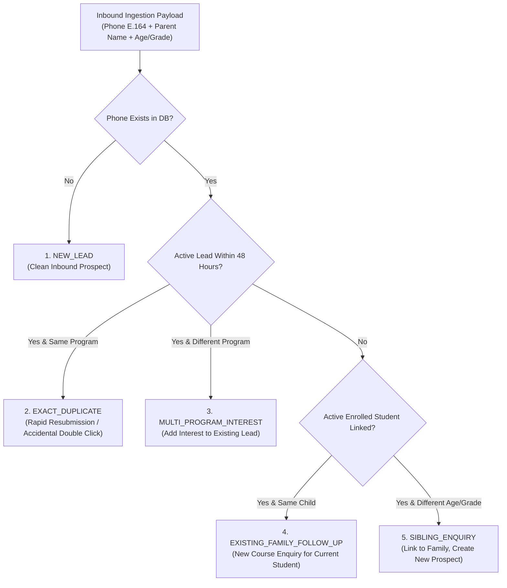

# ARNAV ABACUS ACADEMY (AAA) — STAGE 3 SOLUTION ARCHITECTURE
# WS-09B.7: LEAD DEDUPLICATION & DATA QUALITY ARCHITECTURE

**Project:** Arnav Abacus Academy (AAA), Wakad, Pune  
**Document Reference:** `AAA-S3-SPEC-WS09B-07`  
**Stage:** Stage 3 — Architecture & Design  
**Parent Workstream:** WS-09 — Technology Architecture, Data Persistence & CRM Strategy  
**Sub-Workstream:** WS-09B — Data Integration, Lead Ingestion & Zero-PII Telemetry  
**Deliverable:** WS-09B.7 — Lead Deduplication & Data Quality Architecture Specification  
**Governance Authority:** Nitin Patil (Operations & Technology Lead) & Neha Patil (Academic Director)  
**Date:** 04 November 2026  
**Status:** 🟡 **DRAFT — AWAITING MANAGEMENT REVIEW (GATE 3.4 OPEN)**  
**Execution Mode:** STRICTLY DOCUMENTATION-ONLY (IMPLEMENTATION FREEZE ACTIVE)  

---

## 1. Scope, Context & Core Deduplication Principle

A severe risk in educational CRM architectures is naive deduplication—merging records solely based on a matching phone number. In Indian households, parents almost universally use their single primary mobile phone number for:
- Enrolling a second or third sibling.
- Inquiring about a different programme (e.g., Vedic Maths) for a child already enrolled in Abacus.
- Re-enquiring after a 6-month holiday break.

### 1.1 Non-Negotiable Deduplication Mandate
Under no circumstances shall the system automatically overwrite or merge existing student records based merely on a shared phone number.
- **Parent/Guardian Identity:** Can share a phone number across multiple children.
- **Child Identity:** Must remain completely distinct with separate academic milestones.
- **Enquiry History:** Previous enquiries must remain historically intact for audit and conversion analytics.

---

## 2. Inbound Lead Classification Taxonomy

When an inbound enquiry is received, the deduplication engine categorizes the submission into one of five distinct relational classifications:

### 2.1 Deduplication Classification Rules Matrix

| Classification | Detection Criteria | Automated System Action | Counselor Queue Action | Record Integrity Outcome |
| :--- | :--- | :--- | :--- | :--- |
| **1. NEW_LEAD** | Phone number does not exist in `lead_inquiries`, `families`, or `students`. | Create new `LeadEntity` with ID `AAA-LEAD-YYYY-XXXX`. | Routed to standard admissions queue (2-hour SLA). | Pristine new prospect record. |
| **2. EXACT_DUPLICATE** | Matching phone number, identical program interest, and submitted within 48 hours of an existing active lead. | Do not create duplicate lead record; append submission timestamp to existing lead's activity log. | Lead remains with current counselor; bump priority flag. | Zero duplicate clutter; original lead ID preserved. |
| **3. MULTI_PROGRAM_INTEREST** | Matching phone number with an active lead within 30 days, but parent selected a different programme. | Append secondary programme interest to existing lead record; log activity. | Counselor alerted that family is exploring multiple curricula (e.g., Abacus + Vedic). | Single unified lead card displaying all areas of interest. |
| **4. EXISTING_FAMILY_FOLLOW_UP** | Matching phone number belongs to an already enrolled student family, and child age/name matches. | Create an `InternalServiceTicket` or attach enquiry to student's profile; do not treat as an unknown lead. | Alert Neha Patil / Student Counselor: *"Existing student family inquiring about new course."* | Protects existing student portfolio; avoids embarrassing cold-call scripts. |
| **5. SIBLING_ENQUIRY** | Matching phone number belongs to an enrolled family, but age/grade indicates a second child. | Create new `LeadEntity` explicitly tagged with `family_id` foreign key and flag `is_sibling_prospect: true`. | Counselor alerted: *"Sibling enquiry from [Family Name]. Existing student: [Child Name]."* | Complete sibling separation; honors shared family relationship without cross-contaminating academic records. |

---

## 3. Data Quality & Standardization Pipeline

To maintain high relational data quality, all inbound inputs pass through an automated 4-stage normalization pipeline:

1. **Phone Number Normalization (E.164):**
   - Strip all spaces, dashes, brackets, and non-numeric characters.
   - For 10-digit Indian numbers, prepend `+91`.
   - Result format: `+919021924968` (used as the canonical lookup index).
2. **Name Capitalization & Title Stripping:**
   - Strip prefixes (`Mr.`, `Mrs.`, `Dr.`, `Shri`) into a separate `salutation` field.
   - Convert mixed-case strings (`rAhUL pATil`) to standard title case (`Rahul Patil`).
3. **Age & Grade Standardization:**
   - Map free-text age strings (`"7 yrs"`, `"7.5"`, `"grade 2"`, `"2nd std"`) into standardized enum bands:
     - `AGE_4_TO_6` (Junior Abacus)
     - `AGE_7_TO_9` (Senior Abacus / Foundation Math)
     - `AGE_10_TO_14` (Vedic Math / School Math / Olympiad)
4. **Locality Extraction:**
   - Match parent location against Wakad micro-neighborhoods (e.g., *Park Street*, *Kaspate Vasti*, *Dange Chowk*, *Datta Mandir Road*, *Pimple Saudagar*).

---

## 4. Stage-Gate Acceptance & Verification

This specification satisfies **WS-09B.7** under Stage 3 Workstream WS-09B. It is submitted in **DRAFT** status and will be formally reviewed under Management Determination `MGT-DET-S3-13`. Gate 3.4 remains **OPEN**.
