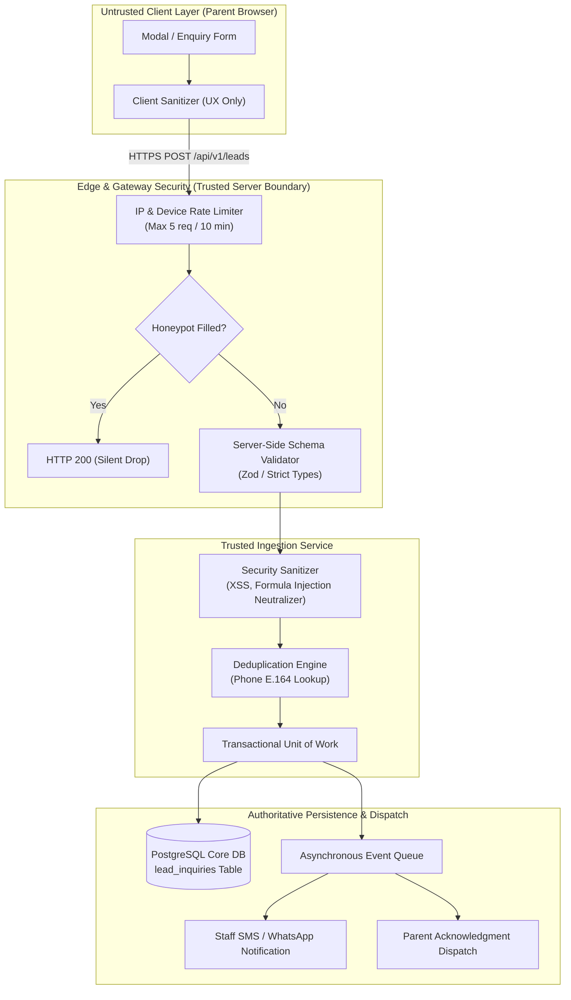

# ARNAV ABACUS ACADEMY (AAA) — STAGE 3 SOLUTION ARCHITECTURE
# WS-09B.2: LEAD INGESTION & CRM ARCHITECTURE

**Project:** Arnav Abacus Academy (AAA), Wakad, Pune  
**Document Reference:** `AAA-S3-SPEC-WS09B-02`  
**Stage:** Stage 3 — Architecture & Design  
**Parent Workstream:** WS-09 — Technology Architecture, Data Persistence & CRM Strategy  
**Sub-Workstream:** WS-09B — Data Integration, Lead Ingestion & Zero-PII Telemetry  
**Deliverable:** WS-09B.2 — Lead Ingestion & CRM Architecture Specification  
**Governance Authority:** Nitin Patil (Operations & Technology Lead) & Neha Patil (Academic Director)  
**Date:** 04 November 2026  
**Status:** 🟡 **DRAFT — AWAITING MANAGEMENT REVIEW (GATE 3.4 OPEN)**  
**Execution Mode:** STRICTLY DOCUMENTATION-ONLY (IMPLEMENTATION FREEZE ACTIVE)  

---

## 1. Scope, Boundaries & Vendor Neutrality

This specification evaluates candidate architectural patterns for inbound parent lead ingestion and CRM data flow at Arnav Abacus Academy.

### 1.1 Strict Governance Boundary: No Premature Vendor Binding
In strict compliance with `AGENTS.md` and the Stage 3 Architecture Charter:
- This document evaluates **ingestion patterns** (Serverless Gateway vs. Dedicated API vs. Webhook Proxy) and **CRM integration architectures** (Custom Relational vs. Commercial CRM vs. Lightweight Headless).
- This document **DOES NOT** procure, bind, or deploy third-party SaaS CRMs (e.g., Zoho CRM, Salesforce, HubSpot) or cloud hosting infrastructure (AWS vs. Vercel vs. Cloudflare). Hosting provider selection is strictly governed by **WS-11**.
- Zero live webhooks, external CRM connectors, or test lead submissions shall be triggered during Stage 3.

---

## 2. In-Depth Evaluation of Lead Ingestion Architectures

The existing prototype repository contains a client-side webhook dispatcher (`src/lib/leadWebhook.ts`) that dispatches leads directly from the parent's browser to a Google Apps Script web app URL using `mode: "no-cors"`:
```typescript
await fetch(webhookUrl.trim(), {
  method: "POST",
  mode: "no-cors",
  headers: { "Content-Type": "text/plain;charset=utf-8" },
  body: JSON.stringify(dataToSend),
});
```

### 2.1 Comparative Architectural Evaluation

| Evaluation Criteria | Option A: Google Apps Script Webhook (Hardened Baseline) | Option B: Dedicated Server-Side API Gateway (Recommended Target) | Option C: Direct Commercial CRM Webhook (SaaS Native) |
| :--- | :--- | :--- | :--- |
| **Description** | Inbound leads POSTed from browser to a Google Apps Script endpoint backing a Google Sheet, enhanced with HMAC signatures and server-side validation. | Inbound leads POSTed to an authenticated backend API endpoint (`POST /api/v1/leads`), validated on a trusted server, and written to PostgreSQL. | Inbound leads POSTed directly from browser to a third-party CRM webhook endpoint (e.g., Zoho Web-to-Lead). |
| **Security & Authentication** | **Poor.** Google Apps Script Web Apps running in `no-cors` cannot enforce client authentication or inspect headers without exposing secret keys in frontend code. | **Superior.** Protected by API Gateway rate limiters, CORS policies, CSRF tokens, and secret backend-to-backend authentication. | **Moderate.** Relies on public CRM form tokens; susceptible to bot spam and unauthorized cross-site submissions. |
| **Input Validation & Sanitization** | **Client-Side Only.** Google Apps Script offers primitive execution limits; complex sanitization in Apps Script easily hits execution timeouts. | **Superior.** Robust, multi-layered validation enforced on a trusted Node.js/Go server before any data reaches database. | **Variable.** Limited to standard CRM field rules; lacks bespoke formula injection or Indian phone normalization logic. |
| **Rate Limiting & Abuse Defense** | **Zero Native Defense.** Apps Script cannot block DDoS or scripted bot floods; Google Cloud account quota will freeze after 20,000 executions/day. | **Superior.** Native token-bucket rate limiting (e.g., max 5 submissions/IP/10min) and CAPTCHA verification at the gateway. | **Moderate.** Handled by CRM vendor, but spam fills up CRM lead queues and inflates contact licensing costs. |
| **Reliability & Idempotency** | **Unreliable.** `mode: "no-cors"` returns an opaque response (`status: 0`). The client cannot verify whether the lead was saved or failed! | **Superior.** Returns explicit HTTP status codes (`201 Created`, `422 Unprocessable`); supports idempotency keys (`Idempotency-Key`). | **Moderate.** Returns vendor-specific redirects or opaque JSON; lacks retry resilience if CRM API experiences an outage. |
| **Duplicate Prevention** | **High Latency.** Must scan rows in a Google Sheet; prone to race conditions under concurrent submissions. | **Instantaneous.** Atomic database transaction checks `UNIQUE INDEX` on normalized phone within milliseconds. | **Moderate.** Most CRMs flag duplicates after creation, cluttering sales dashboards with messy duplicates. |
| **Data Privacy & DPDP Compliance** | **Questionable.** Google Sheets stores minor data in general-purpose cloud sheets accessible to anyone with sheet permissions. | **Superior.** Strictly encapsulated in an encrypted relational database with field-level access control and automated 90-day retention purging. | **Variable.** Requires signing explicit Data Processing Addendums (DPAs); international data transfer questions arise. |
| **Operational Friction & Cost** | Low cost, but high operational friction as spreadsheet grows beyond 1,000 rows. | Zero software licensing cost; fully integrated into academy's unified data architecture. | High recurring SaaS cost (\$20–\$80/user/month); complex UI overhead for small academy team. |

---

## 3. Recommended Ingestion Architecture: Dedicated Server-Side API Gateway

The **Dedicated Server-Side API Gateway (Option B)** is formally recommended as the authoritative lead ingestion architecture for Arnav Abacus Academy.

### 3.1 Architectural Layout



### 3.2 Server-Side Security Responsibilities
The following security boundaries **MUST ALWAYS** be executed on a trusted server, never trusted to the client browser:
1. **Idempotency & Replay Protection:** Generating and validating an `idempotency_key` (hash of normalized phone + submission day) to block accidental double-clicks.
2. **Rate Limiting:** Enforcing IP-based and phone-based rate limits.
3. **Database Write Integrity:** Direct SQL execution with parameterized queries, preventing SQL injection.
4. **Zero-PII Telemetry Decoupling:** Stripping all contact details before pushing completion metrics to analytics.

---

## 4. CRM Strategy & Options Analysis

Arnav Abacus Academy requires a CRM system to manage the parent journey from initial enquiry through Discovery Session scheduling and fee settlement.

### 4.1 CRM Architectural Comparison

| Dimension | Approach 1: Google Sheets as Pseudo-CRM (Current Baseline) | Approach 2: Custom Headless CRM in AcademyOS (Recommended) | Approach 3: Commercial SaaS CRM (Zoho / HubSpot) |
| :--- | :--- | :--- | :--- |
| **Description** | Leads append to Google Sheet; Neha/Nitin manually update status columns and color rows. | Built-in lightweight admissions dashboard inside AcademyOS internal admin portal, querying `lead_inquiries`. | Commercial CRM subscription with external synchronization via webhooks. |
| **Fit for AAA Scale** | High friction; prone to accidental row deletion, cell overwriting, and mobile viewing issues. | **Perfect Fit.** Tailored exactly to AAA's 6-dimension discovery workflow and $\le 5$ student micro-batch rules. | Poor fit; over-engineered enterprise sales pipelines (B2B deals, stages) that confuse simple parent admissions. |
| **Data Privacy & DPDP** | High risk; difficult to enforce strict 90-day automated purging or zero-PII logging. | **Superior.** 100% compliant with WS-09A data classification and automated 90-day deletion triggers. | Vendor-managed; requires DPDP compliance verification and external data processing contracts. |
| **Cost** | Free (included with Google Workspace). | **Zero incremental license cost**; runs on existing academy infrastructure. | \$250–\$1,000 / year in recurring SaaS subscriptions. |

### 4.2 Recommended CRM Decision
Adopt **Approach 2 (Custom Headless CRM within AcademyOS Admin)**. Because AAA is a high-touch, boutique educational academy in Wakad (handling 30–80 qualified leads/month, not 10,000 automated e-commerce transactions), a dedicated, child-safe admissions dashboard built into AcademyOS provides complete data privacy, zero software bloat, and seamless integration with student enrolment.

---

## 5. Stage-Gate Acceptance & Verification

This specification satisfies **WS-09B.2** under Stage 3 Workstream WS-09B. It is submitted in **DRAFT** status and will be formally reviewed under Management Determination `MGT-DET-S3-13`. Gate 3.4 remains **OPEN**.
