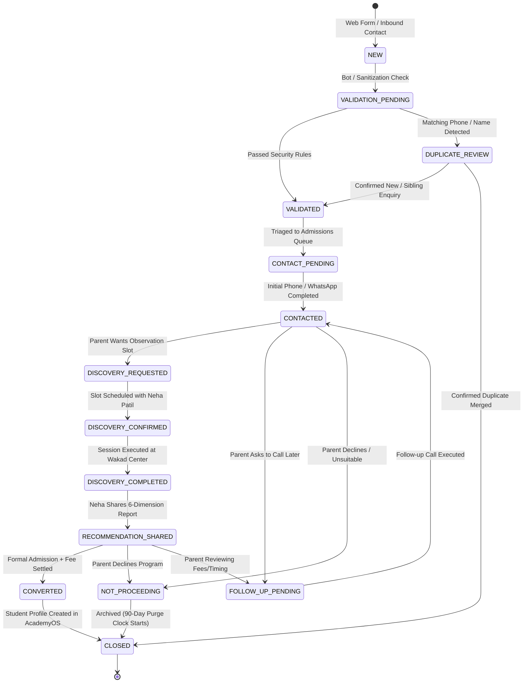

# ARNAV ABACUS ACADEMY (AAA) — STAGE 3 SOLUTION ARCHITECTURE
# WS-09B.3: LEAD LIFECYCLE & CRM DATA MODEL

**Project:** Arnav Abacus Academy (AAA), Wakad, Pune  
**Document Reference:** `AAA-S3-SPEC-WS09B-03`  
**Stage:** Stage 3 — Architecture & Design  
**Parent Workstream:** WS-09 — Technology Architecture, Data Persistence & CRM Strategy  
**Sub-Workstream:** WS-09B — Data Integration, Lead Ingestion & Zero-PII Telemetry  
**Deliverable:** WS-09B.3 — Lead Lifecycle & CRM Data Model Specification  
**Governance Authority:** Nitin Patil (Operations & Technology Lead) & Neha Patil (Academic Director)  
**Date:** 04 November 2026  
**Status:** 🟡 **DRAFT — AWAITING MANAGEMENT REVIEW (GATE 3.4 OPEN)**  
**Execution Mode:** STRICTLY DOCUMENTATION-ONLY (IMPLEMENTATION FREEZE ACTIVE)  

---

## 1. Scope & Business Alignment

This document defines the authoritative 14-state lead lifecycle and relational CRM data model for Arnav Abacus Academy. 

In strict alignment with the Stage 2 Master BRD (`BRD-S2-LEAD-01`), WS-08 (`AAA-S3-SPEC-WS08-01`), and WS-09A (`AAA-S3-SPEC-WS09A-01`):
1. A prospective enquiry **NEVER** creates a student master record.
2. A permanent Student ID (`UUIDv7` / `AAA-STU-YYYY-XXXX`) is **NEVER** allocated to an enquiry.
3. Admissions conversion is recognized **ONLY** after verified registration and tuition settlement.
4. Non-enrolled inquiries are governed by an automated **90-day retention purge schedule**.

---

## 2. The 14-State Lead Lifecycle State Machine



---

## 3. Comprehensive 14-State Specification Matrix

| State Name | Entry Conditions | Exit Conditions | State Owner | Required Evidence | Permitted Transitions | Parent Communication | Audit Requirements |
| :--- | :--- | :--- | :--- | :--- | :--- | :--- | :--- |
| **1. NEW** | Parent submits web form or initiates direct contact. | Ingestion pipeline initiates security validation. | Ingestion Service | Raw inbound request payload. | $\to$ `VALIDATION_PENDING` | Automated UI toast ("Thank you, enquiry received"). | Timestamp, source IP (masked), channel logged. |
| **2. VALIDATION_PENDING** | Lead received at API gateway. | Sanitization and honeypot validation completed. | Security Service | Cleaned text string; honeypot verified empty. | $\to$ `VALIDATED`<br>$\to$ `DUPLICATE_REVIEW` | None. | Input validation outcome and security score logged. |
| **3. VALIDATED** | Payload passes all security and sanitization checks. | Lead triaged to counselor admissions queue. | Admissions System | Validated 4-field entity record. | $\to$ `CONTACT_PENDING` | Automated WhatsApp/SMS transactional ack. | Lead ID (`AAA-LEAD-YYYY-XXXX`) generated and logged. |
| **4. DUPLICATE_REVIEW** | Matching active phone number found in database. | Counselor reviews whether it is duplicate or sibling. | Admissions Lead | Comparison with existing lead/family records. | $\to$ `VALIDATED` (Sibling)<br>$\to$ `CLOSED` (Merge) | None until triaged. | Counselor rationale logged in audit trail. |
| **5. CONTACT_PENDING** | Validated lead queued in counselor dashboard. | Counselor dials phone or sends personal WhatsApp. | Admissions Lead | Queue entry within 2 operating hours SLA. | $\to$ `CONTACTED` | None. | Queue entry time and counselor assignment logged. |
| **6. CONTACTED** | Personal contact initiated by counselor. | Parent conversation outcome recorded. | Admissions Lead | Call notes or WhatsApp exchange record. | $\to$ `DISCOVERY_REQUESTED`<br>$\to$ `FOLLOW_UP_PENDING`<br>$\to$ `NOT_PROCEEDING` | Personalized 1:1 conversation with parent. | Call timestamp, duration, counselor notes logged. |
| **7. DISCOVERY_REQUESTED** | Parent requests an observation slot. | Neha Patil approves date, time, and room slot. | Neha Patil / Admin | Child age, preferred day (Saturday/Sunday/Weekday). | $\to$ `DISCOVERY_CONFIRMED`<br>$\to$ `FOLLOW_UP_PENDING` | Scheduling options discussed with parent. | Discovery request ID and slot preferences logged. |
| **8. DISCOVERY_CONFIRMED** | Date and time confirmed in Neha Patil's schedule. | Session is conducted or cancelled. | Neha Patil | Scheduled calendar appointment entry. | $\to$ `DISCOVERY_COMPLETED`<br>$\to$ `FOLLOW_UP_PENDING` | Formal confirmation sent with center location map. | Appointment confirmation timestamp logged. |
| **9. DISCOVERY_COMPLETED** | Student attends 45–90 min session at Wakad Center. | Neha completes evaluation rubric. | Neha Patil | Attendance confirmed; observation notes recorded. | $\to$ `RECOMMENDATION_SHARED` | Brief verbal summary shared in-person at center. | Session completion confirmed by Neha. |
| **10. RECOMMENDATION_SHARED** | 6-Dimension Observation Report completed. | Parent reviews recommendation and decides. | Neha Patil | Signed-off Recommendation Report (`AAA-REC-*`). | $\to$ `CONVERTED`<br>$\to$ `FOLLOW_UP_PENDING`<br>$\to$ `NOT_PROCEEDING` | Written recommendation report shared with parent. | Report transmission timestamp and recipient logged. |
| **11. FOLLOW_UP_PENDING** | Parent requests time to review schedule or fees. | Follow-up conversation executed. | Admissions Lead | Scheduled follow-up date and specific reason. | $\to$ `CONTACTED`<br>$\to$ `CONVERTED`<br>$\to$ `NOT_PROCEEDING` | Gentle reminder or response to parent questions. | Follow-up reminder date and notes logged. |
| **12. CONVERTED** | Formal registration form completed & tuition paid. | Student profile created; batch allocated. | Accounts / Nitin | Verified bank/UPI transaction reference. | $\to$ `CLOSED` (Transitions to Enrolled Student) | Official welcome pack, fee receipt, batch details. | Invoice ID, transaction ref, payment audit logged. |
| **13. NOT_PROCEEDING** | Parent declines enrollment or child not ready. | Archived; retention countdown starts. | Admissions Lead | Recorded reason (e.g., location, timing, fees). | $\to$ `CLOSED` | Polite closing note wishing family well. | Closure reason code logged; 90-day timer set. |
| **14. CLOSED** | Enrolment completed OR enquiry withdrawn/expired. | Record archived or scheduled for DPDP purge. | System Admin | Link to enrolled Student ID OR 90-day purge date. | Permanent archive / Purge | None. | State transition to CLOSED recorded in audit ledger. |

---

## 4. Relational CRM Data Schema

```mermaid
erDiagram
    LEAD_INQUIRIES ||--o{ LEAD_ACTIVITIES : logs
    LEAD_INQUIRIES ||--o| DISCOVERY_SESSIONS : requests
    FAMILIES ||--o{ LEAD_INQUIRIES : references
    LEAD_INQUIRIES ||--o| STUDENTS : converts_to

    LEAD_INQUIRIES {
        uuid id PK
        string display_id UK "AAA-LEAD-YYYY-XXXX"
        uuid family_id FK "Nullable: Populated if existing family"
        string parent_name
        string phone_e164 UK_INDEX "Normalized: +919021924968"
        string email "Nullable"
        string child_age_or_grade
        string program_interest "ABACUS | VEDIC | SCHOOL_MATH | OLYMPIAD"
        string lead_source "WEBSITE | CAMPAIGN | REFERRAL | WALK_IN"
        string campaign_slug "Nullable"
        boolean transactional_consent "True: Required"
        boolean marketing_consent "True/False: Optional"
        string lifecycle_state "14-State Enum"
        string triage_priority "HIGH | NORMAL | LOW"
        uuid assigned_to "Counselor User UUID"
        timestamp created_at
        timestamp last_contacted_at
        timestamp retention_purge_date "Created + 90 days for non-enrolled"
    }

    LEAD_ACTIVITIES {
        uuid id PK
        uuid lead_id FK
        string activity_type "PHONE_CALL | WHATSAPP | EMAIL | NOTE | STATUS_CHANGE"
        string actor_name "Counselor / System"
        string summary
        text detailed_notes
        timestamp created_at
    }
```

---

## 5. Stage-Gate Acceptance & Verification

This specification satisfies **WS-09B.3** under Stage 3 Workstream WS-09B. It is submitted in **DRAFT** status and will be formally reviewed under Management Determination `MGT-DET-S3-13`. Gate 3.4 remains **OPEN**.
