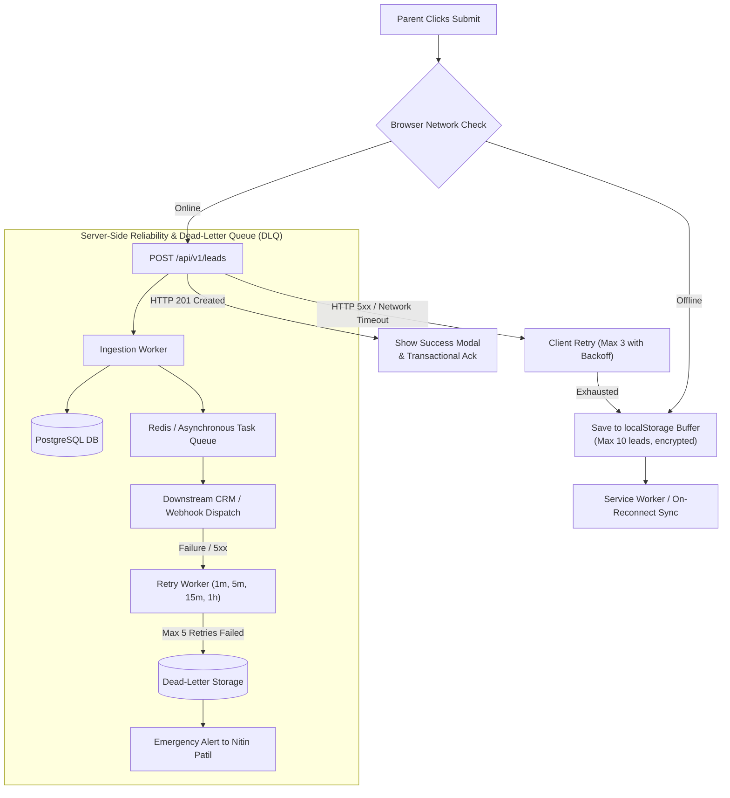

# ARNAV ABACUS ACADEMY (AAA) — STAGE 3 SOLUTION ARCHITECTURE
# WS-09B.8: OPERATIONAL MONITORING & INTEGRATION RELIABILITY

**Project:** Arnav Abacus Academy (AAA), Wakad, Pune  
**Document Reference:** `AAA-S3-SPEC-WS09B-08`  
**Stage:** Stage 3 — Architecture & Design  
**Parent Workstream:** WS-09 — Technology Architecture, Data Persistence & CRM Strategy  
**Sub-Workstream:** WS-09B — Data Integration, Lead Ingestion & Zero-PII Telemetry  
**Deliverable:** WS-09B.8 — Operational Monitoring & Integration Reliability Specification  
**Governance Authority:** Nitin Patil (Operations & Technology Lead) & Neha Patil (Academic Director)  
**Date:** 04 November 2026  
**Status:** 🟡 **DRAFT — AWAITING MANAGEMENT REVIEW (GATE 3.4 OPEN)**  
**Execution Mode:** STRICTLY DOCUMENTATION-ONLY (IMPLEMENTATION FREEZE ACTIVE)  

---

## 1. Scope, Objective & High-Availability Mandate

Under Arnav Abacus Academy's operating baseline, every parent enquiry represents a family seeking foundational education for their child. A dropped webhook, an unhandled network error, or an unmonitored silent failure means a parent is ignored and an enrollment lost.

### 1.1 Non-Negotiable Reliability Axiom
Under no circumstances shall a parent enquiry be silently dropped due to third-party API outages, network drops, or script exceptions. 
- The system must provide **end-to-end delivery visibility**.
- The system must feature **automated retries with exponential backoff**.
- The system must provide a **fail-safe manual fallback** that does not depend solely on WhatsApp.

---

## 2. Ingestion Reliability & Resilience Architecture

---

## 3. Operational Service-Level Agreements (SLAs) & Alerting Rules

| Metric / Event | Target Service Level | Alert Trigger Condition | Escalation Path & Action | Responsible Lead |
| :--- | :--- | :--- | :--- | :--- |
| **Inbound Lead Triage SLA** | $\le 2$ operating hours (Mon–Sat, 9:30 AM–7:30 PM). | Any validated lead untriaged after **90 minutes**. | Automated SMS/Email alert to Admissions Lead; if untriaged at 120 min, escalates directly to Nitin Patil. | Admissions Lead / Nitin Patil |
| **Ingestion Pipeline Uptime** | $99.9\%$ monthly availability. | More than 2 ingestion failures within a 15-minute rolling window. | Urgent alert triggered to Nitin Patil; client automatically falls back to local buffer. | Nitin Patil |
| **Webhook Delivery Latency** | $\le 1,000\text{ ms}$ (p95). | p95 latency $> 3,000\text{ ms}$ across 10 requests. | Ingestion worker logs slow query warning; activates asynchronous queuing. | Nitin Patil |
| **Discovery Session Schedule SLA** | Scheduled within 24 hours of parent request. | Discovery request unconfirmed after 18 hours. | Highlighted in Neha Patil's daily morning briefing. | Neha Patil |
| **Google Review Response SLA** | Within **48 hours** of publication. | Review unaddressed after 36 hours. | Alert dispatched to Center Admin. | Neha Patil |

---

## 4. Fail-Safe Manual Fallbacks (Zero Data Loss)

If the primary API gateway, database, or network connectivity suffers an extended outage:
1. **Client-Side Local Storage Buffer:** The browser automatically saves the sanitized lead payload into `localStorage` (`aaa_leads_history` pattern verified in `src/components/LeadForm.tsx:591-605`). A subtle indicator informs the parent: *"Your request is safely saved on your device and will synchronize automatically once connectivity is restored."*
2. **Direct Phone Call Fallback:** The success modal always displays the canonical direct desk telephone number (**`+91 90219 24968`**) with one-click tap-to-call.
3. **Dead-Letter Queue (DLQ) Daily Reconciliation:** Nitin Patil executes a daily automated reconciliation script verifying that 100% of payloads received by the API gateway match database committed records, with zero orphaned leads.

---

## 5. Stage-Gate Acceptance & Verification

This specification satisfies **WS-09B.8** under Stage 3 Workstream WS-09B. It is submitted in **DRAFT** status and will be formally reviewed under Management Determination `MGT-DET-S3-13`. Gate 3.4 remains **OPEN**.
