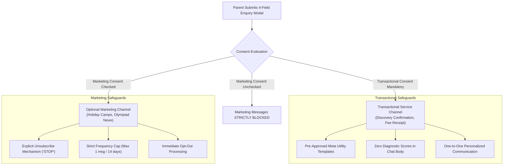

# ARNAV ABACUS ACADEMY (AAA) — STAGE 3 SOLUTION ARCHITECTURE
# WS-09B.6: WHATSAPP INTEGRATION ARCHITECTURE

**Project:** Arnav Abacus Academy (AAA), Wakad, Pune  
**Document Reference:** `AAA-S3-SPEC-WS09B-06`  
**Stage:** Stage 3 — Architecture & Design  
**Parent Workstream:** WS-09 — Technology Architecture, Data Persistence & CRM Strategy  
**Sub-Workstream:** WS-09B — Data Integration, Lead Ingestion & Zero-PII Telemetry  
**Deliverable:** WS-09B.6 — WhatsApp Integration Architecture Specification  
**Governance Authority:** Nitin Patil (Operations & Technology Lead) & Neha Patil (Academic Director)  
**Date:** 04 November 2026  
**Status:** 🟡 **DRAFT — AWAITING MANAGEMENT REVIEW (GATE 3.4 OPEN)**  
**Execution Mode:** STRICTLY DOCUMENTATION-ONLY (IMPLEMENTATION FREEZE ACTIVE)  

---

## 1. Scope, Purpose & Statutory Compliance

WhatsApp is the dominant communication channel for parent engagement in Wakad and Pune. However, unmanaged or automated WhatsApp messaging carries severe risks:
1. Meta Business account bans for spam or unsolicited broadcasting.
2. Breach of Indian Digital Personal Data Protection (DPDP) consent principles.
3. Leaking sensitive minor assessment records into unencrypted chat backups.

This specification designs the **Authoritative WhatsApp Communication Architecture**, establishing a strict separation between **Transactional Service Communications** and **Optional Marketing Communications**.

### 1.1 Strict Governance Boundary: No Live Dispatch in Stage 3
In strict compliance with Stage 3 governance:
- This document evaluates **integration patterns** (Official WhatsApp Cloud API vs. Managed BSPs vs. Manual WhatsApp Business App).
- Zero live WhatsApp APIs, webhooks, or test messages shall be triggered or connected during Stage 3.

---

## 2. Unbundled Consent & Communication Channel Segregation

### 2.1 Communication Category Definitions

| Communication Category | Permitted Message Purposes | Legal Basis & Consent Requirement | Opt-Out Handling | Permitted Channel & Mechanism |
| :--- | :--- | :--- | :--- | :--- |
| **Category A: Transactional Service Communication** | 1. Inbound enquiry acknowledgment. 2. Discovery Session scheduling confirmation. 3. Session appointment reminder (24h prior). 4. Notice that Learning Recommendation is ready. 5. Official fee payment receipts and batch schedules. | **Service Contract Necessity.** Parent explicitly requested the service via enquiry modal or admission. | If parent requests no WhatsApp, communication immediately transitions to phone call or email. | Pre-approved Meta Utility Templates via WhatsApp Cloud API or direct 1:1 educator chat. |
| **Category B: Optional Marketing Communication** | 1. Upcoming Vedic Math or Abacus holiday camps. 2. IPM / Olympiad workshop announcements. 3. Early-bird registration for new batches. | **Explicit Consent.** Must be actively checked by parent on the form. Cannot be pre-ticked. | Instant opt-out. If parent types "STOP" or unchecks preference, marketing flag is set to `false`. | Pre-approved Meta Marketing Templates; frequency capped at max 1 message per fortnight. |

---

## 3. Evaluation of WhatsApp Integration Architectures

The existing repository baseline relies exclusively on unmanaged, client-side `wa.me` URL redirects (`https://wa.me/919021924968?text=...` across 33 instances in `src/`). While simple, client-side `wa.me` links cannot track whether a message was sent, cannot automate appointment confirmations, and cannot log consent.

### 3.1 Comparative Options Matrix

| Evaluation Dimension | Option 1: Unmanaged Direct Links (`wa.me`) (Current Baseline) | Option 2: Official WhatsApp Cloud API (Recommended Target) | Option 3: Third-Party BSP (Wati / Aisensy / Interakt) |
| :--- | :--- | :--- | :--- |
| **Mechanism** | Client browser executes `window.open("https://wa.me/...")` with pre-filled URI parameters. | Backend server calls Meta's official Graph API (`POST /v18.0/{phone-id}/messages`) using pre-approved templates. | Third-party SaaS layer providing a web inbox and automated triggers over WhatsApp API. |
| **Reliability & Delivery Tracking** | **Zero Visibility.** Academy has no record whether parent actually sent the WhatsApp message. | **Superior.** Full delivery tracking: `sent`, `delivered`, `read`, and `failed` webhook callbacks. | **High.** Full delivery tracking within the vendor's dashboard. |
| **Consent & Opt-Out Enforcement** | **Manual Only.** Relies on staff manually noting parent preferences in a notebook. | **Automated.** System automatically suppresses numbers that have not granted consent or have opted out. | **Automated.** Managed within the vendor's contact list. |
| **Child Data Protection** | **Moderate.** Pre-filled text strings can expose child names in browser history and query strings. | **Superior.** Messages dispatched from secure server; sensitive assessment data sent via password-protected PDF links. | **Risk.** Third-party vendor stores all chat logs and student names on their servers (requires DPA). |
| **Cost** | 100% Free. | Pay-per-conversation to Meta ($\approx ₹0.40\text{--}₹0.80$ per utility/marketing conversation). | Platform subscription (\$30–\$100/mo) + Meta conversation markup. |
| **Operational Scalability** | Low. Requires Nitin/Neha to manually type replies on physical mobile phone. | High. Automates routine booking confirmations while keeping 1:1 dialogues seamless. | High. Shared team inbox for multiple counselors. |

### 3.2 Recommended Target Decision
Adopt a **Hybrid Integration Model**:
1. **Public Web CTA (Discovery Booking):** The website submits the 4-field enquiry to the secure API gateway, which creates the lead record and triggers an automated, professional transactional acknowledgment via the **Official WhatsApp Cloud API**.
2. **Personal Parent Dialogue:** Once the lead is acknowledged, **Neha Patil and Nitin Patil** conduct 1:1 parental counselling and Discovery Session scheduling using the verified **WhatsApp Business App** on the canonical academy number (**`+91 90219 24968`**).
3. **Data Protection Safeguard:** Granular diagnostic scores and observation rubrics are **NEVER** pasted into raw WhatsApp chat bodies. They are delivered as signed, password-protected PDF links accessible only by the verified parent.

---

## 4. Stage-Gate Acceptance & Verification

This specification satisfies **WS-09B.6** under Stage 3 Workstream WS-09B. It is submitted in **DRAFT** status and will be formally reviewed under Management Determination `MGT-DET-S3-13`. Gate 3.4 remains **OPEN**.
