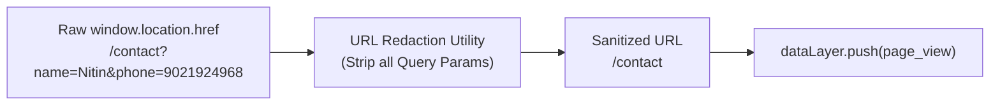

# ARNAV ABACUS ACADEMY (AAA) — STAGE 3 SOLUTION ARCHITECTURE
# WS-09B.4: ZERO-PII TELEMETRY & ANALYTICS ARCHITECTURE

**Project:** Arnav Abacus Academy (AAA), Wakad, Pune  
**Document Reference:** `AAA-S3-SPEC-WS09B-04`  
**Stage:** Stage 3 — Architecture & Design  
**Parent Workstream:** WS-09 — Technology Architecture, Data Persistence & CRM Strategy  
**Sub-Workstream:** WS-09B — Data Integration, Lead Ingestion & Zero-PII Telemetry  
**Deliverable:** WS-09B.4 — Zero-PII Telemetry & Analytics Architecture Specification  
**Governance Authority:** Nitin Patil (Operations & Technology Lead) & Neha Patil (Academic Director)  
**Date:** 04 November 2026  
**Status:** 🟡 **DRAFT — AWAITING MANAGEMENT REVIEW (GATE 3.4 OPEN)**  
**Execution Mode:** STRICTLY DOCUMENTATION-ONLY (IMPLEMENTATION FREEZE ACTIVE)  

---

## 1. Executive Summary & Mandatory Zero-PII Mandate

Under `AGENTS.md` Rule 4 and the Stage 3 Architecture Standards (`AAA-S3-GOV-003`), Arnav Abacus Academy enforces a **Strict Zero-PII Telemetry Protocol** across all Google Analytics 4 (`G-M2EL9MYSRL`) and Google Tag Manager (GTM) deployments.

Because AAA serves minor children (ages 4.5–14), any accidental transmission of personal identifiers, parent contact details, child names, or quiz scores into third-party analytics clouds constitutes an unacceptable regulatory and ethical violation.

### 1.1 Scope of Zero-PII Prohibition
Under no circumstances shall the following data elements ever appear in dataLayer pushes, event parameters, user properties, URL parameters, page titles, or debug logs:
1. **Direct Personal Identifiers:** Parent name, child name, guardian name, email address, phone number.
2. **System Identifiers:** Internal UUIDs, permanent Student IDs (`AAA-STU-*`), Lead IDs (`AAA-LEAD-*`), invoice numbers.
3. **Sensitive Child Data:** Date of birth, exact child age, school name, residential society/address.
4. **Assessment & Academic Results:** Quiz score percentages, correct/wrong counts, diagnostic dimension ratings, instructor evaluation notes.
5. **Free-Text Content:** User message text, feedback notes, search queries.

---

## 2. Approved Canonical Telemetry Event Specification

To ensure total clarity, the table below defines the complete inventory of approved, privacy-safe analytics events for AAA's public web experience:

| Event Name | Business Trigger | Allowed Parameters | Prohibited Parameters | Canonical Source File Reference |
| :--- | :--- | :--- | :--- | :--- |
| `page_view` | User navigates to any public SPA route. | `page_path` (sanitized) `page_title` (static title) `page_location` (sanitized URL without query params) | User IDs, query parameters containing names/phones, email tokens. | `src/lib/analytics.ts:28` |
| `programme_view` | User views a programme details card or page. | `programme_name` ("abacus", "vedic", etc.) `view_source` ("homepage", "navbar", etc.) | Student ID, child age, parent details. | `src/lib/analytics.ts:44` |
| `enquiry_form_start` | User clicks an enquiry CTA or opens the booking modal. | `form_name` ("discovery_modal", "footer_form") | Any pre-filled user contact information. | `src/lib/analytics.ts:128` |
| `enquiry_form_submit` | User submits the 4-field enquiry modal. | `form_name` ("discovery_modal") `programme_category` ("abacus", "vedic") `delivery_mode` ("offline_wakad", "online") `submission_status` ("success", "failure") | Parent name, student name, phone number, email address, child age/grade. | `src/lib/analytics.ts:146` (Refactored) |
| `whatsapp_click` | User clicks an outbound WhatsApp contact link. | `click_source` ("navbar", "sticky_bar", "mentor") `destination_intent` ("discovery_inquiry", "fee_inquiry") | Destination phone number, pre-filled text containing child/parent name. | `src/lib/analytics.ts:72` |
| `phone_click` | User clicks a `tel:` link. | `click_source` ("header", "footer") `channel` ("tel_link") | Academy phone number or caller details. | `src/lib/analytics.ts:85` |
| `location_click` | User clicks the physical center map or directions button. | `click_source` ("contact_page", "footer") `center_location` ("Wakad, Pune") | Visitor GPS coordinates, user IP address. | `src/lib/analytics.ts:104` |
| `brochure_download` | User clicks to download the academy curriculum PDF. | `programme_name` ("abacus_curriculum", "vedic_overview") | Requester email or download token. | `src/lib/brochure.ts` |

---

## 3. URL Hygiene & Redaction Architecture

Public URLs and query strings are the most frequent accidental vector of PII leakage in web analytics (e.g., `?name=Atharv&phone=9021924968`).

### 3.1 Client-Side Query Redaction Filter
The unified analytics layer (`src/lib/analytics.ts`) must pass all URL strings through an automated redaction utility before pushing them to `dataLayer` or `gtag`:

### 3.2 Redaction Rules
1. **Complete Query Parameter Stripping:** In the public website, query parameters are never transmitted to GA4. Only the clean pathname (e.g., `/programs/abacus`) is sent.
2. **Campaign Parameter Whitelist:** Only approved UTM marketing parameters (`utm_source`, `utm_medium`, `utm_campaign`) are allowed to pass to analytics, provided they contain no PII strings.
3. **Fragment Redaction:** URL hash fragments (e.g., `#contact-form`) are stripped of any dynamically injected tokens.

---

## 4. Verification & Audit Procedures

Before any code deployment to staging or production, the zero-PII architecture must be verified using the following 4-step protocol:
1. **Network Payload Inspection:** Open Chrome DevTools $\to$ Network tab $\to$ filter by `collect?v=2` (GA4 measurement hits). Verify that request payloads contain zero instances of parent names, phone digits, or email characters.
2. **DataLayer Inspection:** Inspect `window.dataLayer` in the browser console. Verify all event objects contain only the approved parameters specified in Section 2.
3. **Automated Unit Testing:** Execute client-side unit tests verifying that passing mock PII payloads to `pushGtmEvent()` triggers a defensive sanitizer that strips the offending keys.
4. **Google Analytics DebugView Verification:** Monitor GA4 DebugView in real time during test form submissions to confirm clean ingestion without warnings.

---

## 5. Stage-Gate Acceptance & Verification

This specification satisfies **WS-09B.4** under Stage 3 Workstream WS-09B. It is submitted in **DRAFT** status and will be formally reviewed under Management Determination `MGT-DET-S3-13`. Gate 3.4 remains **OPEN**.
