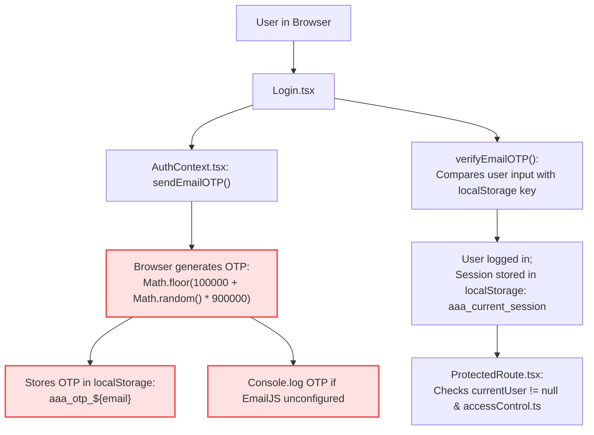
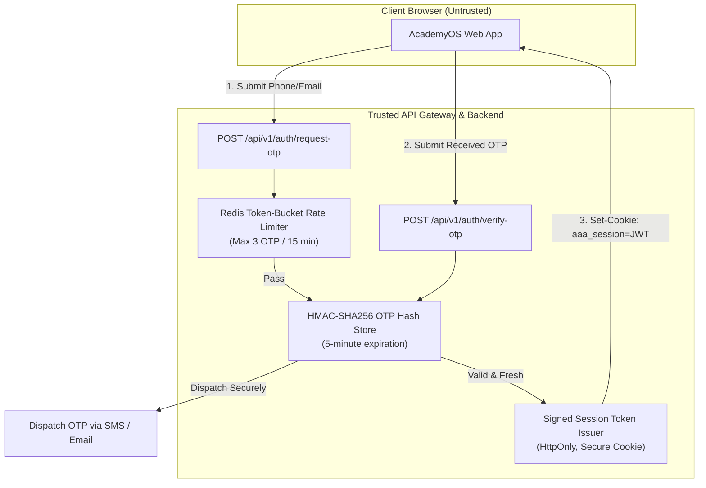

# ARNAV ABACUS ACADEMY (AAA) — STAGE 3 SOLUTION ARCHITECTURE
# WS-10.3: AUTHENTICATION, AUTHORIZATION & ACADEMYOS SECURITY

**Project:** Arnav Abacus Academy (AAA), Wakad, Pune  
**Document Reference:** `AAA-S3-SPEC-WS10-03`  
**Stage:** Stage 3 — Architecture & Design  
**Workstream:** WS-10 — Security, Privacy, Compliance & Certificate Governance  
**Deliverable:** WS-10.3 — Authentication, Authorization & AcademyOS Security Specification  
**Governance Authority:** Nitin Patil (Operations & Technology Lead) & Neha Patil (Academic Director)  
**Date:** 04 November 2026  
**Status:** 🟡 **DRAFT — AWAITING MANAGEMENT REVIEW (GATE 3.5 OPEN)**  
**Execution Mode:** STRICTLY DOCUMENTATION-ONLY (IMPLEMENTATION FREEZE ACTIVE)  

---

## 1. Scope & Current Code Baseline Inspection

An exhaustive empirical audit of AcademyOS authentication (`src/lib/AuthContext.tsx`, `src/lib/accessControl.ts`, `src/components/ProtectedRoute.tsx`) reveals the existing prototype architecture:

### 1.1 Empirical Critical Findings in Existing Code
1. **Client-Side OTP Generation & Verification:** In `src/lib/AuthContext.tsx` lines 80–120, the 6-digit OTP is generated directly in the browser's JavaScript memory and stored in `localStorage` under `aaa_otp_${email}`. Any user with DevTools can read the OTP from `localStorage` without opening their email.
2. **OTP Exposure in Console Logs:** When EmailJS is unconfigured or fails (`AuthContext.tsx` line 105), the plaintext OTP is emitted to `console.log("DEV FALLBACK OTP:", otp)`.
3. **Hardcoded Administrative Whitelist:** In `AuthContext.tsx` lines 55–60, administrative permissions are determined by hardcoded emails: `nitinkpatil@gmail.com`, `admin@arnavabacus.com`, `nehaatharv@gmail.com`, `arnavabacus@gmail.com`.
4. **LocalStorage Permission Tampering:** In `src/lib/accessControl.ts`, user level permissions and admin status are stored in `localStorage.getItem("aaa_approved_email_access_db")`. An attacker can edit this JSON string in DevTools to grant themselves admin rights or access to all quiz levels.
5. **Client-Side ProtectedRoute:** `ProtectedRoute.tsx` only prevents visual rendering in the React tree; it does not protect any underlying API or data endpoints.

---

## 2. Target Security Architecture: Trusted Server Authentication

To eliminate these vulnerabilities permanently in Stage 4, AAA must transition to an industry-standard **Server-Enforced Authentication & Authorization Model**:

### 2.1 Non-Negotiable Target Authentication Controls
1. **Server-Side OTP Generation:** OTPs generated exclusively on a trusted backend using cryptographically secure pseudorandom number generators (CSPRNG).
2. **Time-Limited & Replay-Resistant:** OTPs expire strictly after **5 minutes** (300 seconds); OTPs are single-use (immediately invalidated upon first verification attempt).
3. **Rate Limiting & Brute-Force Lockout:** Maximum **3 failed verification attempts** per phone/email before a mandatory 15-minute cooldown.
4. **HttpOnly, Secure, SameSite Cookies:** Session JWT tokens stored exclusively in `HttpOnly`, `Secure`, `SameSite=Lax` cookies, completely immune to JavaScript XSS theft.
5. **Server-Side Role-Based Access Control (RBAC):** All API routes inspect the server-signed JWT claim; `localStorage` permissions are completely deprecated.

---

## 3. Comprehensive Role-Based Access Control (RBAC) Matrix

| System Role | Scope of Authority | Permitted Operations | Access Boundary & Enforcement |
| :--- | :--- | :--- | :--- |
| **1. Academic Director (Neha Patil)** | **Supreme Academic Authority** | Full access to all 5 curricula; authoring and signing Discovery Recommendations; final approval of physical diplomas; evaluation of all educators. | Server-verified JWT claim: `role: "academic_director"`. Access to all academic and diagnostic tables. |
| **2. Operations & Tech Lead (Nitin Patil)** | **System & Security Admin** | Full access to system logs, integration configs, user management, billing/invoicing ledgers, database backups, security audit logs. | Server-verified JWT claim: `role: "super_admin"`. Access to financial, infrastructure, and audit tables. |
| **3. Center Educator / Trainer** | **Batch & Classroom Instruction** | Mark student batch attendance; record daily practice observations; view student performance within assigned micro-batches ($\le 5$ students). | Server-verified JWT claim: `role: "educator"`. Row-Level Security restricts view strictly to students in their active batches. |
| **4. Admissions / Admin Staff** | **Lead Triage & Scheduling** | View inbound lead queue; manage Discovery Session calendar slots; register parent KYC details; record fee payments. | Server-verified JWT claim: `role: "admissions_staff"`. Zero access to diagnostic evaluation rubrics or raw exam questions. |
| **5. Parent / Guardian** | **Family Account & Billing** | View assigned children's attendance; view published Learning Recommendations; access fee receipts; update emergency contacts. | Server-verified JWT claim: `role: "guardian"`. Row-Level Security restricts access strictly to matching `family_id`. |
| **6. Student** | **AcademyOS Practice & Drills** | Launch timed practice quizzes; view self-performance history and practice achievement records. | Server-verified JWT claim: `role: "student"`. Row-Level Security restricts access strictly to self `student_id`. |

---

## 4. Stage-Gate Acceptance & Verification

This specification satisfies **WS-10.3** under Stage 3 Workstream WS-10. It is submitted in **DRAFT** status and will be formally reviewed under Management Determination `MGT-DET-S3-14`. Gate 3.5 remains **OPEN**.
