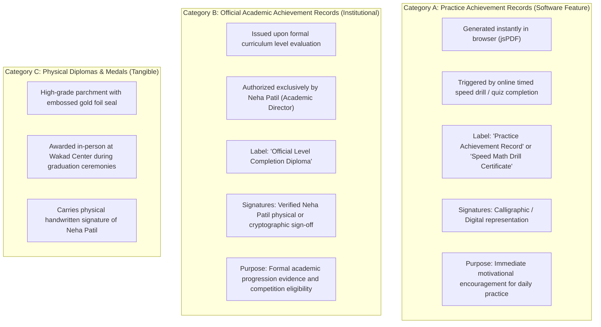
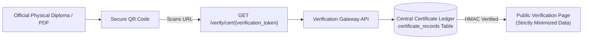
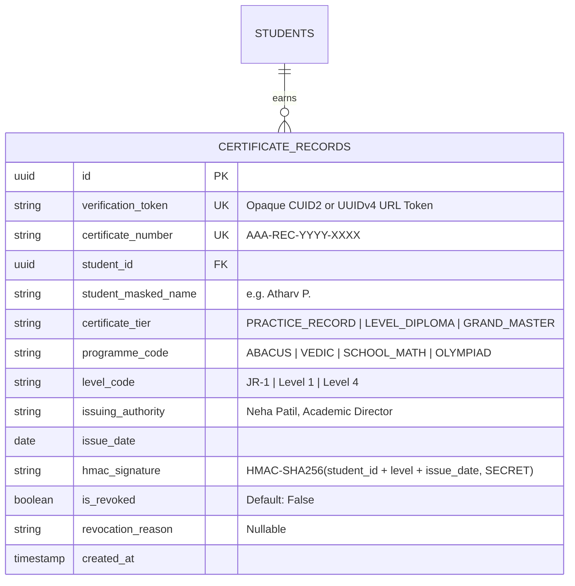

# ARNAV ABACUS ACADEMY (AAA) — STAGE 3 SOLUTION ARCHITECTURE
# WS-10.5: CERTIFICATE & ACHIEVEMENT GOVERNANCE ARCHITECTURE

**Project:** Arnav Abacus Academy (AAA), Wakad, Pune  
**Document Reference:** `AAA-S3-SPEC-WS10-05`  
**Stage:** Stage 3 — Architecture & Design  
**Workstream:** WS-10 — Security, Privacy, Compliance & Certificate Governance  
**Deliverable:** WS-10.5 — Certificate & Achievement Governance Architecture Specification  
**Governance Authority:** Neha Patil (Academic Director) & Nitin Patil (Operations & Technology Lead)  
**Date:** 04 November 2026  
**Status:** 🟡 **DRAFT — AWAITING MANAGEMENT REVIEW (GATE 3.5 OPEN)**  
**Execution Mode:** STRICTLY DOCUMENTATION-ONLY (IMPLEMENTATION FREEZE ACTIVE)  

---

## 1. Scope & Critical Governance Distinctions

Arnav Abacus Academy awards academic recognition to students across their multi-year learning journey. Under `AGENTS.md` Rule 6 (*"No Fabricated Credentials or Claims"*), this specification establishes an unshakeable boundary separating **instant client-side practice records** from **authoritative academic diplomas**:

### 1.1 Non-Negotiable Governance Rules
1. **No False Claims of Accreditation:** Software-generated PDF practice records must **NEVER** use misleading terms like *"International Accreditation"* or *"Government Recognized"* unless backed by verified institutional affiliations approved by AAA management.
2. **Serial Number Integrity:** The existing code (`src/lib/certificateGenerator.ts:163`) generates random unverified serials: `AAA-INT-${Math.floor(100000 + Math.random() * 900000)}`. This mock serial **DOES NOT** establish institutional authenticity and must be replaced by an authoritative central ledger.
3. **No Stage 3 Generation:** Zero cryptographic signing keys or live certificate records shall be generated or issued during Stage 3.

---

## 2. Digital Verification Architecture & Public Minimization

To provide tamper-evident verification for genuine academic achievements while strictly protecting minor student privacy:

### 2.1 Public Verification Data Minimization Rules
When a prospective school admissions officer, competition organizer, or parent scans the diploma QR code, the public verification page (`/verify/cert/...`) must display **ONLY** the minimum necessary public attributes:

| Data Field | Displayed on Public Verification Page? | Privacy & Protection Rationale |
| :--- | :---: | :--- |
| **Certificate Reference (`AAA-REC-YYYY-XXXX`)** | **YES** | Confirms valid reference against central ledger. |
| **Student First Name & Last Initial** | **YES** (e.g., *"Atharv P."*) | Protects minor identity from full public web scraping. |
| **Programme & Level Completed** | **YES** (e.g., *"Abacus Senior — Level 4"*) | Core academic fact being verified. |
| **Issue Date & Academic Director Sign-Off** | **YES** (e.g., *"Issued 15-Oct-2026 by Neha Patil"*) | Establishes academic validity. |
| **Tamper-Evident Hash Status** | **YES** (*"Cryptographically Verified"*) | Proves document has not been altered. |
| **Student Permanent ID (`UUIDv7`)** | ❌ **STRICTLY PROHIBITED** | Internal system identifier; never exposed publicly. |
| **Parent Name, Phone, Email** | ❌ **STRICTLY PROHIBITED** | Personal PII strictly excluded. |
| **Exact Date of Birth / Age** | ❌ **STRICTLY PROHIBITED** | Minor demographic protection. |
| **Granular Question Scores / Error Breakdown** | ❌ **STRICTLY PROHIBITED** | Detailed educational evaluation is private to family. |

---

## 3. Cryptographic Tamper-Evidence & Central Ledger Schema

### 3.1 Central Certificate Ledger Schema

### 3.2 Cryptographic Signing Mechanism (Stage 4 Target)
- The backend generates an HMAC-SHA256 digest of the tuple: `(student_id, certificate_number, programme_code, level_code, issue_date)`.
- The secret HMAC signing key is stored in an encrypted environment vault managed by Nitin Patil; it is **never** embedded in client bundles.
- Verification checks that `HMAC(record_attributes) === hmac_signature` and that `is_revoked === false`.

---

## 4. Stage-Gate Acceptance & Verification

This specification satisfies **WS-10.5** under Stage 3 Workstream WS-10. It is submitted in **DRAFT** status and will be formally reviewed under Management Determination `MGT-DET-S3-14`. Gate 3.5 remains **OPEN**.
