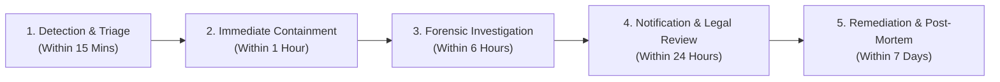

# ARNAV ABACUS ACADEMY (AAA) — STAGE 3 SOLUTION ARCHITECTURE
# WS-10.6: INCIDENT RESPONSE, RISK & CONTROL GOVERNANCE

**Project:** Arnav Abacus Academy (AAA), Wakad, Pune  
**Document Reference:** `AAA-S3-SPEC-WS10-06`  
**Stage:** Stage 3 — Architecture & Design  
**Workstream:** WS-10 — Security, Privacy, Compliance & Certificate Governance  
**Deliverable:** WS-10.6 — Incident Response, Risk & Control Governance Specification  
**Governance Authority:** Nitin Patil (Operations & Technology Lead) & Neha Patil (Academic Director)  
**Date:** 04 November 2026  
**Status:** 🟡 **DRAFT — AWAITING MANAGEMENT REVIEW (GATE 3.5 OPEN)**  
**Execution Mode:** STRICTLY DOCUMENTATION-ONLY (IMPLEMENTATION FREEZE ACTIVE)  

---

## 1. Scope & Incident Management Objectives

Because Arnav Abacus Academy processes minor children's educational records and parent financial data, operational incidents (such as suspected data leaks, credential compromise, or vendor outages) require a clear, structured incident response protocol.

### 1.1 Non-Negotiable Operational Axiom
- **Evidence-Based Reporting:** AAA will never claim a data breach has occurred without forensic evidence; conversely, suspected exposures will be aggressively contained and investigated immediately.
- **Incident Ownership:** **Nitin Patil** serves as the Primary Incident Commander for all cybersecurity, infrastructure, and technical data incidents; **Neha Patil** serves as Communications Lead for parent and student welfare.

---

## 2. 5-Phase Security & Privacy Incident Response Lifecycle

### 2.1 Detailed Incident Response Protocols Across 10 Scenarios

| # | Incident Scenario | Detection Signal | Initial Triage & Containment Action | Responsible Lead | Legal / Regulatory Escalation | Parent Communication Protocol |
| :-: | :--- | :--- | :--- | :--- | :--- | :--- |
| **1** | **Suspected Student Practice Data Leak** | Unscheduled spike in JSONBlob or API GET traffic. | Immediately freeze endpoint API keys; switch client to offline `localStorage` buffer. | Nitin Patil | Document data fields exposed; review DPDP notification threshold with legal counsel. | Inform affected parents with transparent advisory if personal identities exposed. |
| **2** | **Compromised Administrator Account** | Login from unverified IP address or multiple failed OTPs. | Immediately revoke all active sessions in Redis/DB; reset admin password and force re-authentication. | Nitin Patil | Audit admin action log for unauthorized modifications. | Internal notification only unless student data accessed. |
| **3** | **Unauthorized WhatsApp Outbound Spam** | Parent complaint or Meta Business Account rate limit alert. | Revoke WhatsApp Cloud API access token immediately; freeze automated dispatch worker. | Nitin Patil | Investigate compromised API secret or staff device. | Dispatch official broadcast apology explaining technical glitch. |
| **4** | **PII Leakage in Analytics (GA4)** | DevTools or DebugView reveals parent phone in URL. | Terminate GA4 tag in GTM immediately; execute retroactive data deletion request in Google Analytics. | Nitin Patil | Verify whether data was stored in GA4 servers; document incident log. | Transparent explanation to management; update URL redaction regex. |
| **5** | **Spreadsheet Formula Injection Execution** | Google Sheets displays unexpected formula error or popup. | Revoke Google Apps Script webhook URL; disconnect sheet; sanitize offending rows with `'` prefix. | Nitin Patil | Review Google Workspace access logs. | Inform parent if lead was dropped; re-verify lead intake. |
| **6** | **Certificate Forgery / Tampering** | QR code scan fails HMAC check on public verification page. | Flag certificate reference as `REVOKED_FRAUDULENT`; log scanning IP and timestamp. | Neha Patil | Document fraudulent diploma for legal warning notice if forged by third party. | Contact verifying institution or parent to confirm authentic credentials. |
| **7** | **Physical Break-In / Theft of Center Hardware** | Center laptop or paper attendance register stolen. | Remotely wipe stolen device via MDM / Google Workspace; lock all session tokens. | Nitin & Neha | File police report (FIR) at Wakad Police Station; document physical breach. | Direct outreach to affected parents detailing what records were on device. |
| **8** | **Database Corruption / Loss** | Automated restore drill fails or database query timeout. | Switch traffic to read-only replica; initiate Point-in-Time Recovery (PITR) to last valid WAL. | Nitin Patil | Assess RPO data loss window (target $\le 5$ min). | Notify parents if scheduled practice portal maintenance is required. |
| **9** | **Vendor Service Outage (EmailJS / SMS / Meta)** | Lead or OTP dispatch error rate exceeds 5%. | Client automatically activates secondary SMS fallback gateway or displays direct phone CTA. | Nitin Patil | Monitor vendor status page; log SLA violation. | Display user-friendly banner: *"Please call +91 90219 24968 directly"*. |
| **10** | **Parent Consent Dispute / Deletion Request** | Parent requests immediate erasure under DPDP rights. | Verify parent identity via phone OTP; execute purge script removing lead/student data. | Nitin Patil | Record fulfillment in Data Principal Rights Log; maintain tax invoices. | Formal written confirmation sent to parent confirming erasure. |

---

## 3. Master Risk & Control Register (WS-10 Baseline)

| Risk ID | Risk Description | Severity | Existing Control | Proposed Target Control (Stage 4) | Residual Risk | Risk Owner |
| :---: | :--- | :---: | :--- | :--- | :---: | :---: |
| **RSK-10-01** | JSONBlob unauthenticated practice sync exposure. | **CRITICAL** | None (Code baseline). | 5-phase deprecation framework (`WS-09A.5`); cutover to authenticated PostgreSQL. | **LOW** | Nitin Patil |
| **RSK-10-02** | Client-side OTP generation and console exposure. | **CRITICAL** | Math.random() in browser. | Server-side CSPRNG OTP generation; rate limiting (3 tries/15 min); HttpOnly cookies. | **LOW** | Nitin Patil |
| **RSK-10-03** | LocalStorage permission tampering in AcademyOS. | **HIGH** | `accessControl.ts` in local storage. | Server-enforced JWT claims; Row-Level Security on all database queries. | **LOW** | Nitin Patil |
| **RSK-10-04** | Accidental PII transmission in GA4 URLs. | **MEDIUM** | Developer caution. | Automated client-side URL query redaction filter (`src/lib/analytics.ts`). | **LOW** | Nitin Patil |
| **RSK-10-05** | Unverified mock certificate serial numbers. | **MEDIUM** | Random math serial in jsPDF. | Authoritative Central Certificate Ledger with HMAC-SHA256 tamper-evident verification. | **LOW** | Neha Patil |
| **RSK-10-06** | Browser `localStorage` offline buffer exposure on shared PC. | **MEDIUM** | Plain JSON array (`LeadForm.tsx`). | Encrypted offline storage buffer; auto-purge immediately upon successful sync. | **LOW** | Nitin Patil |

---

## 4. Stage-Gate Acceptance & Verification

This specification satisfies **WS-10.6** under Stage 3 Workstream WS-10. It is submitted in **DRAFT** status and will be formally reviewed under Management Determination `MGT-DET-S3-14`. Gate 3.5 remains **OPEN**.
