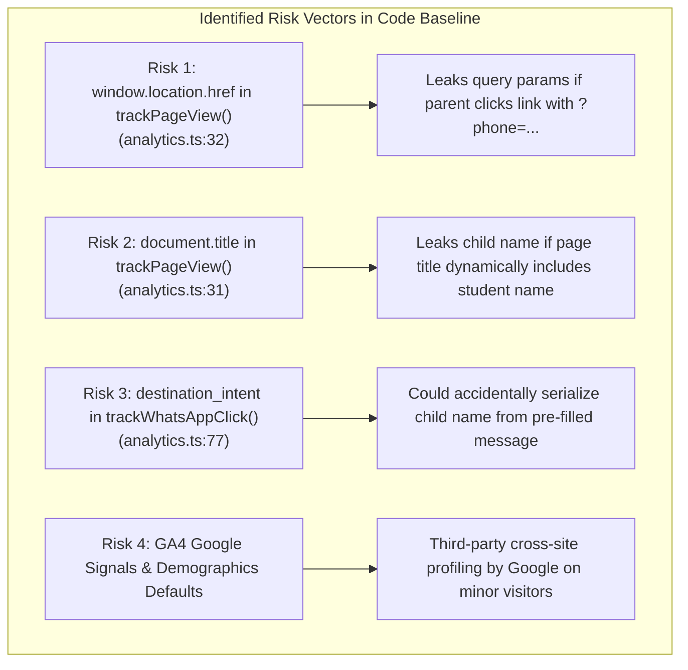

# ARNAV ABACUS ACADEMY (AAA) — STAGE 3 SOLUTION ARCHITECTURE
# WS-10.4: ZERO-PII TELEMETRY INDEPENDENT VALIDATION

**Project:** Arnav Abacus Academy (AAA), Wakad, Pune  
**Document Reference:** `AAA-S3-SPEC-WS10-04`  
**Stage:** Stage 3 — Architecture & Design  
**Workstream:** WS-10 — Security, Privacy, Compliance & Certificate Governance  
**Deliverable:** WS-10.4 — Zero-PII Telemetry Independent Validation Specification  
**Governance Authority:** Nitin Patil (Operations & Technology Lead) & Neha Patil (Academic Director)  
**Date:** 04 November 2026  
**Status:** 🟡 **DRAFT — AWAITING MANAGEMENT REVIEW (GATE 3.5 OPEN)**  
**Execution Mode:** STRICTLY DOCUMENTATION-ONLY (IMPLEMENTATION FREEZE ACTIVE)  

---

## 1. Executive Summary & Audit Methodology

In Workstream WS-09B, specification `AAA_WS09B_Zero_PII_Telemetry_and_Analytics_Architecture.md` defined the theoretical zero-PII event dictionary for Google Analytics 4 (`G-M2EL9MYSRL`) and Google Tag Manager (GTM).

To satisfy the non-negotiable Prime Directive and `AGENTS.md` Rule 4, this deliverable provides an **independent security and privacy validation** of that specification against:
1. Actual source-code implementation in `src/lib/analytics.ts` and `src/lib/gtm.ts`.
2. Potential browser-side leak vectors (URL query parameters, page titles, browser referrers, console logs).
3. Third-party vendor data-sharing defaults inside Google Analytics.

---

## 2. Independent Code Audit & Discovered Exposure Risks

An in-depth line-by-line inspection of `src/lib/analytics.ts` and `src/lib/gtm.ts` reveals four specific areas where PII could unintentionally leak if not strictly governed:

### 2.1 Mitigation Architecture Enforced in WS-10
1. **Sanitized Pathname Enforcement:** In `src/lib/analytics.ts:28-34`, `page_location` must be stripped of `window.location.search` (query parameters) and `window.location.hash`. GA4 hits must receive only `window.location.origin + window.location.pathname`.
2. **Static Page Title Sanitization:** Page titles passed to `gtag` must match a predefined static catalog (e.g., *"Arnav Abacus Academy — Abacus Program"*). Dynamic injection of student names or parent names into `document.title` is strictly blocked.
3. **Explicit DataLayer Parameter Whitelist:** The wrapper `pushGtmEvent()` in `src/lib/gtm.ts` must enforce an explicit key whitelist. Any parameter not on the approved list (e.g., `phone`, `email`, `name`, `score`, `student_id`) is automatically purged before calling `window.dataLayer.push()`.
4. **Google Signals & Ad Personalization Disablement:** In the production GA4 property configuration, Google Signals and Personalized Advertising must be explicitly toggled **OFF** to prevent cross-site profiling of minor visitors.

---

## 3. Zero-PII Telemetry Test & Verification Matrix

Before production deployment, the following test battery must be executed in staging to independently verify zero-PII compliance:

| Test ID | Test Scenario | Trigger Action in Browser | Expected DataLayer / Network Payload | Pass / Fail Acceptance Criteria |
| :---: | :--- | :--- | :--- | :--- |
| **TEL-01** | **Query Parameter Leak Defense** | Navigate to `/programs/abacus?parentName=Rahul&phone=9021924968`. | `page_location: "https://arnavabacus.com/programs/abacus"`. Query string completely stripped. | Zero occurrence of "Rahul" or "9021924968" in DevTools network filter `collect?v=2`. |
| **TEL-02** | **Form Submission Event** | Submit enquiry modal with parent details. | `event: "enquiry_form_submit"`, `programme_category: "abacus"`, `delivery_mode: "offline"`. | Zero personal fields present in `dataLayer` payload. |
| **TEL-03** | **WhatsApp Click Tracking** | Click WhatsApp CTA with pre-filled message text. | `event: "whatsapp_click"`, `click_source: "navbar"`, `destination_intent: "discovery_inquiry"`. | Pre-filled message body containing parent name is NOT serialized to GA4. |
| **TEL-04** | **Student Practice Screen Isolation** | Student launches and completes `/practice/session`. | **Zero GA4 events fired.** Analytics tracking completely disabled on practice routes. | Zero network hits to Google Analytics during active practice sessions. |
| **TEL-05** | **Console Log PII Suppression** | Application throws network error during lead submission. | Error message logged as generic code (`ERR_LEAD_DISPATCH_FAILED`). | Payload containing parent name/phone is never printed to `console.error`. |

---

## 4. Stage-Gate Acceptance & Verification

This specification satisfies **WS-10.4** under Stage 3 Workstream WS-10. It is submitted in **DRAFT** status and will be formally reviewed under Management Determination `MGT-DET-S3-14`. Gate 3.5 remains **OPEN**.
