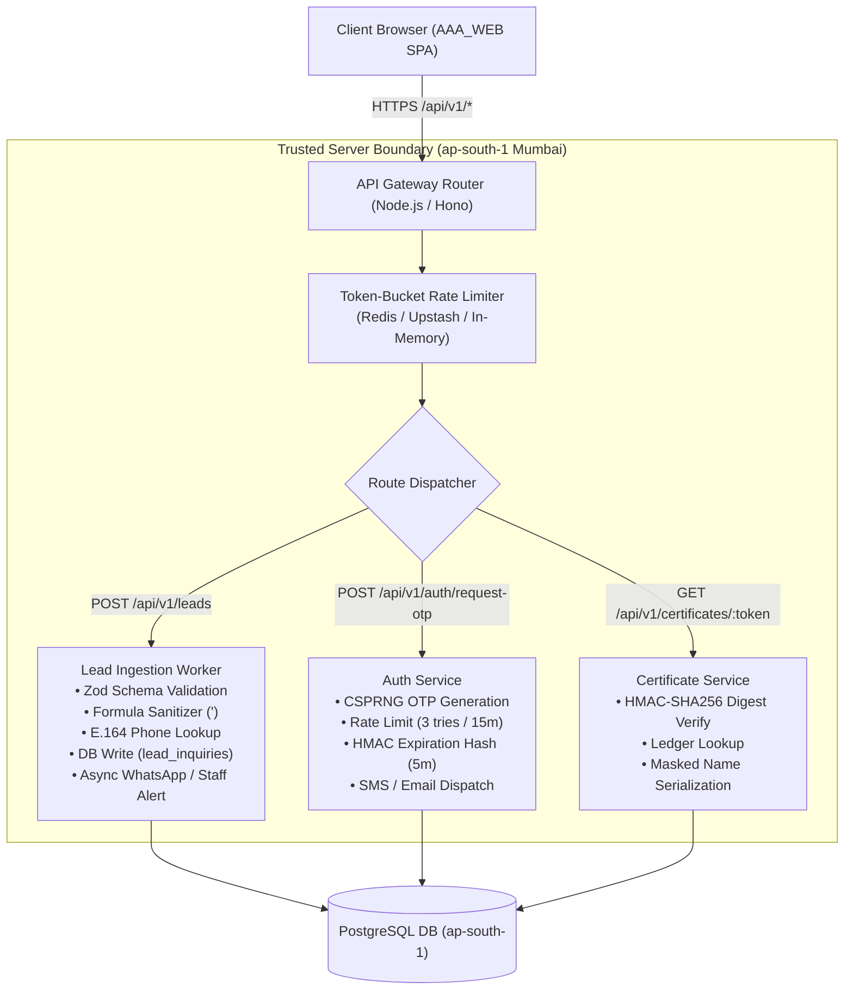

# ARNAV ABACUS ACADEMY (AAA) — STAGE 3 SOLUTION ARCHITECTURE
# WS-11.2: BACKEND API GATEWAY & RUNTIME ARCHITECTURE

**Project:** Arnav Abacus Academy (AAA), Wakad, Pune  
**Document Reference:** `AAA-S3-SPEC-WS11-02`  
**Stage:** Stage 3 — Architecture & Design  
**Workstream:** WS-11 — Platform Hosting, Infrastructure & Operational Architecture  
**Deliverable:** WS-11.2 — Backend API Gateway & Runtime Architecture Specification  
**Governance Authority:** Nitin Patil (Operations & Technology Lead) & Neha Patil (Academic Director)  
**Date:** 04 November 2026  
**Status:** 🟡 **DRAFT — AWAITING MANAGEMENT REVIEW (GATE 3.6 OPEN)**  
**Execution Mode:** STRICTLY DOCUMENTATION-ONLY (IMPLEMENTATION FREEZE ACTIVE)  

---

## 1. Scope & Core Architectural Separation

Under ratified determinations `MGT-DET-S3-13` (WS-09B) and `MGT-DET-S3-14` (WS-10), the browser must **NEVER** serve as an authoritative boundary for authentication, permissions, student ID generation, or persistence. 

Arnav Abacus Academy requires a dedicated, lightweight, and secure server-side API Gateway to host:
1. **`/api/v1/leads`:** Public lead ingestion, server-side Zod validation, E.164 phone deduplication, formula injection sanitization, honeypot traps, and transactional notifications.
2. **`/api/v1/auth`:** CSPRNG OTP generation, rate-limited phone/email verification (3 tries/15 min), and HttpOnly/Secure session cookie issuance.
3. **`/api/v1/certificates`:** Public tamper-evident certificate verification resolving HMAC-SHA256 digests against the central ledger.
4. **`/api/v1/practice`:** Authenticated student practice attempt ingestion, dual-read failover, and historical progress querying.

---

## 2. In-Depth Comparative Evaluation of Backend Runtime Environments

| Evaluation Dimension | Option A: Cloudflare Workers (Edge Serverless) | Option B: Node.js Serverless (Vercel Serverless / AWS Lambda) (Recommended Target) | Option C: Containerized Go / Node.js (AWS ECS / Fly.io / Railway) |
| :--- | :--- | :--- | :--- |
| **Execution Environment** | V8 isolates running directly on global Anycast edge nodes ($< 5\text{ms}$ cold start). | Managed Node.js runtime executing in regional cloud containers (e.g., AWS `ap-south-1` Mumbai). | Dedicated persistent Linux container running continuous Node.js or compiled Go service. |
| **Cold Starts & Performance** | **Instantaneous.** 0–5ms cold start; ultra-fast globally. | **Low.** 150–400ms cold start in Node.js; negligible impact on asynchronous lead ingestion. | **Zero.** Always-on daemon process; zero cold start. |
| **Database Connection Pooling** | **Requires Proxy.** Cannot hold long-lived TCP sockets; requires Hyperdrive or Prisma Accelerate for PostgreSQL pooling. | **Native Support.** Supports native connection poolers (PgBouncer, Neon serverless driver, Supabase connection pool). | **Native.** Standard connection pooling libraries (`pg-pool`, Go `database/sql`) hold direct TCP pools effortlessly. |
| **Cryptographic Standards** | Supports standard Web Crypto API (`crypto.subtle`) for CSPRNG and HMAC-SHA256. | Native Node.js `crypto` module (mature, robust, standardized CSPRNG and HMAC utilities). | Standard system crypto libraries. Absolute flexibility. |
| **Ecosystem & Library Maturity** | Restricted runtime (no native Node.js C++ bindings; some npm packages fail to bundle). | **Superior.** 100% npm compatibility (Zod, DOMPurify, jsPDF, pg, jsonwebtoken, nodemailer). | **Superior.** Unrestricted operating system environment. |
| **Operational Simplicity** | High simplicity, but edge debugging and logging can be tricky. | **Minimal.** Single repository setup; automated deployment via Git; zero server patching. | **Moderate / High.** Requires Dockerfiles, container registries, health check monitoring, and OS patching. |
| **Cost at AAA Current Scale** | Extremely low (first 100k req/day free). | **Free to Negligible.** Free tier includes 100k invocations/month. Paid tier $\approx \$10\text{--}\$20/\text{mo}$. | **Moderate.** Always-on VM/container costs minimum \$5–\$25/month regardless of traffic. |
| **Vendor Portability** | Proprietary Worker runtime; moderate lock-in. | **High Portability.** Standard Express/Fastify/Hono code runs on any Node.js host with zero code rewrite. | **100% Portable.** Docker container runs anywhere (AWS, GCP, DigitalOcean, local hardware). |

---

## 3. Recommended Backend Architecture: Standard Node.js Serverless Runtime

The **Standard Node.js Serverless Runtime (Option B)** utilizing a framework-agnostic lightweight router (such as **Hono** or **Fastify**) deployed in the **Mumbai, India (`ap-south-1`) region** is formally recommended for Arnav Abacus Academy.

### 3.1 Architectural Structure & Trusted Boundary



### 3.2 Non-Negotiable Server-Side Invariants
1. **Zero Browser Authority:** Inbound requests to `/api/v1/auth` and `/api/v1/practice` require valid session tokens; claims are verified using server-side public/private key pairs.
2. **Standardized Response Formats:** All API routes return clean, typed JSON responses with standard RFC 7807 problem details on error:
   ```json
   {
     "status": 422,
     "error": "Unprocessable Entity",
     "code": "INVALID_PHONE_FORMAT",
     "message": "Please enter a valid 10-digit Indian mobile number."
   }
   ```
3. **Audit Logging & Telemetry Stripping:** The server logs request metadata (timestamp, route, response status, execution duration, masked IP) while strictly scrubbing parent names, phone numbers, and child identities from server log aggregators.

---

## 4. Stage-Gate Acceptance & Verification

This specification satisfies **WS-11.2** under Stage 3 Workstream WS-11. It is submitted in **DRAFT** status and will be formally reviewed under Management Determination `MGT-DET-S3-15`. Gate 3.6 remains **OPEN**.
