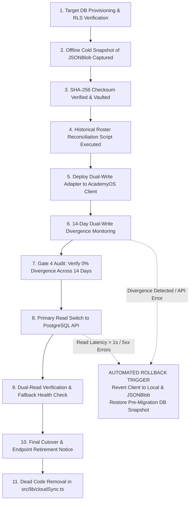

# ARNAV ABACUS ACADEMY (AAA) — STAGE 3 SOLUTION ARCHITECTURE
# WS-11.6: JSONBLOB MIGRATION & ROLLBACK ARCHITECTURE

**Project:** Arnav Abacus Academy (AAA), Wakad, Pune  
**Document Reference:** `AAA-S3-SPEC-WS11-06`  
**Stage:** Stage 3 — Architecture & Design  
**Workstream:** WS-11 — Platform Hosting, Infrastructure & Operational Architecture  
**Deliverable:** WS-11.6 — JSONBlob Migration & Rollback Architecture Specification  
**Governance Authority:** Nitin Patil (Operations & Technology Lead) & Neha Patil (Academic Director)  
**Date:** 04 November 2026  
**Status:** 🟡 **DRAFT — AWAITING MANAGEMENT REVIEW (GATE 3.6 OPEN)**  
**Execution Mode:** STRICTLY DOCUMENTATION-ONLY (IMPLEMENTATION FREEZE ACTIVE)  

---

## 1. Scope, Strict Safeguards & Governance Baseline

In Stage 3 Workstream WS-07 and WS-09A, Management Determinations `MGT-DET-S3-10` and `MGT-DET-S3-12` ratified the **5-Phase JSONBlob Deprecation Framework** and the **11-Point Migration Readiness Checklist** (`AAA_WS09A_JSONBlob_Deprecation_and_Replacement_Strategy.md`).

### 1.1 Non-Negotiable Safeguards for Stage 3
- **Planning & Architecture Only:** This specification operationalizes the exact engineering cutover and automated rollback procedures.
- **Zero Endpoint Disablement in Stage 3:** The existing JSONBlob endpoints in `src/lib/cloudSync.ts` (`019f9065...`) and `src/lib/successStories.ts` (`019fa81d...`) **MUST NOT** be modified, disabled, disconnected, or scraped during Stage 3.
- **Zero Live Migration:** Live extraction of historical attempts, database insertion, and endpoint decommissioning are strictly scheduled for Stage 4 execution after passing all Stage 4 Hard Gates.

---

## 2. The 11-Step Controlled Cutover & Rollback Engineering Workflow

---

## 3. Phase-by-Phase Entry, Exit, Evidence & Rollback Specifications

| Step # | Step Name | Entry Criteria | Exit Criteria | Owning Lead | Evidence Required for Sign-Off | Rollback Trigger & Action |
| :---: | :--- | :--- | :--- | :--- | :--- | :--- |
| **01** | **Target DB Readiness** | Supabase/PostgreSQL instance active in `ap-south-1`. | Relational tables (`practice_attempts`) created; RLS policies active; connection pooler verified. | Nitin Patil | Successful schema migration log; test insert query execution. | Destroy corrupted schema; re-run migrations. |
| **02** | **Offline Cold Snapshot** | Stage 4 Hard Gate approval. | One-time authenticated administrative export of `jsonblob.com` payload saved as offline file `aaa_attempts_snapshot_v1.json`. | Nitin Patil | Raw JSON file saved in encrypted cold storage vault. | Re-attempt export if network drops. Zero impact on live users. |
| **03** | **SHA-256 Verification** | Snapshot captured. | SHA-256 hash computed and recorded in management register: `SHA256(snapshot) === REGISTER_HASH`. | Nitin Patil | Cryptographic hash certificate signed by Nitin Patil. | Re-compute hash; re-verify file integrity. |
| **04** | **Historical Reconciliation** | Snapshot hash verified. | Automated script maps historical attempts to verified student roster (`AAA-STU-*`). Resolves legacy email IDs to UUIDs. | Nitin & Neha | Reconciliation report showing 100% attempts mapped; zero orphaned records. | Manual triage by Neha Patil of unmapped email aliases. |
| **05** | **Deploy Dual-Write Adapter** | Reconciliation complete. | Client code updated: when student finishes practice, attempt writes simultaneously to `/api/v1/practice` and JSONBlob. | Nitin Patil | PR merged to staging; unit tests passing with mock endpoints. | Revert PR; client continues single-write to JSONBlob. |
| **06** | **14-Day Dual-Write Monitoring** | Dual-write active in production. | System records 14 consecutive days of practice telemetry across mobile and desktop. | Nitin Patil | Daily divergence logs showing exact parity between PostgreSQL count and JSONBlob count. | **ROLLBACK TRIGGER:** Divergence $> 0.1\%$; freeze cutover; inspect network logs. |
| **07** | **Management Gate Audit** | 14 days completed. | Formal review showing 0% data loss across minimum 500 live practice sessions. | Nitin & Neha | Signed Stage 4 Gate Audit Certificate by Nitin and Neha. | Extend dual-write window by 7 days if parity unconfirmed. |
| **08** | **Primary Read Switch** | Gate Audit approved. | Toggle feature flag `VITE_PERSISTENCE_MODE = "API_PRIMARY"`. Leaderboard and attempt history query PostgreSQL. | Nitin Patil | Browser network tab confirms GET hits route to `/api/v1/practice/attempts`. | **ROLLBACK TRIGGER:** p95 latency $> 1,000\text{ms}$ or HTTP 5xx; instant toggle back to legacy read. |
| **09** | **Dual-Read Fallback Check** | Primary read active. | Test disconnecting PostgreSQL API; verify client seamlessly falls back to `localStorage` without UI crash. | Nitin Patil | Test report verifying offline practice drill execution and local caching. | Fix client fallback wrapper; re-test in staging. |
| **10** | **Endpoint Retirement** | 30 days of 100% stable API operation. | Terminate all network writes to `jsonblob.com`. Replace endpoint body with archival notice if permitted. | Nitin Patil | Network inspection confirming zero outgoing requests to `jsonblob.com`. | Re-enable endpoint if unexpected legacy client versions exist. |
| **11** | **Dead Code Removal** | Endpoint retired. | Cleanly remove legacy JSONBlob constants and fallback code from `src/lib/cloudSync.ts` and `successStories.ts`. | Nitin Patil | Git commit diff showing clean removal of dead code; `npm run build` passing. | Git revert commit if build breaks. |

---

## 4. Stage-Gate Acceptance & Verification

This specification satisfies **WS-11.6** under Stage 3 Workstream WS-11. It is submitted in **DRAFT** status and will be formally reviewed under Management Determination `MGT-DET-S3-15`. Gate 3.6 remains **OPEN**.
