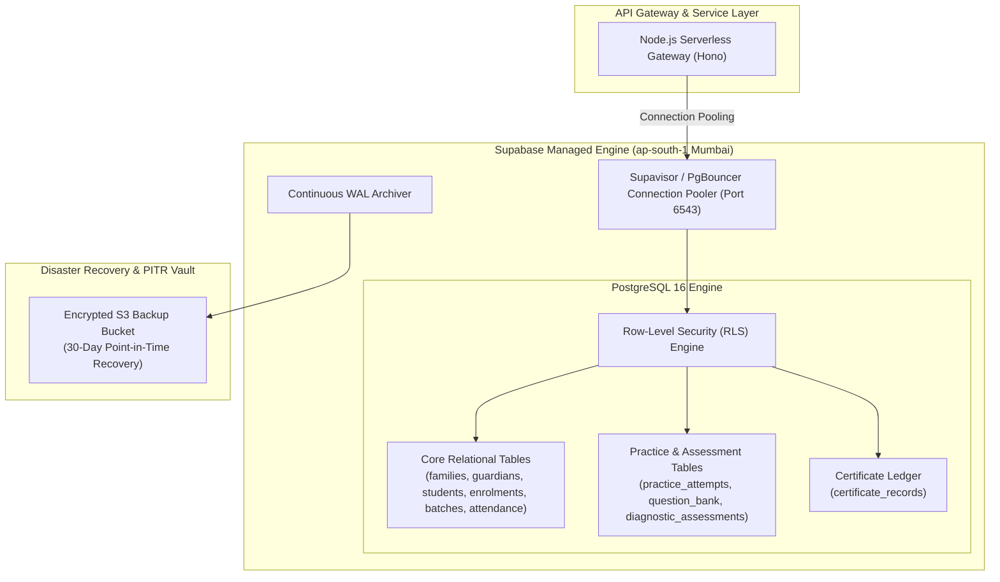

# ARNAV ABACUS ACADEMY (AAA) — STAGE 3 SOLUTION ARCHITECTURE
# WS-11.3: MANAGED POSTGRESQL HOSTING & DATABASE ARCHITECTURE

**Project:** Arnav Abacus Academy (AAA), Wakad, Pune  
**Document Reference:** `AAA-S3-SPEC-WS11-03`  
**Stage:** Stage 3 — Architecture & Design  
**Workstream:** WS-11 — Platform Hosting, Infrastructure & Operational Architecture  
**Deliverable:** WS-11.3 — Managed PostgreSQL Hosting Architecture Specification  
**Governance Authority:** Nitin Patil (Operations & Technology Lead) & Neha Patil (Academic Director)  
**Date:** 04 November 2026  
**Status:** 🟡 **DRAFT — AWAITING MANAGEMENT REVIEW (GATE 3.6 OPEN)**  
**Execution Mode:** STRICTLY DOCUMENTATION-ONLY (IMPLEMENTATION FREEZE ACTIVE)  

---

## 1. Scope & Database Architecture Requirements

In Workstream WS-09A, Management Determination `MGT-DET-S3-12` ratified the **Relational-First Hybrid Model (PostgreSQL + JSONB)** as the authoritative persistence paradigm for Arnav Abacus Academy.

To support the relational data model (`AAA_WS09A_Student_Parent_Sibling_Data_Model.md`), the persistence provider must satisfy six critical technical criteria:
1. **Full PostgreSQL 16+ Compliance:** Native support for strict ACID transactions, foreign key constraints, unique indexes, and JSONB indexing.
2. **Row-Level Security (RLS) & Native Role Enforcement:** Granular SQL policies enforcing student-level and family-level data isolation.
3. **Continuous WAL Archiving & Point-in-Time Recovery (PITR):** Enabling the ratified recovery targets of $\text{RPO} \le 5\text{ minutes}$ and $\text{RTO} < 1\text{ hour}$.
4. **Data Residency & Low Latency in India:** Database nodes located physically in the **Mumbai (`ap-south-1`) region** to comply with Indian data residency standards and ensure sub-25ms latency for Wakad users.
5. **Connection Pooling for Serverless Workers:** Built-in connection pooling (e.g., PgBouncer) capable of multiplexing high-concurrency requests from serverless API gateways.
6. **Cost Predictability:** Low baseline operational cost during current academy scale, with linear, predictable scaling.

---

## 2. In-Depth Comparative Evaluation of Managed PostgreSQL Providers

| Evaluation Dimension | Option A: Supabase (Managed PostgreSQL) (Recommended Target) | Option B: AWS RDS for PostgreSQL | Option C: Neon (Serverless Postgres) |
| :--- | :--- | :--- | :--- |
| **Architecture Model** | Fully managed open-source PostgreSQL engine with built-in PgBouncer, Auth, and Storage. | Enterprise-grade managed relational database service in AWS VPC. | Serverless PostgreSQL with separated storage and compute architecture. |
| **Indian Region Availability** | **Native Mumbai (`ap-south-1`).** Data physically resides in AWS Mumbai data center. | **Native Mumbai (`ap-south-1`).** Full multi-AZ availability across Mumbai zones. | **Limited/Regional.** Primary regions in AWS US/EU; Mumbai region available but variable routing. |
| **Row-Level Security (RLS)** | **First-Class Native.** RLS is a core architectural pillar; integrates with JWT auth claims effortlessly. | **Supported.** Native SQL RLS supported, but requires custom JWT claim decoding in SQL session variables. | **Supported.** Native SQL RLS supported; requires custom session handling. |
| **Point-in-Time Recovery (PITR)** | **Native Add-on.** Pro plan includes 7-day or 30-day continuous WAL archiving with 1-second granularity. | **Native Enterprise.** Automated automated daily snapshots + continuous transaction log archiving (up to 35 days). | **Instant Branching.** Time-travel queries and instant branch-from-timestamp capabilities. |
| **Connection Pooling** | **Built-in PgBouncer & Supavisor.** Pre-configured transaction-mode pooling for serverless functions. | **Requires AWS RDS Proxy.** Complex setup; requires separate VPC endpoints and security groups. | **Built-in Connection Pooling.** Native pooling over WebSockets and TCP. |
| **Data Encryption & Isolation** | AES-256 at rest; TLS 1.3 in transit. SOC 2 Type II, HIPAA, and GDPR compliant infrastructure. | AES-256 KMS at rest; TLS in transit; full VPC network isolation. Top enterprise certifications. | AES-256 at rest; TLS 1.3 in transit. SOC 2 compliant. |
| **Cost at Current Scale** | **Free Tier:** 500MB DB, 50k users (Zero cost).<br>**Pro Plan:** \$25/month flat (8GB DB, 250GB egress, daily backups). | **Moderate to High.** `db.t4g.micro` base instance: $\approx \$18\text{--}\$25/\text{mo}$ + storage + RDS Proxy ($\approx \$15/\text{mo}$). Total $\approx \$40\text{--}\$60/\text{mo}$. | **Free Tier:** 0.5GB storage.<br>**Launch Plan:** \$19/month flat (compute hour credits + storage). |
| **Operational Complexity** | **Very Low.** Clean web dashboard, visual SQL editor, automated migrations, instant table views for Neha/Nitin. | **High.** Requires advanced AWS IAM, VPC subnetting, route tables, security groups, and CLI administration. | **Low.** Modern web console, Git-like database branching for staging. |
| **Vendor Lock-In** | **Zero Lock-In.** Underneath the UI is 100% standard PostgreSQL. A standard `pg_dump` exports to any standard Postgres host. | **Zero Lock-In.** Standard PostgreSQL engine. Fully portable via standard dump/restore. | **Low.** Core engine is standard Postgres, though storage layer is proprietary. |

---

## 3. Recommended Database Hosting Decision: Supabase Managed PostgreSQL

**Supabase Managed PostgreSQL (Option A)** deployed in the **Mumbai (`ap-south-1`) region** is formally recommended for Arnav Abacus Academy.

### 3.1 Architectural Schema Mapping & Security Layers



### 3.2 Dual-Layer Security Architecture: Application Auth + Database RLS
In accordance with management principles, **Database RLS is NOT treated as a substitute for secure application authorization**. Security is enforced across both layers:
1. **Layer 1: Application-Level Authorization:** The Node.js API gateway validates session JWTs, checks role permissions (e.g., `academic_director` vs. `educator`), and validates inbound parameters.
2. **Layer 2: Database-Level Row-Level Security (RLS):** Even if an application bug or compromised query occurs, the PostgreSQL database engine independently rejects any query attempting to read or modify student records outside the caller's authorized tenant or family scope:
   ```sql
   -- Example RLS Policy for Student Practice Attempts
   CREATE POLICY student_own_attempts_isolation ON practice_attempts
     FOR SELECT
     USING (student_id = auth.jwt() ->> 'student_id' OR auth.jwt() ->> 'role' IN ('academic_director', 'super_admin'));
   ```

---

## 4. Stage-Gate Acceptance & Verification

This specification satisfies **WS-11.3** under Stage 3 Workstream WS-11. It is submitted in **DRAFT** status and will be formally reviewed under Management Determination `MGT-DET-S3-15`. Gate 3.6 remains **OPEN**.
