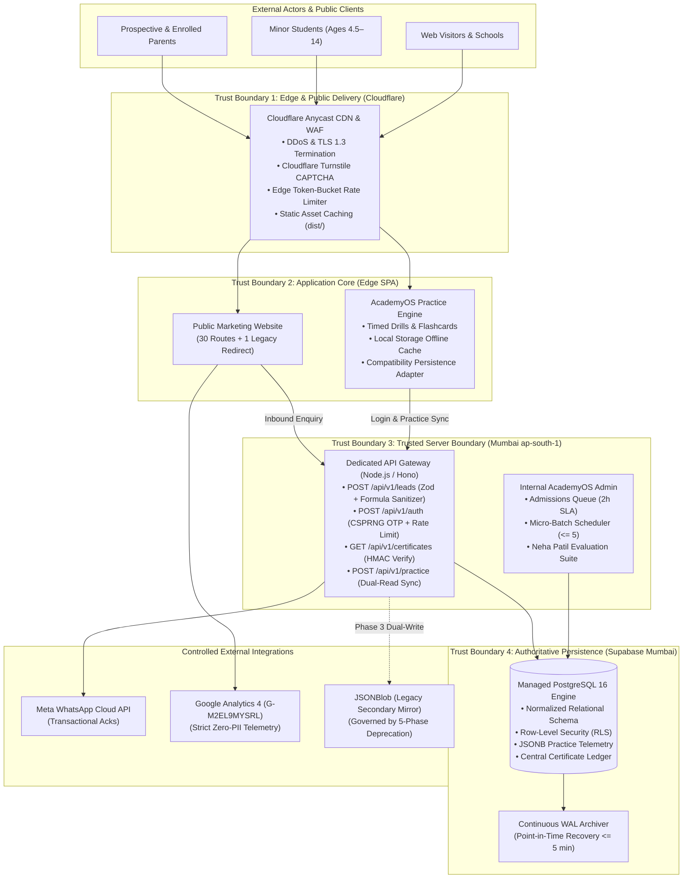
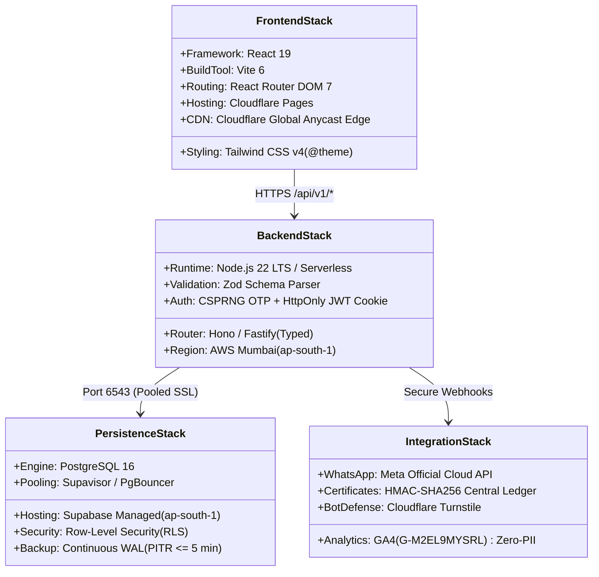

# ARNAV ABACUS ACADEMY (AAA) — STAGE 3 SOLUTION ARCHITECTURE
# WS-11.8: MASTER SOLUTION ARCHITECTURE SPECIFICATION

**Project:** Arnav Abacus Academy (AAA), Wakad, Pune  
**Document Reference:** `AAA-S3-SPEC-WS11-08`  
**Stage:** Stage 3 — Architecture & Design  
**Workstream:** WS-11 — Platform Hosting, Infrastructure & Operational Architecture  
**Deliverable:** WS-11.8 — Master Solution Architecture Specification (Stage 3 Consolidation)  
**Governance Authority:** Nitin Patil (Operations & Technology Lead) & Neha Patil (Academic Director)  
**Date:** 04 November 2026  
**Status:** 🟡 **DRAFT — AWAITING MANAGEMENT REVIEW (GATE 3.6 OPEN)**  
**Execution Mode:** STRICTLY DOCUMENTATION-ONLY (IMPLEMENTATION FREEZE ACTIVE)  

---

## 1. Executive Summary & Master Architecture Charter

The **Master Solution Architecture Specification** represents the definitive technical, operational, pedagogical, and security blueprint for the complete digital transformation of **Arnav Abacus Academy (AAA), Wakad, Pune**.

It consolidates and synthesizes all ratified architectural deliverables across Stage 3:
- **WS-06:** Digital Experience, Information Architecture, Component Systems, Thumb-Zones, Local SEO & Messaging (`MGT-DET-S3-09`).
- **WS-07:** Internal & Student System Boundary Isolation, AcademyOS Protection (`MGT-DET-S3-10`).
- **WS-08:** Diagnostic Assessment, 6 Educational Observation Dimensions, 8 Child Development Pillars, Personalised Learning Recommendations (`MGT-DET-S3-11`).
- **WS-09A:** Student Identity (UUIDv7 + `AAA-STU-*`), Relational Data Model, Micro-Batch ($\le 5$) Constraints, Persistence Architecture (`MGT-DET-S3-12`).
- **WS-09B:** End-to-End Admissions Data Flow (19 steps), Dedicated Server-Side API Gateway, Custom Headless CRM, 14-State Lead Lifecycle, Zero-PII Telemetry, Layered Form Security, WhatsApp Integration (`MGT-DET-S3-13`).
- **WS-10:** DPDP Minor Data Compliance, External Integration Risk Remediation, Server-Side Authentication & Session Security, 6-Tier RBAC, Central Certificate Ledger with HMAC Verification (`MGT-DET-S3-14`).
- **WS-11:** Cloudflare Pages Frontend, Node.js Serverless API Gateway, Supabase Managed PostgreSQL in Mumbai (`ap-south-1`), Cloudflare WAF & Turnstile, Point-in-Time Recovery ($\text{RPO} \le 5\text{ min}$, $\text{RTO} < 1\text{ hr}$), and Controlled JSONBlob Deprecation.

---

## 2. Master System Context Diagram

---

## 3. The 3 Architectural Zones & Trust Boundaries

| Architectural Zone | Primary Functionality | Trust Level | Governing Security Controls | Data Assets Handled |
| :--- | :--- | :--- | :--- | :--- |
| **Zone 1: Public Website** | Marketing, curriculum showcase, blog, parent guides, discovery booking modal. | **Untrusted Public Edge** | WAF OWASP rules, Turnstile CAPTCHA, 4-field inquiry contract, zero-PII telemetry, client-side input sanitization. | Anonymous page views, public blog content, inbound 4-field inquiries. |
| **Zone 2: AcademyOS Practice Engine** | Timed mental math drills, abacus speed challenges, dictation audio, practice result generation. | **Authenticated Student Client** | Dual-read persistence adapter, local storage offline buffer, client-side sound effects, non-authoritative session state. | Quiz questions, user arithmetic answers, temporary attempt cache. |
| **Zone 3: Internal Admin & Core Persistence** | Admissions triage, batch scheduling, attendance, payment processing, diagnostic evaluations, permanent records. | **High Trust Server & DB** | Server-enforced JWT claims, 6-tier RBAC, database RLS, CSPRNG OTP, continuous WAL archiving, secret vault. | Confidential minor PII, family contact info, financial receipts, diagnostic rubrics, diplomas. |

---

## 4. End-to-End Master Technology Stack

---

## 5. Master Governance Traceability Summary

- **Total Stage 2 Requirements Traced:** **100% (43 of 43 requirements fully mapped)** across WS-06 through WS-11.
- **Total Architectural Determinations Executed:** **42 formal determinations** across Stage 3 (Gates 3.0 through 3.5).
- **Core Educational Brand Alignment:** The master architecture firmly enforces the core philosophy: *"Mathematics is the medium; developing confident, independent and thoughtful learners is the mission."* Public leaderboards with child names and comparative ranking are permanently eliminated.
- **Canonical Center NAP Standardized:** Verified strictly across all systems as:
  - Phone: **`+91 90219 24968`**
  - Center Address: *Flat No. 3, 1st Floor, Adv. Balaji Sagar Bungalow, Opp. Creative Cameo, Near Park Street, Behind Wisdom World School, Wakad, Pune 411057*.

---

## 6. Stage-Gate Acceptance & Verification

This specification satisfies **WS-11.8** under Stage 3 Workstream WS-11. It is submitted in **DRAFT** status and will be formally reviewed under Management Determination `MGT-DET-S3-15`. Gate 3.6 remains **OPEN**.
