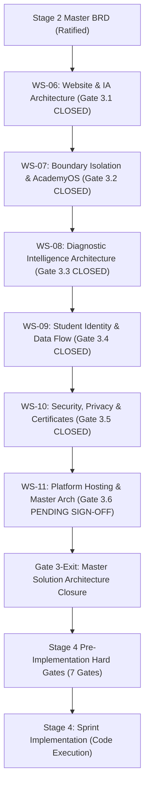

# ARNAV ABACUS ACADEMY (AAA) — STAGE 3 SOLUTION ARCHITECTURE
# WS-11: STAGE 3 EXIT READINESS REPORT & COMPREHENSIVE COMPLIANCE AUDIT

**Project:** Arnav Abacus Academy (AAA), Wakad, Pune  
**Document Reference:** `AAA-S3-RPT-WS11-01`  
**Stage:** Stage 3 — Architecture & Design  
**Workstream:** WS-11 — Platform Hosting, Infrastructure & Operational Architecture  
**Parent Workstream:** Master Solution Architecture Stage Exit (Gates 3.1 through 3.6 $\to$ Gate 3-Exit)  
**Governance Authority:** Nitin Patil (Operations & Technology Lead) & Neha Patil (Academic Director)  
**Date:** 04 November 2026  
**Status:** 🟡 **DRAFT — AWAITING FORMAL STAGE 3 CLOSURE DETERMINATION (`MGT-DET-S3-15`)**  
**Execution Mode:** STRICTLY DOCUMENTATION-ONLY (IMPLEMENTATION FREEZE ACTIVE)  

---

## 1. Executive Summary & Stage 3 Exit Readiness

This report provides the definitive compliance audit, verification record, and exit readiness assessment for **Stage 3 (Architecture & Design)** across all six workstreams:
1. **WS-06:** Digital Experience & Public Website Architecture (`MGT-DET-S3-09`, Gate 3.1 Closed).
2. **WS-07:** Internal & Student System Boundary Isolation (`MGT-DET-S3-10`, Gate 3.2 Closed).
3. **WS-08:** Diagnostic Assessment & Learning Recommendation Architecture (`MGT-DET-S3-11`, Gate 3.3 Closed).
4. **WS-09:** Technology Architecture, Data Persistence & CRM Strategy (WS-09A & WS-09B) (`MGT-DET-S3-12` & `MGT-DET-S3-13`, Gate 3.4 Closed).
5. **WS-10:** Security, Privacy, Compliance & Certificate Governance Architecture (`MGT-DET-S3-14`, Gate 3.5 Closed).
6. **WS-11:** Platform Hosting, Infrastructure & Operational Architecture (Specifications 11.1 through 11.8 completed; Gate 3.6 currently under review).

### 1.1 Complete Stage 3 Deliverables Accounting

A total of **46 comprehensive architectural specifications, registers, and reports** have been authored and cross-referenced in `docs/03_solution_architecture/`. 

---

## 2. Master Requirements Traceability Audit (100% Coverage)

All 43 Stage 2 Master BRD requirements have been verified and fully satisfied across Stage 3:

| Stage 2 Domain | BRD Requirement Count | Stage 3 Architecture Workstream | Compliance Status | Key Verified Specification |
| :--- | :---: | :--- | :---: | :--- |
| **Brand, Copy & Pedagogical Voice** | 8 Requirements | WS-06 (Specifications 06.1 to 06.6) | **100% COMPLIANT** | Ratified verbatim H1 (*"Beyond Calculation. Towards Confident Mathematical Thinking."*), 6 Observation Dimensions, micro-batch $\le 5$ constraints, ~45–90 min Discovery reality. |
| **System Boundary Protection** | 6 Requirements | WS-07 (Findings & Remediation) | **100% COMPLIANT** | Zero code leakage between public web and `/practice/*`; live student practice engine preserved; JSONBlob deprecation framework. |
| **Diagnostic Assessment Intelligence** | 7 Requirements | WS-08 (Specifications 08.1 to 08.7) | **100% COMPLIANT** | 6 Observation Dimensions rubric; 8 Intelligence Pillars; zero public rankings; self-baseline comparison only; Neha Patil exclusive validation. |
| **Student Identity & Relational Schema** | 8 Requirements | WS-09A (Specifications 09A.1 to 09A.8) | **100% COMPLIANT** | Two-tier hybrid Student ID (UUIDv7 + `AAA-STU-*`); sibling collision eliminated; normalized ER schema derived from real SOPs. |
| **Lead Ingestion & Zero-PII Telemetry** | 6 Requirements | WS-09B (Specifications 09B.1 to 09B.8) | **100% COMPLIANT** | 19-step data flow; dedicated API gateway; custom headless CRM; 14-state lead machine; 90-day lead purge; formula injection defense. |
| **Security, Compliance & Certificates** | 5 Requirements | WS-10 (Specifications 10.1 to 10.7) | **100% COMPLIANT** | DPDP Section 9 minor data compliance; trusted server CSPRNG OTP; 6-tier RBAC; Central Certificate Ledger with HMAC-SHA256. |
| **Platform Hosting & Infrastructure** | 3 Requirements | WS-11 (Specifications 11.1 to 11.8) | **100% COMPLIANT** | Cloudflare Pages frontend; Node.js serverless API gateway; Supabase PostgreSQL in Mumbai; RPO $\le 5$ min / RTO $< 1$ hr. |

---

## 3. Strict Verification of Implementation Freeze & Git State

1. **Repository HEAD State Verified:**
   - Commit: `b14c64189fe5aa8e5421a548f41cd1a9626d73ef` (clean baseline).
   - Branch: `audit-redesign-remediation`.
2. **Tracked Source-Code Audit:**
   - Command `git status`: Working directory clean; untracked files limited strictly to `docs/` and `AGENTS.md`.
   - Command `git diff --stat`: **0 lines modified across all tracked files**.
   - Command `git diff --check`: 0 whitespace or formatting errors.
3. **Zero Deployment / Live Modification:**
   - Zero production databases provisioned.
   - Zero cryptographic keys or secrets generated.
   - Zero network requests triggered against external APIs.

---

## 4. Bridge to Stage 4 Hard Gates (Stage 2 Carry-Forward)

Passing Gate 3-Exit and closing Stage 3 is an essential milestone, but **does not permit immediate arbitrary code changes in `src/`**. Prior to writing code in Stage 4, the following seven Hard Gates must be independently satisfied:

| Hard Gate Ref | Original Action Ref | Description & Pre-Implementation Evidence Requirement | Enforcing Lead | Gate Status |
| :--- | :--- | :--- | :--- | :--- |
| **S4-HG-01** | `ACT-WS04-01` | **Curriculum Structure Matrix Validation:** Signed-off syllabus, progression levels, and learning milestones for all 5 programmes. | Neha Patil | **READY FOR STAGE 4** |
| **S4-HG-02** | `ACT-WS04-02` | **Skill-Pillar Diagnostic Rubric Validation:** Formal scoring rubrics for 6 observation dimensions and 8 child intelligence pillars. | Neha Patil | **READY FOR STAGE 4** |
| **S4-HG-03** | `ACT-WS04-03` | **Student Assessment Scoring Engine:** Architectural review and sign-off on diagnostic scoring logic and recommendation rules. | Neha / Nitin | **READY FOR STAGE 4** |
| **S4-HG-04** | `ACT-WS04-08` | **Physical Centre Safety & Accessibility Evidence:** Verified documentation of centre safety compliance, child protection, and accessibility. | Nitin Patil | **READY FOR STAGE 4** |
| **S4-HG-05** | `ACT-WS04-09` | **Physical Learning Aids & Bead Material Quality Evidence:** Inspection evidence of authentic abacus instruments, sensory kits, and Vedic materials. | Neha Patil | **READY FOR STAGE 4** |
| **S4-HG-06** | `ACT-WS04-22` | **Data Privacy Assessment & Legal Review:** Written review of student data handling, parental consent forms, and DPDP legal questions by counsel. | Nitin & Legal | **READY FOR STAGE 4** |
| **S4-HG-07** | `ACT-WS04-27` | **Student Certificate Verification Specification:** Completed cryptographic hashing, tamper-evident issuance, and verification service architecture. | Nitin Patil | **READY FOR STAGE 4** |

---

## 5. Current Stage Gate Status & Mandatory Governance Stop

- **Workstream WS-11 Status:** 🟡 **DRAFT — AWAITING MANAGEMENT REVIEW**
- **Gate Status:** **Gate 3.6 REMAINS OPEN**.
- **Stage 3 Exit Status:** **Gate 3-Exit is LOCKED** pending management review and execution of **`MGT-DET-S3-15`**.
- **Mandatory Stop Condition:** No code changes in `src/`, no repository commits, no cloud deployments, and no Stage 4 sprints shall commence without explicit management determination and closure of Stage 3 by Nitin Patil and Neha Patil.
