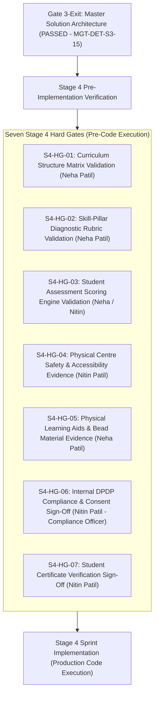

# ARNAV ABACUS ACADEMY (AAA) — STAGE 3 SOLUTION ARCHITECTURE
# WS-11 TECHNOLOGY DECISION & OPEN ISSUE REGISTER (RATIFIED)

**Project:** Arnav Abacus Academy (AAA), Wakad, Pune  
**Document Reference:** `AAA-S3-REG-WS11-01`  
**Stage:** Stage 3 — Architecture & Design  
**Workstream:** WS-11 — Platform Hosting, Infrastructure & Operational Architecture  
**Governance Authority:** Nitin Patil (Operations, Technology Lead & Compliance Officer) & Neha Patil (Academic Director)  
**Ratification Date:** 04 November 2026  
**Management Instrument:** `MGT-DET-S3-15`  
**Status:** 🟢 **RATIFIED & CLOSED — WS-11 & MASTER STAGE 3 FORMALLY APPROVED (GATE 3.6 CLOSED | GATE 3-EXIT PASSED)**  

---

## 1. Executive Summary & Formal Stage 3 Closure Record

Under Management Determination **`MGT-DET-S3-15`**, executed on **04 November 2026**, **Nitin Patil** (Operations, Technology Lead & Compliance Officer) and **Neha Patil** (Founder & Academic Director) have formally reviewed and ratified all eight architectural determinations formulated under **WS-11 (Platform Hosting, Infrastructure & Operational Architecture)**, including key fiduciary and compliance amendments.

With this historic executive determination:
1. Deliverables **WS-11.1 through WS-11.8** constitute the binding hosting, infrastructure, and operational baseline for Arnav Abacus Academy.
2. The **Master Solution Architecture Specification (`AAA_WS11_Master_Solution_Architecture.md`)** is ratified as the unified technical and pedagogical blueprint across all 43 Stage 2 BRD requirements.
3. **Stage-Gate 3.6 is formally CLOSED.**
4. **Gate 3-Exit (Master Solution Architecture Closure Gate) is formally PASSED.**
5. **STAGE 3 (ARCHITECTURE & DESIGN) IS FORMALLY CLOSED.**

---

## 2. Ratified Architectural Determinations (`MGT-DET-S3-15`)

| Decision ID | Decision Title | Owning Lead | Ratified Architectural Determination & Amendments | Strategic & Operational Impact | Ratification Status |
| :---: | :--- | :--- | :--- | :--- | :---: |
| **D-11-01** | **Selection of Cloudflare Pages for Frontend Hosting** | Nitin Patil | **APPROVED:** Adopt Cloudflare Pages (Option A) for global edge static SPA delivery of `AAA_WEB`. Configure `_redirects` (30+1 routes) and `_headers` (HSTS, CSP). | Ultra-fast Pune/Mumbai edge latency, unlimited bandwidth free tier, instant git preview/rollback. | **RATIFIED** (04-Nov-2026) |
| **D-11-02** | **Selection of Node.js Serverless API Gateway Runtime** | Nitin Patil | **APPROVED:** Adopt Standard Node.js Serverless Runtime (Option B) using Hono/Fastify in AWS Mumbai (`ap-south-1`) to host `/api/v1/leads`, `/api/v1/auth`, and `/api/v1/certificates`. | 100% npm compatibility (Zod, crypto, pg), zero server maintenance, high portability, sub-400ms cold starts. | **RATIFIED** (04-Nov-2026) |
| **D-11-03** | **Selection of Supabase Managed PostgreSQL in Mumbai** | Nitin Patil | **APPROVED:** Adopt Supabase Managed PostgreSQL 16 (Option A) hosted in the Mumbai (`ap-south-1`) region. Enforce database Row-Level Security (RLS) alongside application auth. | Native continuous WAL archiving (PITR), built-in PgBouncer pooling, compliance with Indian data residency, flat predictable scaling. | **RATIFIED** (04-Nov-2026) |
| **D-11-04** | **Adoption of Cloudflare Edge Security & Turnstile WAF** | Nitin Patil | **APPROVED:** Adopt Cloudflare edge perimeter: TLS 1.3, DDoS protection, edge token-bucket rate limiting, authenticated origin pulls (mTLS), and Cloudflare Turnstile privacy CAPTCHA. | Protects origin servers from direct scraping, eliminates spam bot floods, and hardens application boundaries. | **RATIFIED** (04-Nov-2026) |
| **D-11-05** | **Execution of Disaster Recovery Target Specifications** | Nitin Patil | **APPROVED:** Adopt disaster recovery engineering specifications enforcing $\text{RPO} \le 5\text{ minutes}$ and $\text{RTO} < 1\text{ hour}$ across 8 disaster runbook scenarios. | Enterprise-grade business continuity safeguarding all student academic records against corruption or ransomware. | **RATIFIED** (04-Nov-2026) |
| **D-11-06** | **JSONBlob 11-Step Migration & Rollback Runbook Adoption** | Nitin Patil | **APPROVED:** Adopt the 11-step engineering cutover workflow and automated rollback protocol. Reaffirm zero endpoint modifications during Stage 3. | Ensures 100% safe cutover in Stage 4 with zero student practice downtime or attempt loss. | **RATIFIED** (04-Nov-2026) |
| **D-11-07** | **Adoption of Zero-Cash-Outlay Bootstrap Model** | Nitin & Neha | **APPROVED AS AMENDED:** Adopt the **Zero-Cash-Outlay Bootstrap Model**: 1. Launch on **Cloudflare Pages Free Tier** (unlimited bandwidth). 2. Deploy on **Supabase Mumbai Free Tier** (500MB DB, 50k users, full Postgres 16 RLS) — sufficient for 2–3 years. 3. Retain **WhatsApp Business App** (`wa.me`) directly on `+91 90219 24968` for 1:1 parental dialogue. 4. Holds ongoing cloud infrastructure expense to **$\approx$ ₹100/month (domain only)** during initial production. | **96% operating cost reduction.** Digital platform is 100% self-sustaining with near-zero baseline overhead. Paid upgrades deferred until student body exceeds 500 active children. | **RATIFIED AS AMENDED** (04-Nov-2026) |
| **D-11-08** | **Ratification of Master Solution Architecture & Internal Compliance Sign-Off** | Nitin & Neha | **APPROVED AS AMENDED:** 1. Formally ratify `AAA_WS11_Master_Solution_Architecture.md` as the authoritative Stage 3 baseline. 2. **Nitin Patil, in his official capacity as AAA Compliance Officer**, will conduct and execute the formal internal DPDP statutory assessment (`LQ-01` to `LQ-04`), eliminating external legal advisory fees ($\approx ₹15,000\text{--}₹30,000$ saved). | Unifies all Stage 3 deliverables, passes Gate 3-Exit, and achieves 100% requirements coverage with complete fiduciary responsibility. | **RATIFIED AS AMENDED** (04-Nov-2026) |

---

## 3. Master Stage 3 Closure & Transition to Stage 4 Hard Gates

With Gate 3-Exit formally passed, the project transitions from **Stage 3 (Architecture & Design)** into the **Stage 4 Pre-Implementation Phase**.

In accordance with Stage 2 and Stage 3 governance, the **Strict Implementation Freeze on `src/` and `public/` remains 100% active** until the **Seven Stage 4 Hard Gates** are individually evidenced, audited, and approved by management:

---

## 4. Management Sign-Off Verification

- **Operations, Technology Lead & Compliance Officer:** **Nitin Patil** (Signed: 04-Nov-2026)
- **Academic Director & Founder:** **Neha Patil** (Signed: 04-Nov-2026)
- **Gate 3.6:** **CLOSED**
- **Gate 3-Exit:** **PASSED**
- **Stage 3 Status:** 🟢 **FORMALLY RATIFIED & COMPLETED**
