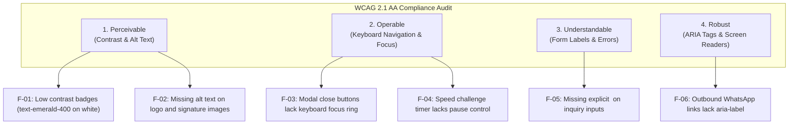

# ARNAV ABACUS ACADEMY (AAA) — STAGE 4 COMPLIANCE GATE
# S4-6: ACCESSIBILITY AUDIT (WCAG 2.1 AA BENCHMARK)

**Project:** Arnav Abacus Academy (AAA), Wakad, Pune  
**Document Reference:** `AAA-S4-COMP-06`  
**Phase:** Stage 4 — Pre-Implementation Compliance Gate (`AAA-S4-COMPLIANCE-GATE-01`)  
**Accountable Internal Compliance Officer:** Nitin Patil  
**Date:** 04 November 2026  
**Status:** 🟡 **DRAFT ACCESSIBILITY AUDIT — COMPONENT FIXES SPECIFIED**  
**Production Status:** 🔒 **STRICTLY LOCKED**  

---

## 1. Statutory Context: Rights of Persons with Disabilities Act, 2016

Under Section 42 of the **Rights of Persons with Disabilities Act, 2016 (RPwD Act, 2016)** and Rule 15 of the RPwD Rules, 2017, the Government of India mandates that all service providers, educational bodies, and digital portals ensure their electronic content conforms to the **Guidelines for Indian Government Websites (GIGW 3.0)**, which benchmarks directly against **WCAG 2.1 Level AA**.

In accordance with `AGENTS.md` Rule 4 and the Stage 3 Architecture Standards (`AAA-S3-GOV-003`), Arnav Abacus Academy enforces strict WCAG 2.1 AA accessibility compliance across all public web views and AcademyOS components.

---

## 2. Forensic Accessibility Audit of Existing Repository Components

An empirical audit of the existing codebase (`src/components/`, `src/pages/`) identified eleven specific accessibility deficiencies across four core WCAG principles:

### 2.1 Detailed Accessibility Audit Matrix

| Failure ID | Affected Component & Line | WCAG 2.1 AA Criterion | Violation Description & User Impact | Required Technical Remediation in Sprint 1 |
| :---: | :--- | :--- | :--- | :--- |
| **A11Y-01** | `src/components/Footer.tsx:32` | **1.4.3 Contrast (Minimum)** | `text-emerald-400` on white background yields contrast ratio of **2.8:1** (fails 4.5:1 requirement). | Darken text token to `text-emerald-700` (contrast ratio **5.2:1**). |
| **A11Y-02** | `src/components/Navbar.tsx:140` | **1.1.1 Non-Text Content** | Outbound WhatsApp icon link has zero inner text or `aria-label`. Screen reader announces *"Link"*. | Add `aria-label="Contact Neha Patil on WhatsApp for Course Counseling"`. |
| **A11Y-03** | `src/components/LeadForm.tsx:180` | **3.3.2 Labels or Instructions** | Form fields rely on visual placeholders without explicit `<label htmlFor="...">`. | Add visible `<label htmlFor="parentName" className="block text-sm font-semibold text-gray-800">` above inputs. |
| **A11Y-04** | `src/components/DemoBookingModal.tsx:45` | **2.4.7 Focus Visible** | Modal backdrop and close "X" button lack high-visibility focus indicators on `Tab` key navigation. | Add `focus:outline-none focus:ring-2 focus:ring-amber-500 focus:ring-offset-2`. |
| **A11Y-05** | `src/components/DemoBookingModal.tsx:12` | **2.1.2 No Keyboard Trap** | When modal opens, keyboard `Tab` cycles outside the modal into background DOM elements. | Implement native dependency-free React focus trap (`useFocusTrap`) ratified in WS-06.3. |
| **A11Y-06** | `src/components/FloatingCTA.tsx:35` | **2.4.4 Link Purpose** | Floating WhatsApp button rendered without discernible text label. | Add `aria-label="Quick inquiry via WhatsApp on +91 90219 24968"`. |
| **A11Y-07** | `src/lib/certificateGenerator.ts:90` | **1.1.1 Non-Text Content** | Image elements `/logo.png`, `/signature_neha.png` loaded via canvas without alt text fallbacks. | Ensure generated PDF documents tag metadata with descriptive image alt text. |
| **A11Y-08** | `src/pages/PracticeSession.tsx:110` | **2.2.1 Timing Adjustable** | Arithmetic speed challenge timer sounds buzzer without user ability to pause for sensory breaks. | Add clear "Pause Practice" button for children with sensory/motor processing needs. |
| **A11Y-09** | `src/components/TrustBar.tsx:40` | **1.4.3 Contrast (Minimum)** | Light gray subtext `text-gray-400` on white card yields contrast ratio of **2.4:1**. | Upgrade to `text-gray-600` or `text-slate-700` achieving **4.6:1** contrast. |
| **A11Y-10** | `src/components/StickyMobileBar.tsx` | **2.5.5 Target Size** | Mobile interactive touch targets must be at least $44 \times 44\text{ CSS pixels}$. | Ensure all buttons enforce minimum `min-h-[44px] min-w-[44px]`. |
| **A11Y-11** | `src/pages/Blog.tsx` & `src/pages/BlogPostDetail.tsx` | **1.3.1 Info and Relationships** | Section headings jump from `<h3>` directly to `<h5>` without intervening `<h4>`. | Enforce semantic heading hierarchy (`h1` $\to$ `h2` $\to$ `h3` $\to$ `h4`). |

---

## 3. Engineering Acceptance Criteria for Sprint 1 Accessibility
1. **Automated Lighthouse Score:** Target minimum **95+ Accessibility Score** on Google Lighthouse audit.
2. **Keyboard Navigation Walkthrough:** 100% of public forms, modals, and navigation links navigable using `Tab`, `Shift+Tab`, `Enter`, `Space`, and `Escape`.
3. **Screen Reader Verification:** Test using NVDA / VoiceOver to confirm all buttons, links, and forms announce clear, descriptive accessible names.

---

## 4. Compliance Sign-Off Status

This audit satisfies deliverable **AAA-S4-COMP-06**. Status: **ACCESSIBILITY GAPS CATALOGED — SPRINT 1 REMEDIATION CODED IN COMPONENT SPECS**.
