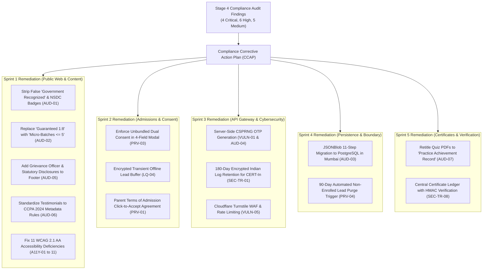

# ARNAV ABACUS ACADEMY (AAA) — STAGE 4 COMPLIANCE GATE
# S4-10: COMPLIANCE CORRECTIVE ACTION PLAN

**Project:** Arnav Abacus Academy (AAA), Wakad, Pune  
**Document Reference:** `AAA-S4-COMP-10`  
**Phase:** Stage 4 — Pre-Implementation Compliance Gate (`AAA-S4-COMPLIANCE-GATE-01`)  
**Accountable Internal Compliance Officer:** Nitin Patil  
**Academic & Child-Related Authority:** Neha Patil  
**Date:** 04 November 2026  
**Status:** 🟡 **DRAFT CORRECTIVE ACTION PLAN — SPRINT REMEDIATION ACTIVE**  
**Production Status:** 🔒 **STRICTLY LOCKED**  

---

## 1. Executive Summary & Purpose

The **Compliance Corrective Action Plan (CCAP)** operationalizes the exact engineering, content, legal, and operational fixes required to remediate every critical, high, and medium finding identified during the Stage 4 Compliance Audit.

### 1.1 Non-Negotiable Governance Rule
**No feature may be merged into production or deployed live while an unmitigated CRITICAL or HIGH compliance finding exists against that feature.** All fixes are mapped to specific sprints and assigned clear leadership ownership.

---

## 2. Master Compliance Remediation Ledger

---

## 3. Detailed Corrective Action Item Specifications

| Action Ref | Finding Ref | Severity | Specific Remediation Action Required | Target Sprint | Responsible Lead | Verification & Acceptance Evidence |
| :---: | :---: | :---: | :--- | :---: | :--- | :--- |
| **CAP-01** | AUD-01 | 🔴 **CRITICAL** | Remove all occurrences of *"Government Recognized"*, *"Skill India"*, and *"NSDC Partner"* from `Footer.tsx`, `Hero.tsx`, and `translations.ts`. Reframe to factual NEP 2020 cognitive alignment statements. | **Sprint 1** | Neha Patil & Nitin Patil | Codebase `git grep` verification confirming zero instances of unverified emblems. |
| **CAP-02** | AUD-02 | 🔴 **CRITICAL** | Eliminate the word *"Guaranteed"* from all marketing headings; update batch ratio copy to ratified *"Dedicated Micro-Batches ($\le 5$ Students for Focused Educator Attention)"*. | **Sprint 1** | Neha Patil | Content review of homepage and program hubs verifying adherence. |
| **CAP-03** | AUD-05 | 🟠 **HIGH** | Add comprehensive statutory footer displaying: Designated Grievance Officer (*Nitin Patil, grievance@arnavabacus.com, +91 90219 24968*), Terms of Admission link, and DPDP-aligned Privacy Policy link. | **Sprint 1** | Nitin Patil | Visual inspection of footer on all public routes. |
| **CAP-04** | AUD-06 | 🟠 **HIGH** | Update all student testimonials in `src/data.ts` to include mandatory CCPA 2024 disclosures: student name, course track, enrollment duration, and paid course status. | **Sprint 1** | Neha Patil | Cross-check testimonials against verified student register in DVR. |
| **CAP-05** | A11Y-01 to 11 | 🟡 **MEDIUM** | Correct contrast on badges (`text-emerald-700`), add `aria-label` to WhatsApp buttons, implement `useFocusTrap` on modals, and ensure 44px touch targets. | **Sprint 1** | Nitin Patil | Automated Lighthouse Accessibility Score $\ge 95$; manual keyboard tab walkthrough. |
| **CAP-06** | PRV-03 & LQ-04 | 🟠 **HIGH** | Implement unbundled dual consent checkboxes in `LeadForm.tsx` (Mandatory Service vs Optional Marketing); encrypt offline local storage caching buffer. | **Sprint 2** | Nitin Patil | Functional UI test verifying optional marketing is unticked by default and buffers encrypt. |
| **CAP-07** | VULN-01 & AUD-04 | 🔴 **CRITICAL** | Migrate authentication from client-side `AuthContext.tsx` to server-side Node.js gateway (`/api/v1/auth/request-otp`) using CSPRNG OTP and HttpOnly session cookies. | **Sprint 3** | Nitin Patil | Security penetration test verifying zero OTPs in `localStorage` or browser console. |
| **CAP-08** | SEC-TR-01 | 🟡 **MEDIUM** | Configure API Gateway server-side logging streaming to encrypted S3 bucket in Mumbai (`ap-south-1`) with rolling 180-day retention for CERT-In compliance. | **Sprint 3** | Nitin Patil | Log retention configuration verification in AWS/S3. |
| **CAP-09** | AUD-03 & VULN-04 | 🔴 **CRITICAL** | Execute 11-step migration framework transferring historical student practice attempts from JSONBlob to Supabase PostgreSQL in Mumbai; decommission JSONBlob endpoints. | **Sprint 4** | Nitin Patil | 14-day zero-divergence audit certificate; zero network hits to `jsonblob.com`. |
| **CAP-10** | AUD-07 | 🟠 **HIGH** | Retitle browser quiz PDF generator to *"Practice Achievement Record"*; remove *"International Accreditation"*; deploy Central Certificate Ledger with HMAC-SHA256 verification. | **Sprint 5** | Nitin Patil & Neha Patil | Verify public verification endpoint (`/verify/cert/:token`) displays masked name only (`Atharv P.`). |

---

## 4. Compliance Sign-Off Status

This plan satisfies deliverable **AAA-S4-COMP-10**. Status: **CORRECTIVE ACTIONS FORMALLY CODIFIED INTO STAGE 4 SPRINT ROADMAP**.
