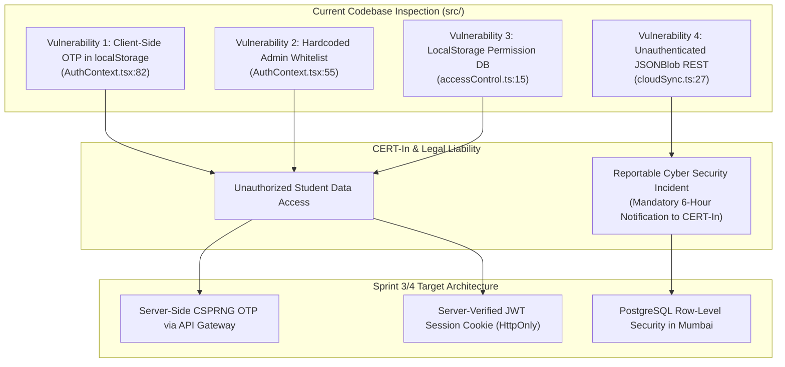

# ARNAV ABACUS ACADEMY (AAA) — STAGE 4 COMPLIANCE GATE
# S4-5: CYBERSECURITY & CERT-IN APPLICABILITY ASSESSMENT

**Project:** Arnav Abacus Academy (AAA), Wakad, Pune  
**Document Reference:** `AAA-S4-COMP-05`  
**Phase:** Stage 4 — Pre-Implementation Compliance Gate (`AAA-S4-COMPLIANCE-GATE-01`)  
**Accountable Internal Compliance Officer:** Nitin Patil  
**Date:** 04 November 2026  
**Status:** 🟡 **DRAFT CYBERSECURITY ASSESSMENT — AWAITING REVIEW**  
**Production Status:** 🔒 **STRICTLY LOCKED**  

---

## 1. Statutory Context: CERT-In Directions (28 April 2022)

Under Section 70B(6) of the Information Technology Act, 2000, the Indian Computer Emergency Response Team (CERT-In) issued Direction No. 20(3)/2022-CERT-In on 28 April 2022. 

These directions apply to **all service providers, intermediaries, data centers, body corporates, and educational entities in India**.

### 1.1 Key CERT-In Statutory Obligations Applicable to AAA
1. **Mandatory 6-Hour Incident Reporting (Direction 2.1):** Any cybersecurity incident meeting specified threshold types (including unauthorized access to IT systems/data, identity theft, data breach, or compromise of critical systems) must be formally reported to CERT-In within **6 hours** of notice.
2. **Log Maintenance for 180 Days (Direction 2.4):** System logs, network logs, and application access logs must be maintained securely for a rolling period of **180 days** within Indian jurisdiction.
3. **Synchronization of System Clocks (Direction 2.2):** All server and database clocks must be synchronized to the National Informatics Centre (NIC) or National Physical Laboratory (NPL) Network Time Protocol (NTP) servers, or traceable to Indian Standard Time (IST).

---

## 2. In-Depth Cybersecurity Audit of Existing Repository

### 2.1 Vulnerability & Threat Assessment Table

| Vulnerability ID | Code Reference | Description & Root Cause | Exploitation Scenario | CERT-In Risk Rating | Target Architecture Remediation |
| :---: | :--- | :--- | :--- | :---: | :--- |
| **VULN-01** | `src/lib/AuthContext.tsx:82-95` | **Client-Side OTP Generation & Storage:** OTP generated via `Math.random()` and saved in `localStorage.setItem("aaa_otp_...", otp)`. | An attacker inspects DevTools `localStorage` to view the 6-digit OTP without opening email; logs into any student practice account. | 🔴 **CRITICAL** | Transition OTP generation to server API (`POST /api/v1/auth/request-otp`) using CSPRNG; store ephemeral hash in server cache (5 min TTL). |
| **VULN-02** | `src/lib/AuthContext.tsx:105` | **Plaintext OTP Emitted to Console:** `console.log("DEV FALLBACK OTP:", otp)`. | Browser console leaks active login OTP on shared household devices. | 🔴 **CRITICAL** | Remove console logging of credentials; replace with generic error codes (`ERR_DISPATCH_FAILED`). |
| **VULN-03** | `src/lib/accessControl.ts:15` | **Tamperable Permissions Whitelist in LocalStorage:** `localStorage.getItem("aaa_approved_email_access_db")`. | Attacker edits local JSON string in DevTools to set `isAdmin: true` or unlock all quiz levels. | 🟠 **HIGH** | Deprecate client-side permissions; enforce server-verified JWT claims (`role: "admin"`) on API calls. |
| **VULN-04** | `src/lib/cloudSync.ts:27` | **Public Unauthenticated JSONBlob Endpoint:** `https://jsonblob.com/api/jsonBlob/019f9065...`. | Anyone with the GUID can issue a `GET` request to read all student practice records or issue a `PUT` to overwrite scores. | 🔴 **CRITICAL** | Maintain strict containment in Stage 3; execute 11-step migration framework to authenticated PostgreSQL in Sprint 4. |
| **VULN-05** | `src/lib/leadWebhook.ts:72` | **Unauthenticated Google Apps Script Ingestion:** POST request with `mode: "no-cors"`. | Spam bots issue headless flood attacks; cannot verify delivery success due to opaque HTTP response (`status: 0`). | 🟠 **HIGH** | Replace with dedicated API gateway (`POST /api/v1/leads`) protected by Cloudflare Turnstile and rate limiting. |

---

## 3. CERT-In Operational Compliance Runbook for AAA

1. **Designated Point of Contact (PoC):** **Nitin Patil** is registered as the Primary Incident Response Commander and CERT-In Point of Contact for Arnav Abacus Academy.
2. **6-Hour Breach Notification Workflow:**
   - **Triage (0–30 min):** Incident detected via log alert or parent report. Nitin Patil isolates affected systems.
   - **Forensic Assessment (30 min–2 hrs):** Determine volume of compromised records, data fields exposed, and root cause.
   - **Notification (Within 6 Hours):** If student personal data or system credentials are confirmed breached, dispatch official formal report to `incident@cert-in.org.in` in the mandated CERT-In Incident Reporting Format.
3. **180-Day Secure Log Retention Protocol:**
   - All API Gateway access logs, database query transactions, and authentication events must be streamed to an encrypted S3 bucket in the **Mumbai (`ap-south-1`) region**.
   - Logs must record: timestamp (IST / NTP synced), client IP (masked to `/24`), HTTP method, request path, response status, and user session ID. Zero parent names or phones logged in plaintext.

---

## 4. Compliance Sign-Off Status

This assessment satisfies deliverable **AAA-S4-COMP-05**. Status: **CYBERSECURITY GAPS IDENTIFIED — REMEDIATION SPRINT ROADMAP BOUND TO SPRINTS 3 & 4**.
