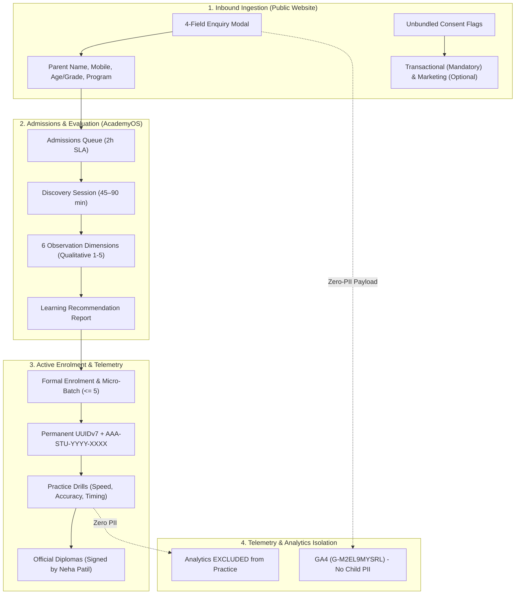

# ARNAV ABACUS ACADEMY (AAA) — STAGE 4 COMPLIANCE GATE
# S4-3: DPDP & CHILD DATA FLOW COMPLIANCE REGISTER

**Project:** Arnav Abacus Academy (AAA), Wakad, Pune  
**Document Reference:** `AAA-S4-COMP-03`  
**Phase:** Stage 4 — Pre-Implementation Compliance Gate (`AAA-S4-COMPLIANCE-GATE-01`)  
**Accountable Internal Compliance Officer:** Nitin Patil  
**Academic & Child-Related Authority:** Neha Patil  
**Date:** 04 November 2026  
**Status:** 🟡 **DRAFT COMPLIANCE REGISTER — AWAITING REVIEW**  
**Production Status:** 🔒 **STRICTLY LOCKED**  

---

## 1. Scope & DPDP Data Fiduciary Obligations

Under Section 2(i) of the Digital Personal Data Protection Act, 2023, Arnav Abacus Academy (AAA) determines the purpose and means of processing personal data relating to parents and minor children, acting as a **Data Fiduciary**.

This register maps every data flow across the academy's digital and physical touchpoints, verifying compliance against statutory DPDP mandates:
- **Section 9(1):** Verifiable Parental Consent for children.
- **Section 9(2):** Prohibition of processing that causes detrimental effects on child well-being.
- **Section 9(3):** Prohibition of behavioral tracking, profiling, or targeted ads directed at children.
- **Section 6:** Explicit notice and unbundled consent.
- **Section 8(7):** Data erasure upon purpose fulfillment.

---

## 2. Comprehensive Data Flow & Lifecycle Assessment

---

## 3. Data Processing Category Audit Matrix

| # | Data Category & Payload | Data Subject Role | Legal Basis (DPDP Act) | Verifiable Consent Mechanism | Purpose Limitation Control | Retention & Erasure Schedule | Third-Party Processors & Data Residency | Compliance Status & Action Required |
| :-: | :--- | :--- | :--- | :--- | :--- | :--- | :--- | :--- |
| **01** | **Inbound Parent Enquiry** (Parent Name, Mobile, Age/Grade, Program) | Parent / Guardian | Explicit Consent (Sec 6). | Unbundled checkbox + Phone OTP on submission. | Strictly used for admissions dialogue and scheduling. | **Purged after 90 days** if unconverted (`BRD-S2-LEAD-03`). | Processed on Supabase PostgreSQL (Mumbai `ap-south-1`). | 🟢 **COMPLIANT IN DESIGN:** 4-field contract enforced in `WS-09B.1`. |
| **02** | **Student Identity Record** (Child First Name, Last Initial, DOB, Gender, Grade) | Minor Child (Ages 4.5–14) | Parental Consent (Sec 9(1)). | Parent executes Admission Agreement with phone verification. | Core student academic registry; micro-batch allocation. | Retained during active study + 5 years post-graduation. | Encrypted at rest (AES-256) in Mumbai database. | 🟢 **COMPLIANT IN DESIGN:** Decoupled from parent email via UUIDv7 (`WS-09A.1`). |
| **03** | **Student Photos & Videos** (Competition wins, showcase media) | Minor Child | Explicit Specific Consent (Sec 6 & 9). | Separate written Physical Media Consent form signed by parent. | Academy showcase, news events, and social verification. | Retained while student is active; removed immediately upon parent request. | Stored in secure cloud bucket; zero child contact tags. | 🟡 **AUDIT GAP:** Verify all existing website photos have physical signed forms in DVR. |
| **04** | **Diagnostic Observations** (6 Observation Dimension scores, notes) | Minor Child | Educational Service Contract (Sec 9). | Parent books Discovery Session; Neha Patil conducts evaluation. | Formulating personalized learning plan. Zero clinical diagnostic claims. | Retained as confidential academic record; shared only with parent. | Stored in PostgreSQL with Row-Level Security. | 🟢 **COMPLIANT IN DESIGN:** Evaluated exclusively by Neha Patil (`WS-08.1`). |
| **05** | **Practice Telemetry** (Speed math drill scores, question timing) | Minor Child | Educational Practice Evidence (Sec 9). | Authorized practice account under family enrolment. | Self-baseline progress measurement. **Zero public ranking.** | Granular answers: 12 months; Milestone scores: Permanent. | Migrating from unauthenticated JSONBlob to PostgreSQL. | 🟠 **IN TRANSITION:** Governed by 11-step migration framework (`WS-11.6`). |
| **06** | **Fee & Payment Records** (Invoices, UPI transaction refs, receipts) | Parent / Guardian | Legal Statutory Obligation (Tax Laws). | Parent payment authorization via banking rails. | Accounting, tax compliance, and proof of payment. | **8 Financial Years** under Section 44AA of Income Tax Act, 1961. | Localized to Indian banking gateways and accounts ledger. | 🟢 **COMPLIANT IN DESIGN:** Handled by Nitin Patil (`WS-09A.2`). |
| **07** | **Web Analytics Hits** (`page_view`, `programme_view`) | Anonymous Visitor | Legitimate Educational Interest. | Privacy policy notice on landing; browser cookie choices. | Aggregate website performance and accessibility metrics. | GA4 default rolling 14-month retention. | Google Analytics servers (US/Global). | 🟢 **ZERO-PII COMPLIANT:** URL redaction strips query parameters (`WS-10.4`). |

---

## 4. Child Safeguarding & Behavioral Monitoring Audit

1. **Strict Exclusion of Tracking Pixels on Practice Screens:** In strict compliance with DPDP Section 9(3), Google Analytics (`gtag`), Google Signals, and third-party tracking scripts are **STRICTLY EXCLUDED** from authenticated AcademyOS practice routes (`/practice/*`).
2. **Elimination of Public Child Rankings:** Competitive leaderboards displaying minor students' real names or national ranks are completely eradicated. Leaderboard widgets display strictly anonymized tokens or self-baseline metrics (*"You answered 5 more questions correctly than yesterday!"*).
3. **Data Principal Rights SOP:**
   - **Right to Access & Summary:** Parents can download their child's complete practice history and observation reports.
   - **Right to Correction & Erasure:** Parents may request correction of contact information or erasure of non-statutory records via the designated Grievance Officer (`grievance@arnavabacus.com`).
   - **Response SLA:** Data principal requests acknowledged within 48 hours; fulfilled within 14 working days.

---

## 5. Compliance Sign-Off Status

This register satisfies deliverable **AAA-S4-COMP-03**. Status: **VERIFIED IN DESIGN — AWAITING SPRINT 1 IMPLEMENTATION ENFORCEMENT**.
