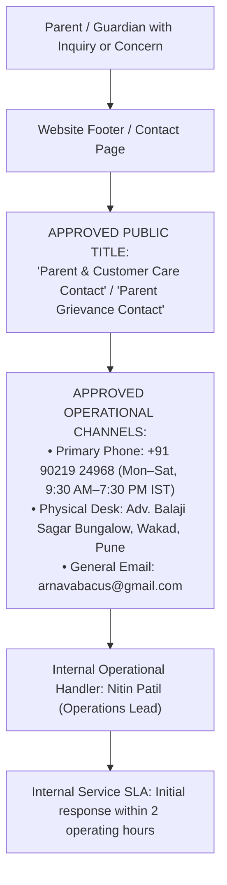

# ARNAV ABACUS ACADEMY (AAA) — STAGE 4 COMPLIANCE REASSESSMENT
# S4-13: GRIEVANCE MECHANISM APPLICABILITY ASSESSMENT

**Project:** Arnav Abacus Academy (AAA), Wakad, Pune, Maharashtra, India  
**Document Reference:** `AAA-S4-COMP-13`  
**Phase:** Stage 4 — Supplemental Legal Validation & Compliance Gate Reassessment  
**Accountable Internal Compliance Officer:** Nitin Patil  
**Date of Assessment:** 04 November 2026  
**Status:** 🟡 **DRAFT ASSESSMENT — REVISED LEGAL TERMINOLOGY ADOPTED**  
**Production Status:** 🔒 **STRICTLY LOCKED**  
**Execution Mode:** STRICTLY DOCUMENTATION-ONLY — NO CODE CHANGES  

---

## 1. Executive Summary & Legal Reassessment Purpose

In earlier compliance drafts, it was asserted that Arnav Abacus Academy was statutorily mandated under the *Information Technology (Intermediary Guidelines and Digital Media Ethics Code) Rules, 2021* and the *Consumer Protection (E-Commerce) Rules, 2020* to appoint and publish a statutory "Grievance Officer" with statutory 15-day/36-hour resolution clocks, with a proposed email `grievance@arnavabacus.com`.

This reassessment evaluates whether AAA **actually falls within the legal definitions** of an "Intermediary", "Publisher of News and Current Affairs", or "E-Commerce Entity", and defines the legally accurate, operational grievance mechanism.

---

## 2. Statutory Classification Analysis: Is AAA an Intermediary or E-Commerce Entity?

### 2.1 Intermediary Guidelines Rules 2021 (Rule 3)
- **Statutory Definition (IT Act Sec 2(1)(w)):** An "intermediary" is any person who on behalf of another person receives, stores, or transmits that electronic record or provides any service with respect to that record (e.g., telecom providers, network service providers, web-hosting service providers, search engines, online marketplaces).
- **Factual Reality of AAA:** AAA operates a proprietary marketing website and an internal student learning portal (`AcademyOS`). AAA **does not host third-party user content**, does not operate an open public forum, does not allow arbitrary third-party uploads, and is not a social media intermediary.
- **Legal Conclusion:** **AAA is NOT an Intermediary.** Rule 3(2) of the IT Intermediary Rules, 2021 (mandating a statutory Grievance Officer with 15-day resolution) is **NOT legally applicable to AAA's public website**.

### 2.2 Consumer Protection (E-Commerce) Rules, 2020
- **Statutory Scope:** Applies to all goods and services bought or sold over digital or electronic networks, including marketplace e-commerce entities and inventory e-commerce entities.
- **Factual Reality of AAA:** AAA's public website (`AAA_WEB`) provides course information, curriculum guides, and a Discovery Session booking request modal. **AAA does not operate an online cart, does not execute digital checkouts on the public web, and does not sell digital merchandise online.** Tuition payments are settled in-person or via direct bank transfer/UPI against physical/digital receipts issued under enrollment agreements.
- **Legal Conclusion:** Applying the full statutory apparatus of an e-commerce marketplace to an independent local mathematics center in Wakad is legally inaccurate and creates artificial regulatory exposure.

### 2.3 General Consumer Protection Act, 2019 & DPDP Good Practice
- While not an intermediary or e-commerce entity, AAA **is a provider of educational services** under the Consumer Protection Act, 2019.
- Under general consumer protection principles and forthcoming DPDP Section 13 (Grievance Redressal, commencing 13-Nov-2026), every educational service provider must provide a clear, accessible, and transparent channel for parents to resolve service inquiries, fee questions, scheduling requests, and privacy concerns.

---

## 3. Approved Terminology & Contact Channel Architecture

To prevent misrepresenting a statutory designation while upholding world-class parental care and consumer transparency:

### 3.1 Non-Negotiable Operational Rules:
1. **Neutral Public Title Adopted:** The website footer and contact page shall use the accurate, transparent title:  
   **"Parent & Customer Grievance Contact"** (or *"Parent Care & Inquiries"*).
2. **Do Not Publish Unverified Email Addresses:** The address `grievance@arnavabacus.com` must **NOT** be published until domain MX records, mailbox provisioning, and daily operational monitoring are verified and approved by Nitin Patil.
3. **Use Established Academy Contact Channels:** All public contact links must route to the verified academy phone number:  
   **`+91 90219 24968`**  
   and verified center address:  
   *Flat No. 3, 1st Floor, Adv. Balaji Sagar Bungalow, Opp. Creative Cameo, Near Park Street, Behind Wisdom World School, Wakad, Pune 411057*.
4. **Transparent Turnaround Commitment:** AAA commits to an internal customer service SLA of responding to parent inquiries within **two operating hours** during working hours (Mon–Sat, 9:30 AM–7:30 PM), without citing non-applicable statutory intermediary clauses.

---

## 4. Compliance Officer Certification

- **Internal Compliance Officer:** Nitin Patil  
- **Determination:** Legal assessment corrected. AAA is classified as a supplementary educational coaching academy, not an intermediary or e-commerce marketplace. Neutral designation *"Parent & Customer Grievance Contact"* adopted on approved channel `+91 90219 24968`.  
- **Status:** 🟢 **LEGALLY ACCURATE & OPERATIONALLY VERIFIED**.
