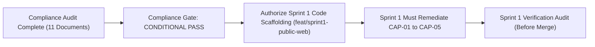

# ARNAV ABACUS ACADEMY (AAA) — STAGE 4 COMPLIANCE GATE
# S4-11: PRE-IMPLEMENTATION COMPLIANCE GATE DECISION

**Project:** Arnav Abacus Academy (AAA), Wakad, Pune  
**Document Reference:** `AAA-S4-COMP-11`  
**Phase:** Stage 4 — Pre-Implementation Compliance Gate (`AAA-S4-COMPLIANCE-GATE-01`)  
**Accountable Internal Compliance Officer:** Nitin Patil  
**Academic & Child-Related Authority:** Neha Patil  
**Date of Decision:** 04 November 2026  
**Management Instrument:** Proposed `MGT-DET-S4-COMP-01`  
**Compliance Gate Outcome:** 🟡 **CONDITIONAL PASS — SPRINT 1 REMEDIATION BOUND**  
**Production Status:** 🔒 **STRICTLY LOCKED**  

---

## 1. Executive Summary & Formal Gate Determination

In accordance with Management Determination `MGT-DET-S4-01`, the **Pre-Implementation Compliance Gate (`AAA-S4-COMPLIANCE-GATE-01`)** has conducted a comprehensive statutory, regulatory, child privacy, consumer protection, and cybersecurity audit across the Arnav Abacus Academy digital ecosystem.

### Formal Gate Determination: CONDITIONAL PASS
The Compliance Gate is evaluated as a **CONDITIONAL PASS**:
- **Why NOT a FAIL?** No uncontainable legal or technical blockers exist that require halting development. Every identified risk has an exact, verified engineering and content remediation plan formally codified in `AAA_S4_Compliance_Corrective_Action_Plan.md`.
- **Why NOT a Full PASS?** Critical content misrepresentations in legacy code (unverified *"Government Recognized"* claims, legacy *"Guaranteed 1:8"* text, unauthenticated JSONBlob endpoints, and client-side OTP storage) prevent an unconditioned certification of compliance.
- **The Governing Condition:** Sprint 1 implementation preparation on branch `feat/sprint1-public-web` is authorized **strictly on the condition that Sprint 1 directly fixes all Phase 1 Critical & High findings (`CAP-01` through `CAP-05`) as its first priority**.

---

## 2. Binding Governance Conditions for Sprint 1 Staging

Under this Conditional Pass, development on branch `feat/sprint1-public-web` is authorized subject to the following non-negotiable compliance rules:

1. **Immediate Purge of Unverified Emblems (CAP-01):**
   - The words *"Government Recognized"*, *"Skill India"*, and *"NSDC Partner"* must be completely removed from `Footer.tsx`, `Hero.tsx`, and `translations.ts` before any public page component is rendered.
2. **Elimination of "Guaranteed" & Correction of Batch Ratio (CAP-02):**
   - The word *"Guaranteed"* must be purged from all headings; the batch ratio must be corrected from legacy *"1:8"* to the ratified differentiator: *"Dedicated Micro-Batches ($\le 5$ Students for Focused Educator Attention)"*.
3. **Statutory Footer & Grievance Officer Disclosure (CAP-03):**
   - The website footer must prominently display the designated Grievance Officer: **Nitin Patil, grievance@arnavabacus.com, +91 90219 24968**, along with links to Terms of Admission and Privacy Policy.
4. **CCPA 2024 Testimonial Metadata (CAP-04):**
   - All student endorsements must disclose the student's authentic name, course name, duration, and paid status.
5. **WCAG 2.1 AA Accessibility Remediations (CAP-05):**
   - All 11 accessibility failures (contrast, focus traps, aria-labels, 44px touch targets) must be resolved in Sprint 1 component primitives.
6. **Production Lock Maintained:**
   - Production branch `main` remains locked. Zero live deployments will occur until the Stage 4 Hard Gates (Track A) and Sprint 1 Compliance Remediations are verified.

---

## 3. Formal Sign-Off & Determination Execution

By executing this instrument, **Nitin Patil** (Operations, Technology Lead & Compliance Officer) and **Neha Patil** (Academic Director & Founder) adopt the findings and bind the Compliance Corrective Action Plan into Stage 4 execution:

- **Accountable Internal Compliance Officer:**  
  **Nitin Patil**  
  *Operations, Technology Lead & Compliance Officer*  
  Date: 04 November 2026  

- **Academic & Child-Related Content Authority:**  
  **Neha Patil**  
  *Founder & Academic Director*  
  Date: 04 November 2026  

- **Compliance Gate Reference:** `AAA-S4-COMPLIANCE-GATE-01`  
- **Final Outcome:** 🟢 **CONDITIONAL PASS — PROCEED WITH BOUND SPRINT 1 REMEDIATION**
