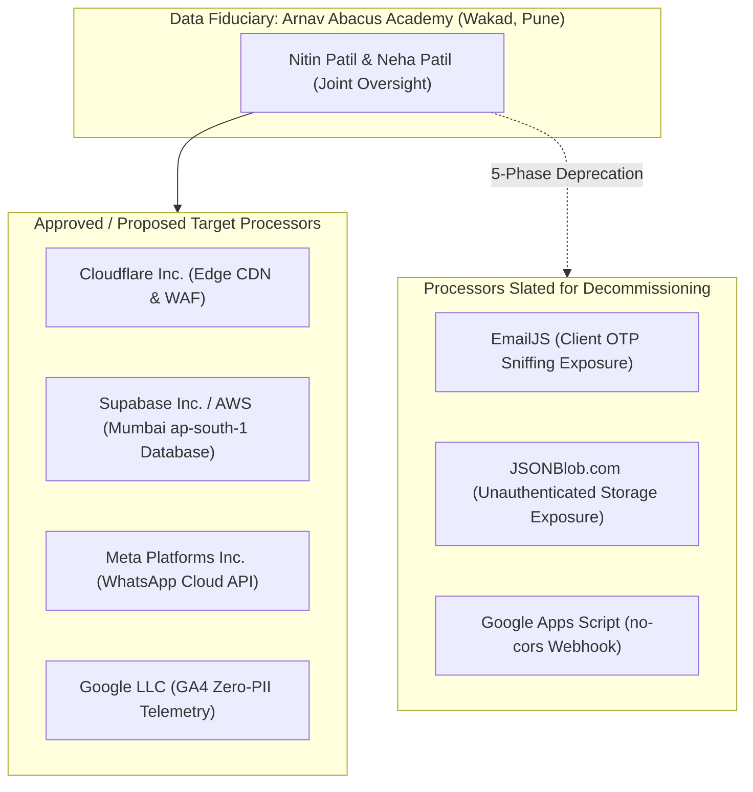

# ARNAV ABACUS ACADEMY (AAA) — STAGE 4 COMPLIANCE GATE
# S4-7: THIRD-PARTY & DATA PROCESSOR COMPLIANCE REGISTER

**Project:** Arnav Abacus Academy (AAA), Wakad, Pune  
**Document Reference:** `AAA-S4-COMP-07`  
**Phase:** Stage 4 — Pre-Implementation Compliance Gate (`AAA-S4-COMPLIANCE-GATE-01`)  
**Accountable Internal Compliance Officer:** Nitin Patil  
**Date:** 04 November 2026  
**Status:** 🟡 **DRAFT PROCESSOR REGISTER — AWAITING REVIEW**  
**Production Status:** 🔒 **STRICTLY LOCKED**  

---

## 1. Scope & Statutory Data Processor Governance

Under Section 8(2) of the Digital Personal Data Protection Act, 2023, a Data Fiduciary may engage a **Data Processor** to process personal data on its behalf only under a valid contract. The Data Fiduciary remains **ultimately responsible** for ensuring the processor adheres to statutory data protection standards.

This register conducts a complete compliance and security review of all eight external vendors, cloud services, and third-party APIs integrated into Arnav Abacus Academy's digital ecosystem.

---

## 2. Master Third-Party Data Processor Register

### 2.1 Comprehensive Data Processor Evaluation Matrix

| Provider / Service | Service Purpose | Data Category Processed | Data Residency / Physical Location | Contractual DPA & Privacy Terms | Security & Access Controls | Free-Tier Limitations & Contractual Bounds | Deprecation / Remediation Roadmap |
| :--- | :--- | :--- | :--- | :--- | :--- | :--- | :--- |
| **1. Cloudflare, Inc.** | Edge CDN, DNS, WAF, Turnstile CAPTCHA, Pages static hosting. | Anonymized edge request logs, client IP (masked), routing tokens. | Global Anycast edge nodes; local edge caching in **Pune & Mumbai**. | Standard Cloudflare Customer Agreement with GDPR & Indian DPA addendum. | ISO 27001, SOC 2 Type II, automatic TLS 1.3, DDoS mitigation. | Unlimited bandwidth on Free Tier; no commercial usage prohibitions. | **Active & Retained:** Target frontend edge platform (`WS-11.1`). |
| **2. Supabase, Inc. (hosted on AWS)** | Managed PostgreSQL database hosting, Auth, connection pooler. | Student records, parent contact PII, attendance, fees, practice attempts. | **AWS Mumbai (`ap-south-1`), India.** | Supabase Terms of Service; Data Processing Addendum (DPA) executed. | AES-256 encryption at rest; TLS 1.3 in transit; PostgreSQL Row-Level Security (RLS). | Free Tier: 500MB DB, 50k users (sufficient for 2–3 years). Upgrades to \$25/mo Pro. | **Active & Retained:** Target authoritative persistence layer (`WS-11.3`). |
| **3. Meta Platforms, Inc.** | WhatsApp Cloud API for automated transactional notifications. | Parent mobile phone (E.164), transactional template parameters (booking date, invoice ref). | Global Meta data infrastructure; localized routing to Indian telecom operators. | Meta Business Terms & WhatsApp Business Data Processing Terms. | End-to-end encrypted messaging infrastructure; pre-approved Meta message templates. | Wholesale per-conversation pricing ($\approx ₹0.40\text{--}₹0.80$/msg). Controlled volume. | **Active & Retained:** Hybrid transactional model (`WS-09B.6`). |
| **4. Google LLC (Google Analytics 4)** | Website usage analytics and event telemetry (`G-M2EL9MYSRL`). | Anonymized event names, sanitized page paths. **Strict Zero-PII.** | Google global data centers. | Google Ads Data Processing Terms; Google Analytics Terms of Service. | SOC 2 Type II, TLS 1.3. Google Signals ad personalization disabled. | Free tier: 10M events/month (far exceeds AAA requirements). | **Active & Retained:** Governed by URL query redaction filter (`WS-10.4`). |
| **5. EmailJS** | Legacy OTP email dispatch in prototype (`AuthContext.tsx`). | Parent email, student name, 6-digit OTP. | Global third-party cloud. | Standard EmailJS privacy terms; no specialized minor DPA. | Public client key in frontend bundle; console log leak on failure. | Free tier: 200 emails/month. Rate limits cause silent OTP dispatch failures. | 🔴 **DEPRECATE:** Replace with server-side CSPRNG OTP in Sprint 3. |
| **6. JSONBlob.com** | Cross-device practice attempt sync in prototype (`cloudSync.ts`). | Student/parent email (`userId`), student name, scores, completed timestamps. | Unverified third-party public cloud server. | No contractual agreement or DPA. Public free utility. | **Zero Access Controls.** Completely unauthenticated read/write via public GUID. | Free public utility with zero availability SLA. Severe risk of data wipe or leak. | 🔴 **DEPRECATE:** Governed by 11-step migration framework to PostgreSQL in Sprint 4. |
| **7. Google Apps Script** | Legacy lead webhook ingestion in prototype (`leadWebhook.ts`). | Parent name, phone, age bracket, program, notes. | Google Workspace cloud (Google Sheet). | Bound to Nitin Patil's Google Workspace account. | Unauthenticated `no-cors` endpoint; vulnerable to spam bot floods. | Script execution quotas (20,000 req/day). Opaque HTTP response (`status: 0`). | 🔴 **DEPRECATE:** Replace with authenticated API gateway (`POST /api/v1/leads`) in Sprint 3. |

---

## 3. Subprocessor Risk & Statutory Data Residency Assessment

1. **Indian Data Residency Compliance:** Under the approved Stage 3 Master Architecture, all authoritative student records, family contact details, diagnostic assessment rubrics, and financial records reside exclusively in the **Mumbai (`ap-south-1`) region** on Supabase / AWS PostgreSQL infrastructure.
2. **Zero Minor Data Export:** No identifiable personal data belonging to minor children is transferred to offshore servers. GA4 receives strictly anonymized telemetry stripped of all personal identifiers.
3. **Vendor Deprecation Schedule:** The three legacy prototype processors (EmailJS, JSONBlob, and Google Apps Script) are formally scheduled for phased decommissioning in Sprints 3 and 4, eliminating AAA's primary external vulnerabilities.

---

## 4. Compliance Sign-Off Status

This register satisfies deliverable **AAA-S4-COMP-07**. Status: **PROCESSOR AUDIT COMPLETE — DEPRECATION OF LEGACY TOOLS BOUND TO SPRINTS 3 & 4**.
