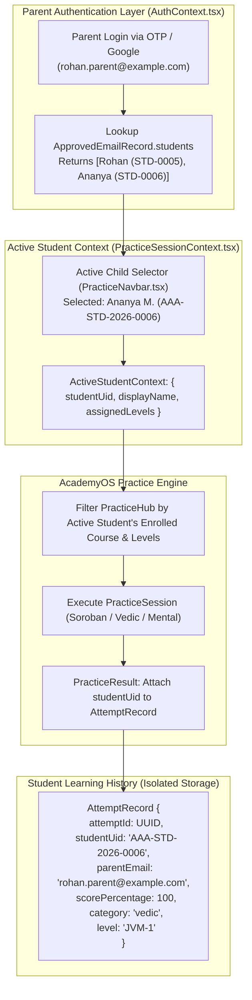

# ARNAV ABACUS ACADEMY (AAA) — ARCHITECTURAL DESIGN
## Sibling Practice Attribution & Student Learning History Isolation Design

**Document Reference:** `AAA_SIBLING_PRACTICE_ATTRIBUTION_DESIGN`  
**Governing Directive:** AAA Management Directive (05-Nov-2026)  
**Governing Baseline:** Hardening Item `QA-ROS-01` (`OBS-WS18-01`)  
**Lead Architect:** Nitin Patil (Operations, Tech & Compliance)  
**Academic Lead:** Neha Patil (Founder & Academic Director)  
**Target Environment:** AcademyOS Practice Platform (`/practice/*`)  
**Status:** 🟡 **DESIGN PROPOSAL ONLY — IMPLEMENTATION PAUSED PENDING RATIFICATION**  

---

## 1. Problem Statement & Audited Reality

In `feat/sprint3-integration` commit `5c134a8`, hardening item **`QA-ROS-01`** solved the data collision problem at the admissions and storage layer by introducing:
```typescript
export interface EnrolledSiblingSummary {
  studentUid: string;
  studentName: string;
  assignedLevels?: string[];
  enrolledAt?: string;
}
```
This ensures that `rohan.parent@example.com` can store both Rohan M. (`AAA-STD-2026-0005`) and Ananya M. (`AAA-STD-2026-0006`) without data overwrites.

### The Critical Unresolved Practice Platform Gap:
A rigorous inspection of `src/pages/PracticeHub.tsx`, `src/pages/PracticeSession.tsx`, `src/pages/PracticeResult.tsx`, `src/lib/cloudSync.ts`, and `src/lib/AuthContext.tsx` reveals:
1. **User Identity Keyed Strictly on Parent Email:**
   In `src/lib/AuthContext.tsx`, `User.id` and `User.email` are the parent's email.
2. **Practice Attempts Lack Student Attribution:**
   In `src/lib/cloudSync.ts`, the `AttemptRecord` interface is defined as:
   ```typescript
   export interface AttemptRecord {
     setId: string;
     category: string;
     level: string;
     scorePercentage: number;
     timeTakenSeconds: number;
     completedAt: string;
     userId: string;    // Stores parent email
     userName: string;  // Stores "Rohan M. & Ananya M."
     userEmail: string; // Stores parent email
   }
   ```
   **There is no `studentUid` field on `AttemptRecord`.**
3. **Overwritten Accuracy & Streak Statistics:**
   When Rohan practices Abacus and Ananya practices Vedic Math on the same family tablet:
   - Both attempts are saved with `userId: "rohan.parent@example.com"`.
   - Practice Hub calculates total attempts, accuracy percentage, and level mastery by filtering `attempts.filter(a => a.userEmail === user.email)`.
   - Rohan's speed calculations are merged with Ananya's calculations.
   - If Ananya scores 100% in Vedic and Rohan scores 60% in Abacus, the parent dashboard displays a blended score that obscures both children's genuine academic progress.

### Authoritative Architecture Finding:
$$\mathbf{The\ current\ practice\ platform\ CANNOT\ safely\ support\ two\ siblings\ practicing\ under\ one\ parent\ login.}$$
In accordance with management instructions:
> *"Do not enable multi-sibling practice functionality until student-level practice attribution is verified."*

---

## 2. Architectural Design: Student-Centric Practice Attribution



---

## 3. Detailed Technical Specifications

### 3.1 Enhanced Attempt Record Model (`src/lib/cloudSync.ts`)
Add `studentUid` as a mandatory attribution key while preserving `userId` for backwards compatibility:

```typescript
export interface AttemptRecord {
  attemptId: string;           // UUIDv4 unique attempt identifier
  studentUid: string;          // Authoritative Permanent Student ID (e.g. "AAA-STD-2026-0006")
  studentName: string;         // Individual child's name (e.g. "Ananya M.")
  parentEmail: string;         // Parent account email (e.g. "rohan.parent@example.com")
  
  // Practice Parameters
  setId: string;
  setTitle: string;
  category: "abacus" | "vedic" | "mental";
  level: string;               // e.g. "JVM-1" or "JR-1"
  mode: PracticeMode;
  totalQuestions: number;
  correctCount: number;
  wrongCount: number;
  unansweredCount: number;
  scorePercentage: number;
  timeTakenSeconds: number;
  completedAt: string;         // ISO-8601 UTC

  // Legacy compatibility fields (deprecated but preserved for old clients)
  userId: string;              // Mirrors parentEmail
  userName: string;            // Mirrors studentName
  userEmail: string;           // Mirrors parentEmail
}
```

### 3.2 Active Student Selection Context (`src/lib/ActiveStudentContext.tsx`)
Create a lightweight React context mounted under `AuthProvider`:

```typescript
export interface ActiveStudentContextProps {
  activeStudentUid: string | null;
  activeStudentName: string | null;
  enrolledStudents: EnrolledSiblingSummary[];
  selectStudent: (studentUid: string) => void;
  isMultiSibling: boolean;
}
```
- **Default Selection Logic:**
  - If parent account has **1 student**: automatically selected. Zero UI friction for single-child families.
  - If parent account has **$\ge 2$ students**:
    - Restore previously selected sibling from `sessionStorage.getItem("aaa_active_student_uid")`.
    - If no session exists, default to the first sibling and prompt the parent with an un-obtrusive selection badge.

### 3.3 UI Child Switcher in `PracticeNavbar.tsx`
When `isMultiSibling === true`, render a clean pill selector in the header:
- **Display:** Displays avatar with child's name: `[ 👧 Practicing: Ananya M. ▼ ]`
- **Dropdown:** Lists all registered siblings:
  - `👧 Ananya M. (Vedic Mathematics — Junior Level 1)`
  - `👦 Rohan M. (Abacus Mathematics — Soroban Level 1)`
- **Behavior:** Toggling the dropdown immediately re-filters:
  - Accessible levels in Practice Hub.
  - Accuracy and streak statistics.
  - Recent attempt history.

### 3.4 Student-Specific Practice History Queries
In `src/pages/PracticeHub.tsx` and `src/pages/PracticeResult.tsx`:
```typescript
// Filter attempts strictly by the active student's permanent UID
const studentAttempts = allAttempts.filter((a) => {
  if (a.studentUid) {
    return a.studentUid === activeStudentUid;
  }
  // Backwards compatibility fallback for legacy single-student records:
  return a.userEmail?.toLowerCase() === currentUser?.email.toLowerCase();
});
```

---

## 4. Backwards Compatibility & Data Migration Strategy

| Account Type | Data State | System Handling | Migration Risk |
| :--- | :--- | :--- | :--- |
| **Existing Single-Child Accounts** | `ApprovedEmailRecord` has `studentName: "Aarav"`, `students: undefined`. | Automatic hydration creates `students: [{ studentUid: "AAA-STD-LEGACY", studentName: "Aarav" }]`. | **Zero Risk.** Single child experiences identical UI and uninterrupted practice. |
| **Legacy Historical Attempts** | Stored attempts in `localStorage` lack `studentUid`. | Legacy attempts without `studentUid` are assigned to the primary/legacy student profile. | **Low Risk.** No historical data deleted; legacy attempts remain visible to the primary student. |
| **New Multi-Sibling Accounts** | Roster bridge creates `students: [Sibling1, Sibling2]`. | Sibling profiles require active student selection. All new attempts stamped with unique `studentUid`. | **Zero Risk.** Complete data isolation guaranteed from day one. |

---

## 5. Implementation Roadmap (Post-Approval)

1. **Sprint Allocation:** Schedule implementation during **Phase 2 ERP Staging Pass**.
2. **Boundary Protection:** Implement strictly inside `src/lib/` and practice components with 100% test coverage before enabling multi-sibling enrollment in public admissions.
3. **Current Status:** Multi-sibling practice UI is **DISABLED** until this design receives formal sign-off.
