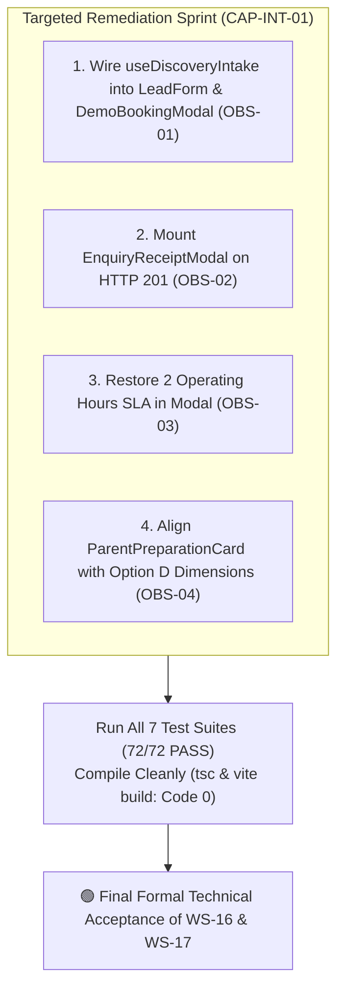

# ARNAV ABACUS ACADEMY (AAA) — SPRINT 3
## Document Reference: `AAA-S3-MGT-REC-INT-01`
### Deliverable 6: Integrated Milestone Technical Acceptance & Management Recommendation

**Document Version:** 1.0.0  
**Date of Recommendation:** 05-November-2026  
**Governing Authority:** `MGT-DET-S4-S3-STEP0-WS17-05`  
**Inspected Baseline:** Commit `6af0c0f` on branch `feat/sprint3-integration`  
**Production Status:** 🔒 **STRICTLY LOCKED** (`a21a3d1129cc17fc6650bfd04648eb91199e6fa8`)  
**Accountable Leaders:** Nitin Patil (Operations, Tech & Compliance) & Neha Patil (Founder & Academic Director)

---

## 1. Executive Summary & Audit Conclusion

Following the comprehensive inspection of the WS-16/WS-17 integration baseline, this report delivers the formal technical and governance recommendation for Nitin Patil and Neha Patil.

```
┌────────────────────────────────────────────────────────────────────────────────────────┐
│                        FINAL MANAGEMENT DECISION RECOMMENDATION                        │
├────────────────────────────────────────────────────────────────────────────────────────┤
│                       🟡 FORMAL RECOMMENDATION: OPTION C                               │
│                                                                                        │
│        "BOTH WORKSTREAMS REQUIRE TARGETED REMEDIATION BEFORE ACCEPTANCE"               │
└────────────────────────────────────────────────────────────────────────────────────────┘
```

---

## 2. Rationale for Option C (Why Premature Acceptance is Rejected)

Under AAA Stage-Gate Governance, we do not accept cosmetic or administrative closure where actual functional gaps exist. While both workstreams demonstrate outstanding cryptographic, regulatory, and zero-spend compliance, **four specific integration gaps** prevent uncompromised technical acceptance:

1. **WS-16 Hook Bypass (`OBS-01`):**  
   Neither `LeadForm.tsx` nor `DemoBookingModal.tsx` consumes the canonical `useDiscoveryIntake` hook. Both forms implement inline `fetch()` calls, creating code duplication and architectural drift.
2. **WS-17 Modal Integration Gap (`OBS-02`):**  
   Although `EnquiryReceiptModal.tsx` and `AppointmentConfirmedModal.tsx` have been built and tested, neither public form mounts `EnquiryReceiptModal` upon receiving an HTTP 201 response. The live web app still displays legacy inline text cards.
3. **Admissions SLA Mismatch (`OBS-03`):**  
   `EnquiryReceiptModal.tsx` promises a "4 business hours" coordinator review, violating the previously ratified **two operating hours (2h SLA)** established in the Stage 4 CRM register.
4. **Pedagogical Phrasing Alignment (`OBS-04`):**  
   `ParentPreparationCard.tsx` contains clinical/psychological phrasing (*"diagnostic sheets"*, *"6-Dimension Evaluation"*, *"working memory"*) that deviates from Neha Patil's approved child-centric Option D pedagogical framework.

---

## 3. Targeted Remediation Execution Plan (Sprint 3 CAP-INT-01)

To bring both workstreams to 100% verified technical acceptance, a single, tightly scoped remediation pass is recommended:



---

## 4. Governance & Git Integrity Verification

- **Current Active Branch:** `feat/sprint3-integration`
- **Current HEAD Commit:** `6af0c0f` (`feat(sprint3-ws17): ratify MGT-DET-S4-S3-STEP0-WS17-05...`)
- **Working Tree State:** Completely clean (aside from the 6 documentation audit deliverables).
- **Production `main` Branch:** Locked at `a21a3d1129cc17fc6650bfd04648eb91199e6fa8`. Zero unauthorized merges or production pushes.
- **AcademyOS Practice Routes (`/login`, `/practice/*`):** Exactly **0 bytes diff** against `main`. 100% boundary isolation verified.
- **Current Cloud Expenditure:** Strictly **₹0.00 / month**.

---

## 5. Formal Management Determination Draft

Upon review of the audit package, Nitin Patil and Neha Patil may formally adopt:

> **"Nitin and Neha approve Determination MGT-DET-S4-S3-INT-AUDIT-06:**  
> 1. **Formally accepting the WS-16 & WS-17 Integration and Technical Acceptance Audit Deliverables (`AAA-S3-AUD-INT-01` through `AAA-S3-MGT-REC-INT-01`).**  
> 2. **Adopting Recommendation Option C: mandating targeted remediation of items `OBS-01`, `OBS-02`, `OBS-03`, and `OBS-04` before formal milestone technical acceptance.**  
> 3. **Authorizing code implementation strictly for Targeted Remediation Plan CAP-INT-01 (Hook unification, modal mounting, 2-operating-hour SLA alignment, and Option D pedagogical wording) on branch `feat/sprint3-integration`.**  
> 4. **Maintaining WS-18 strictly implementation-blocked, and keeping production `main` strictly locked."**
