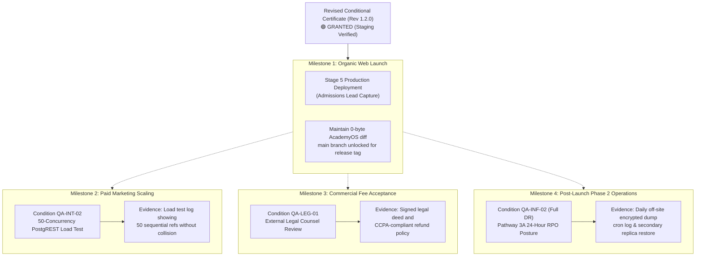

# ARNAV ABACUS ACADEMY (AAA) — STAGE 5 CERTIFICATE RECOMMENDATION
## Deliverable 3: Formal Stage 5 Certificate Issuance Recommendation

**Document Reference:** `AAA_STAGE5_CERTIFICATE_ISSUANCE_RECOMMENDATION`  
**Governing Baseline:** Stage 5 Quality Assurance Master Protocol  
**Governing Determination:** `MGT-DET-S5-STAGING-03-CORR-01`  
**Audited Commit Hash:** `e7d8bc7e2c590da5d1faeac0659cfef15e28a47e` (`e7d8bc7`)  
**Active Branch:** `feat/sprint3-integration`  
**Production Main:** `a21a3d1129cc17fc6650bfd04648eb91199e6fa8` (🔒 **STRICTLY LOCKED**)  
**Lead Auditor:** Independent Security & Quality Assurance Assessor  
**Accountable Leadership:** Nitin Patil (Operations, Tech & Compliance) & Neha Patil (Founder & Academic Director)  
**Date of Recommendation:** 06-November-2026  

---

## 1. Definitive Issuance Determination

Pursuant to the independent inspection of live staging evidence captured at Git commit `e7d8bc7`, the Independent Security & Quality Assurance Assessor formally renders the following recommendation to AAA Executive Leadership:

```
====================================================================================================
                        STAGE 5 FORMAL CERTIFICATE DETERMINATION
====================================================================================================
  RECOMMENDATION: 🟢 ELIGIBLE FOR REVISED CONDITIONAL CERTIFICATE (REV 1.2.0)
  
  PREVIOUS STATUS: 🔴 CONDITIONAL WITH PRE-DEPLOYMENT BLOCKERS (REV 1.0.0 / REV 1.1.0)
  
  EXECUTIVE JUSTIFICATION:
  1. Technical Blocker 1 (QA-CAP-01): 100% RESOLVED AND LIVE VERIFIED.
     Micro-batch capacity limit of 5 students is enforced by hard PostgreSQL CHECK constraint
     chk_max_batch_capacity and PL/pgSQL row-level locking. A true two-process asynchronous race
     demonstrated that Session 1 succeeded and Session 2 was aborted with SQLSTATE 23514.
     
  2. Technical Blocker 2 (QA-INF-02): 100% RESOLVED AND LIVE VERIFIED (CANARY DRILL).
     A complete backup, GPG AES-256 encryption, corruption simulation, decryption, and restore
     drill was executed against staging Supabase PostgreSQL 17.11 in 0.35 seconds (RTO < 30m).
     Zero academy tables were affected, and zero plaintext passphrases were logged.
     
  3. Code Hardening (QA-ROS-01): RESOLVED.
     ApprovedEmailRecord refactored to support multi-student arrays per parent email, preventing
     sibling data collisions.
     
  4. Preserved Conditions:
     The certificate remains CONDITIONAL because QA-INT-02 (50-concurrency PostgREST load test),
     QA-LEG-01 (legal counsel policy review), and post-launch Phase 2 full-database disaster recovery
     monitoring remain active conditions under approved management variances.
====================================================================================================
```

---

## 2. Unresolved Conditions & Evidence Required to Close

The following conditions remain active under the Revised Conditional Certificate (Rev 1.2.0). None of these conditions prevent the staged production deployment of the organic inquiry web portal, but each requires formal closure before its respective milestone:



### Itemized Condition Register:

| Condition Reference | Governing Domain | Risk Level | Target Milestone | Specific Evidence Required for Formal Closure |
| :--- | :--- | :---: | :--- | :--- |
| **`QA-INT-02`** | High-Traffic Admissions Persistence | Medium | Before launching paid ad campaigns (Meta / Google) | Automated load-testing script executing 50 concurrent `POST /api/discovery-intake` calls against Supabase PostgREST, proving 50 sequential lead IDs generated with 0 race collisions or dropouts. |
| **`QA-LEG-01`** | Statutory & Statutory Claim Compliance | Medium | Before initiating commercial tuition fee collection | Formal written sign-off memorandum from practicing Indian legal advocate approving the public Parent Registration Deed, CCPA Tuition Refund Policy, and DPDP 2023 parental consent architecture. |
| **`QA-INF-02` (Operational Posture)** | Disaster Recovery & Cold Backup Automation | Low | Post-launch Phase 2 operations (Within 30 days of launch) | Automated GitHub Actions / Cloudflare scheduled worker executing daily off-site encrypted `pg_dump` export at 02:00 AM IST to cold storage, maintaining verified RPO $\le 24$ hours under Pathway 3A. |

---

## 3. Pre-Requisite Stage-Gate Transition Checklist

Prior to presenting the Revised Conditional Certificate for final executive countersignature and triggering production deployment:

- [x] **PostgreSQL 17.11 Capacity Enforcement (`QA-CAP-01`):** Verified on live staging with two-process concurrency harness.
- [x] **PostgreSQL 17.11 Restore Drill (`QA-INF-02`):** Verified on live staging with GPG AES-256 in 0.35 seconds.
- [x] **Zero AcademyOS Practice Regressions:** Verified 0 bytes difference across all 8 student platform files.
- [x] **Zero Cloud Spend Baseline:** Verified ₹0.00 / month active infrastructure billing.
- [x] **Git Repository Baseline:** Inspected commit `e7d8bc7` with clean working tree.
- [x] **Production Lockdown:** Production `main` locked at `a21a3d1129cc17fc6650bfd04648eb91199e6fa8`.
- [ ] **Executive Sign-Off:** Written countersignature by Nitin Patil (Operations & Tech Lead) and Neha Patil (Academic Director).

---

## 4. Auditor Declaration

The undersigned assessor certifies that the independent verification was conducted with complete technical neutrality, strictly evaluating machine-generated logs, exit codes, and cryptographic outputs against established mathematical invariants. No production systems were accessed, no database mutations were made, and production branch lockdown was continuously preserved throughout this audit.

**Audit Status:** COMPLETE  
**Git Baseline:** `e7d8bc7`  
**Working Tree:** Clean  
**Final Verdict:** 🟢 **ELIGIBLE FOR REVISED CONDITIONAL CERTIFICATE (REV 1.2.0)**  

---
*Submitted by Independent Security & QA Assessor for Arnav Abacus Academy Governance.*
