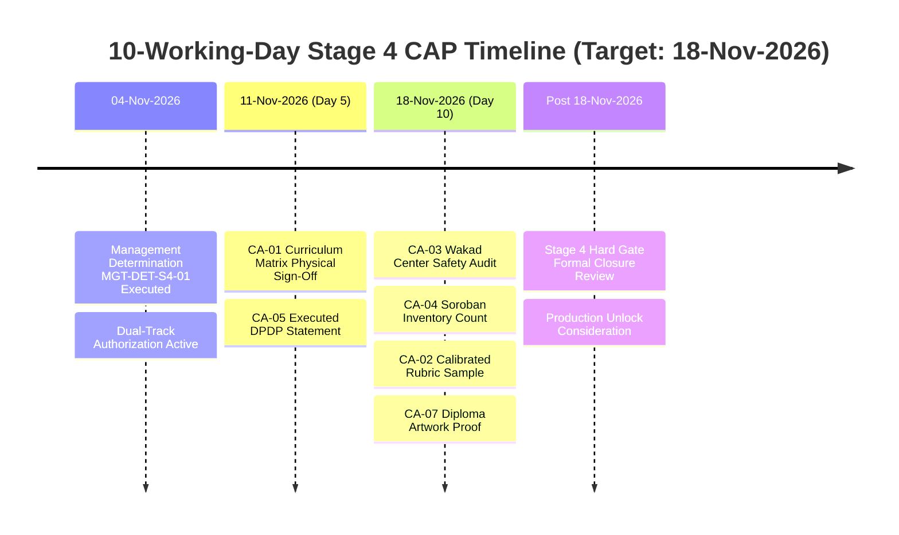

# AAA — SPRINT 1 EVIDENCE AND OPEN ACTION REGISTER
## Master Audit Findings, Evidence Traceability & Corrective Action Tracking

**Document Reference:** `AAA-S1-REG-EVID-ACT-01`  
**Governing Authority:** Nitin Patil (Compliance Officer) & Neha Patil (Academic Director)  
**Active Branch:** `feat/sprint1-public-web`  
**Date:** 04 November 2026  
**Status:** 🟡 **ACTIVE REGISTER — TRACK A CAP RUNNING IN PARALLEL**

---

## 1. Physical & Statutory Evidence Tracking Ledger

The following register tracks the documentary and physical evidence items required to convert all conditional approvals into final, unconditional stage certifications:

| Evidence ID | Requirement / Scope | Responsible Owner | Reviewer | Current Physical State | Target Resolution Date | Statutory / Governance Rationale |
| :---: | :--- | :---: | :---: | :---: | :---: | :--- |
| **EVD-S1-ADDR-01** | **Bungalow Physical Address Statutory Proof:** Documentary proof for granular street coordinates (*Balaji Sagar Bungalow, Wakad, Pune 411057*). | Nitin Patil | Management | 🟡 In Progress (Locality confirmed via AVAS certificate; utility/lease document upload pending) | 18-Nov-2026 | Mandated to ensure public website address is backed by physical property documentation. |
| **EVD-S1-CCPA-02** | **Physical Testimonial Signed Consent Slips:** Physical paper consent forms from parents for 23 published student feedback entries. | Nitin Patil & Neha Patil | Compliance | 🟡 In Progress (Digital copy remediated with composite tag & CCPA disclosure; paper slips on-site) | 18-Nov-2026 | Mandated by CCPA Coaching Guidelines 2024 for student testimonials. |
| **EVD-S1-SAFE-03** | **Wakad Center Safety Inspection & Equipment:** On-site log of medical first-aid kit, chemical fire extinguisher service tag, and child-safe seating photos. | Nitin Patil | Neha Patil | 🔴 Audit Pending (Physical center inspection at Balaji Sagar Bungalow scheduled) | 18-Nov-2026 | Mandated under Stage 4 Hard Gate S4-HG-04 prior to in-person parent bookings. |
| **EVD-S1-INVT-04** | **Soroban & Sensory Material Physical Count:** Inventory audit sheet verifying $\ge 15$ pristine student frames + 1 demonstration Soroban frame. | Neha Patil | Nitin Patil | 🔴 Audit Pending (Physical count at center scheduled) | 18-Nov-2026 | Mandated under Stage 4 Hard Gate S4-HG-05 to guarantee pedagogical resource adequacy. |
| **EVD-S1-DPDP-05** | **Executed DPDP Compliance Officer Statement:** Formally signed internal compliance determination resolving legal questions LQ-01 to LQ-04. | Nitin Patil (Compliance Officer) | Neha Patil | 🟡 Draft Complete (Pending formal physical signature) | 11-Nov-2026 | Mandated under Stage 4 Hard Gate S4-HG-06 to govern child data workflows. |
| **EVD-S1-SYLL-06** | **Master Curriculum Structure Matrix Sign-Off:** Formally executed paper matrix covering progressive syllabus levels across all 5 courses. | Neha Patil | Nitin Patil | 🟡 Draft Complete (Pending formal physical signature) | 11-Nov-2026 | Mandated under Stage 4 Hard Gate S4-HG-01 to govern all published claims. |
| **EVD-S1-DIPL-07** | **Physical Diploma Artwork Master Proof:** Approved and signed physical artwork design for official course completion diplomas. | Neha Patil | Nitin Patil | 🔴 Design Pending (Template proof in drafting) | 18-Nov-2026 | Mandated under Stage 4 Hard Gate S4-HG-07 to preserve certificate distinction. |

---

## 2. Open Technical, Architectural & Operational Questions

| Item ID | Category | Question / Scope | Current Operational Handling (Sprint 1) | Planned Architectural Resolution (Sprint 2 / 3) | Assigned Owner |
| :---: | :--- | :--- | :--- | :--- | :---: |
| **OP-Q-01** | **Admissions Intake** | How are discovery session leads ingested without compromising child data? | Handled via direct, user-initiated WhatsApp link (`https://wa.me/919021924968`) with clean unbundled consent. | Architecture design for 14-state server-side Lead CRM and webhook ingestion in **Sprint 2**. | Nitin Patil |
| **OP-Q-02** | **Lead Data Retention** | What is the statutory retention duration for non-enrolled inquiry records? | 90-day retention proposal drafted; zero persistent server database currently deployed. | Privacy architecture in **Sprint 2 (WS-14)** defining automated DPDP purge mechanism. | Nitin Patil |
| **OP-Q-03** | **Observation Rubrics** | Which observation rubric dimensions govern the Discovery Session? | Existing approved 6 dimensions retained in documentation; change proposal drafted for Neha's review. | Formal Academic Review by Neha Patil in **Sprint 2 (WS-12)**. | Neha Patil |
| **OP-Q-04** | **OTP & Authentication** | Are live OTP credentials or live SMS gateways required in staging? | Strictly mocked and isolated. No live credentials present in repository. | Production SMS/WhatsApp API gateway architecture planned for **Sprint 3**. | Nitin Patil |

---

## 3. Maintenance of the 10-Working-Day CAP Calendar

