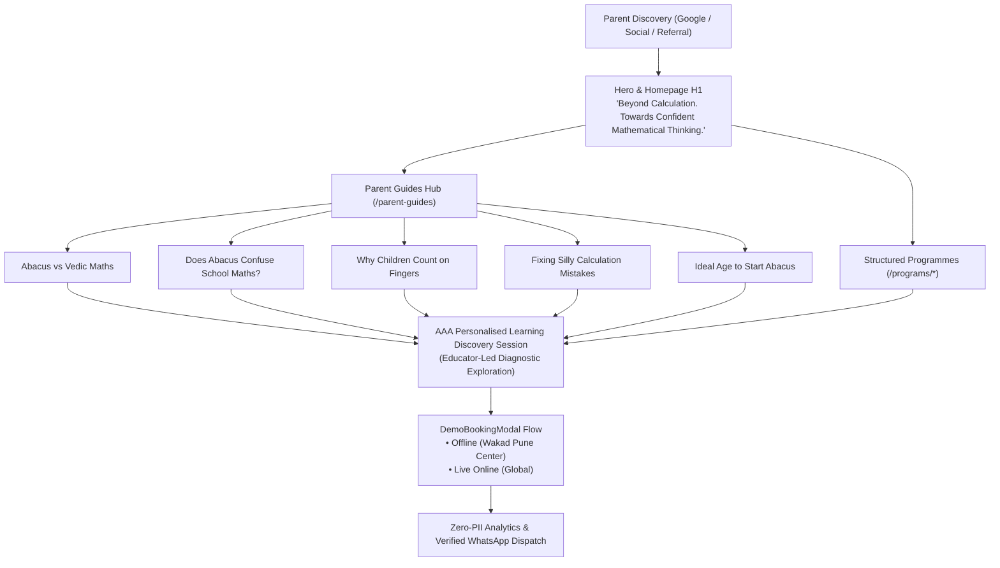

# AAA — SPRINT 1 PARENT EXPERIENCE & PARENT GUIDE IMPLEMENTATION PLAN

**Document Reference:** AAA-S4-IMP-PLAN-PE-01  
**Management Determinations:** `MGT-DET-S4-COMP-02` & `MGT-DET-S4-EVID-03`  
**Active Feature Branch:** `feat/sprint1-public-web`  
**Production Status:** STRICTLY LOCKED  
**Accountable Compliance Officer:** Nitin Patil  
**Academic & Pedagogical Director:** Neha Patil  
**Date of Ratification:** 4 November 2026  

---

## 1. Executive Summary & Purpose

Under management determinations `MGT-DET-S4-COMP-02` and `MGT-DET-S4-EVID-03`, this implementation plan defines the architectural, pedagogical, and user-experience workstream for the **Public Parent Experience and Parent Guide Architecture** of Arnav Abacus Academy (AAA), operating in Wakad, Pune, Maharashtra, India.

The purpose of this workstream is to transform the AAA public web presence from a standard coaching brochure into an authoritative, parent-centric educational guidance hub. It bridges the gap between parental dilemmas (finger-counting, careless mistakes, school curriculum confusion) and the academy's structured cognitive programs, channeling inquiries into an educator-led **AAA Personalised Learning Discovery Session**.

---

## 2. Mandatory Approved Baselines & Governance Constraints

All technical, design, and copy implementations within this plan strictly comply with the ratified baselines:

| Parameter | Mandatory Approved Baseline | Compliance Enforcement |
| :--- | :--- | :--- |
| **Founder Attribution** | Neha Patil (Founder & Academic Director) | Preserved across all headers, cards, and schemas |
| **Founder Credential** | Certified Trainer of Abacus and Vedic Mathematics | No unsupported "Master Trainer" or fabricated titles |
| **Abacus Centre Identity** | Authorised Skill Centre in Abacus (`CI2023/100000455`, Wakad Pune) | Stated precisely without overstatement |
| **Vedic Maths Identity** | Personal Certified Trainer credential | No unverified AAA-named corporate centre claim |
| **Batch Size Policy** | "Personalised learning in small batches, with a maximum of five students per batch." | Maximum 5 students explicitly stated across all pages |
| **Grievance Contact** | Nitin Patil, `+91 90219 24968` (Mon–Sat, 9:30 AM–7:30 PM) | Published in Footer, Contact, and Privacy policies |
| **Homepage H1** | "Beyond Calculation. Towards Confident Mathematical Thinking." | Ratified H1 active in `src/components/Hero.tsx` |
| **Physical Catchment** | Single physical center: *Flat No. 3, 1st Floor, Adv. Balaji Sagar Bungalow, Wakad, Pune 411057* | Serving Wakad, Pimple Saudagar, Hinjawadi, Tathawade & Baner; no satellite branches claimed |
| **AcademyOS Boundary** | Learning ERP & Practice routes (`/practice/*`, `/login`) | Zero modifications; 100% boundary protection |

---

## 3. Workstream Architectural Priorities

### 3.1 Priority 1: Parent Guide Route Structure & Navigation
- **Establish `/parent-guides` Hub:** Deploy `src/pages/ParentGuidesHub.tsx` as an overarching resource portal categorizing the 5 foundational guides with problem statements, takeaways, and recommended reading.
- **De-orphan Guide Routes:** Update `Navbar.tsx` (desktop dropdown and mobile drawer) and `Footer.tsx` with direct links to `/parent-guides` and individual guide routes.
- **Connect Breadcrumbs & JSON-LD:** Update all article schemas and breadcrumb arrays to point canonically to `/parent-guides` rather than generic `/blog`.

### 3.2 Priority 2: Clear Programme Explanations
- Articulate the distinct developmental roles of all 5 AAA programs:
  1. *Abacus Mathematics (Ages 4.5–9)*: Concrete bead mechanics to mental Anzan image storage.
  2. *Vedic Mathematics (Ages 9–14)*: Mental cross-multiplication, sutras, and rapid verification for school and Olympiads.
  3. *Mental Mathematics (Ages 6–14)*: High-speed recall and auditory working memory.
  4. *School Mathematics (Grades 1–10)*: Board-aligned concept mastery (CBSE, ICSE, State).
  5. *IPM & Olympiad Prep (Grades 2–9)*: Deep non-routine problem decomposition.
- Reinforce the AAA 6-stage model (*Inspire, Explore, Understand, Practice, Apply, Reflect*) and 8 intelligence pillars.

### 3.3 Priority 3: Discovery Session Conversion Architecture
- **Educational Framing:** Present the discovery session as an encouraging educational exploration evaluating base-10 number sense, bead visualization aptitude, and focus—strictly avoiding high-pressure clinical or neurological labels.
- **Modal Standardization (`DemoBookingModal.tsx`):** Unify booking modals with transparent copy, offline/online delivery modes, anti-spam validation, and zero-PII telemetry.
- **Floating CTA (`FloatingCTA.tsx`):** Align floating action pills to "Book Discovery Session".

### 3.4 Priority 4: Catchment Integrity & Local Authority
- Clarify that AAA operates from a **single, dedicated physical centre in Wakad, Pune**:
  *Flat No. 3, 1st Floor, Adv. Balaji Sagar Bungalow, Opp. Creative Cameo, Near Park Street, Behind Wisdom World School, Wakad, Pune 411057*.
- Define the local physical catchment as serving families from **Wakad, Pimple Saudagar, Hinjawadi, Tathawade, and Baner**, while serving out-of-station students exclusively through live online batches.
- Eliminate any ambiguity that could mislead parents into expecting physical branches in Pimple Saudagar or Hinjawadi.

---

## 4. Component & File Allocation Matrix

| File Path | Component / Route Role | Key Implementations |
| :--- | :--- | :--- |
| `src/pages/ParentGuidesHub.tsx` | `/parent-guides` Hub Page | Overview cards, dilemma summaries, discovery bridge, schema |
| `src/App.tsx` | Route Router | Added dynamic lazy-loaded route `/parent-guides` |
| `src/components/Hero.tsx` | Homepage Hero Section | Ratified H1 headline, Certified Trainer badges, Discovery CTA |
| `src/components/DemoBookingModal.tsx` | Discovery Booking Modal | Reassuring educational diagnostic wording, WhatsApp template |
| `src/components/FloatingCTA.tsx` | Sticky Bottom Action | "Book Discovery Session" pill, updated notification bubble |
| `src/components/LeadForm.tsx` | Lead Ingestion Form | Discovery session badge, zero-PII webhook integration |
| `src/lib/translations.ts` | Multi-language Strings | Aligned EN, HI, MR keys for Discovery Session and small batches |
| `src/lib/leadWebhook.ts` | Centralized Webhook | Added `"Discovery Session"` to `UnifiedLeadPayload.leadType` |
| `src/components/Navbar.tsx` | Header Navigation | Parent Guides dropdown, updated mobile menu, Discovery CTA |
| `src/components/Footer.tsx` | Site Footer | Added all 5 programs, Parent Guides column, Wakad address |
| `src/pages/Home.tsx` | Homepage | Inserted Section 5B (Parent Guides), standardized CTAs |
| `src/pages/Programs.tsx` | Programs Overview | Discovery terminology, Certified Trainer title, small-batch ratio |
| `src/pages/Guide*.tsx` (5 files) | Individual Parent Guides | Linked `/parent-guides`, embedded Discovery CTA & modal |
| `src/components/SEOHead.tsx` | Head Meta & JSON-LD | Canonical route entry for `/parent-guides`, clean titles |

---

## 5. Verification & Gate Acceptance Criteria

1. **Strict TypeScript Compilation:** `tsc --noEmit` returns Exit Code 0 with zero errors.
2. **ESLint Cleanliness:** `npm run lint` completes without unhandled errors.
3. **Production Bundle Compilation:** `npm run build` succeeds cleanly in Vite, generating separate hashed chunks for `ParentGuidesHub` and all 5 guides.
4. **AcademyOS Route Isolation:** Confirmed zero modifications or regressions to `/practice`, `/practice/session`, `/practice/results`, or `/login`.
5. **Git Isolation:** Branch `feat/sprint1-public-web` isolated; production `main` remains locked.
