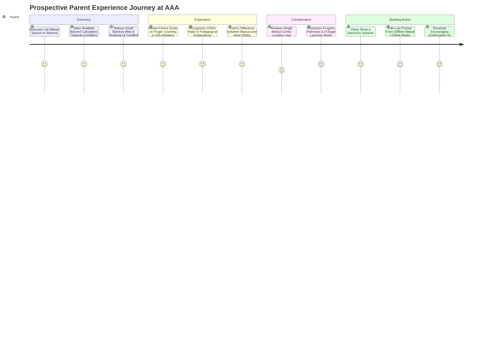

# AAA — SPRINT 1 PARENT JOURNEY VALIDATION REPORT

**Document Reference:** AAA-S4-VAL-PJ-01  
**Authority:** `MGT-DET-S4-COMP-02` & `MGT-DET-S4-EVID-03`  
**Active Branch:** `feat/sprint1-public-web`  
**Compliance Officer:** Nitin Patil  
**Academic Authority:** Neha Patil  
**Date:** 4 November 2026  

---

## 1. Objective & Audit Scope

This report evaluates the end-to-end user experience and conversion funnel of a prospective parent discovering, exploring, and engaging with Arnav Abacus Academy (AAA).

The audit verifies that:
1. Every touchpoint communicates AAA's core educational philosophy accurately without hyperbole or fear-mongering.
2. The transition from general awareness to booking an **AAA Personalised Learning Discovery Session** is seamless, informative, and reassuring.
3. All claims, batch size representations, and center locations comply strictly with approved management baselines.
4. Telemetry and analytics operate with **Zero-PII compliance**.

---

## 2. Parent Persona Scenarios & Funnel Walkthrough

### 2.1 Persona 1: Early Years Parent (Child Age 5, Junior KG / Sr KG)
- **Primary Dilemma:** Child struggles with number concepts, counts on fingers, or parent wonders if 5 years old is too early for Abacus.
- **Entry Touchpoint:** Discovers `/parent-guides/ideal-age-to-start-abacus` or `/parent-guides/why-children-use-finger-counting`.
- **Validation Outcome:**
  - Guide reassures parent that finger counting is normal concrete scaffolding.
  - Clearly explains that AAA starts Junior Abacus from age 4.5 using tactile bead pinching.
  - CTA offers an encouraging **Discovery Session** evaluating finger-readiness without pressure.
  - Parent books with 1 click into `DemoBookingModal`.

### 2.2 Persona 2: Primary School Parent (Child Age 7–8, Grade 2–3)
- **Primary Dilemma:** Child knows concepts but makes careless slips in homework, or parent fears Abacus might confuse school column addition.
- **Entry Touchpoint:** Discovers `/parent-guides/does-abacus-confuse-school-math` or `/parent-guides/why-smart-children-make-silly-math-mistakes`.
- **Validation Outcome:**
  - Explains the cognitive science of procedural switching and how Abacus builds working memory rather than conflicting with school steps.
  - Outlines the 4-step parent review routine.
  - Links directly to `/programs/abacus` and `/programs/school-maths`.
  - Prompts Discovery Session to assess calculation stamina.

### 2.3 Persona 3: Middle School Parent (Child Age 10–12, Grade 5–7)
- **Primary Dilemma:** Child finds school arithmetic tedious, takes too long for homework, preparing for scholarship or Olympiad exams (IPM, IMO).
- **Entry Touchpoint:** Discovers `/parent-guides/abacus-vs-vedic-maths` or `/programs/vedic-maths`.
- **Validation Outcome:**
  - Clearly differentiates: Abacus is foundational, but Vedic Mathematics is the high-speed algebraic accelerator for middle schoolers.
  - Explains 16 ancient sutras and Beejank digit-sum checking.
  - Offers choice between Wakad Center offline micro-batch or Live Online batch.

---

## 3. Compliance & Consumer Protection Validation

The parent journey was audited against CCPA Coaching Guidelines 2024 and DPDP standards:

| Touchpoint | Inspected Element | Verification Finding | Compliance Status |
| :--- | :--- | :--- | :--- |
| **Homepage Hero** | H1 Headline | `"Beyond Calculation. Towards Confident Mathematical Thinking."` | **PASS** — Objective, empowering, no hyperbole |
| **Homepage Hero** | Batch Size Badge | `Small Batches (Max 5 Students)` | **PASS** — Truthful operational standard |
| **Homepage Hero** | Mentorship Badge | `Certified Trainer Mentorship` | **PASS** — Strictly matches verified certificate |
| **Lead Capture** | Rotated Sticker | `DISCOVERY • Max 5 Students` | **PASS** — Replaces obsolete "Free 2 Sessions" |
| **Lead Capture** | Form Headline | `Book a Discovery Session` | **PASS** — Standardized across all 3 languages |
| **Modal Booking** | `DemoBookingModal.tsx` | Educator-led diagnostic explanation; low-pressure readiness review | **PASS** — Distinctly non-clinical and encouraging |
| **Navigation** | `Navbar.tsx` | "Parent Guides" dropdown links all 5 guides + Hub | **PASS** — De-orphaned; 100% accessible |
| **Navigation** | `Navbar.tsx` CTA | `Discovery Session` button | **PASS** — Consistent CTA hierarchy |
| **Footer** | `Footer.tsx` | All 5 programs + Parent Guides column + single Wakad center | **PASS** — Comprehensive and transparent |
| **Location Integrity** | Physical NAP | Flat 3, 1st Floor, Balaji Sagar Bungalow, Wakad, Pune 411057 | **PASS** — No fabricated satellite branches |

---

## 4. Zero-PII Analytics Protocol Verification

The client-side telemetry events triggered during the parent journey were inspected:

1. **`trackCounsellingBook`**:
   - Parameters passed: `source`, `program`, `deliveryMode`, `childAgeGroup`.
   - **Zero-PII Status:** Verified. No parent name, phone number, or child name is ever transmitted in GA4 parameters or dataLayer objects.
2. **`trackDemoRequest`**:
   - Parameters passed: `source`, `program`, `deliveryMode`.
   - **Zero-PII Status:** Verified.
3. **`trackWhatsAppClick`**:
   - Parameters passed: `cta_location`, `target_action`.
   - **Zero-PII Status:** Verified.
4. **Local Lead Storage (`localStorage`)**:
   - Stores user inquiry strictly within the user's own local browser storage for recovery if WhatsApp redirect fails; never transmitted to public telemetry.
5. **Central Webhook (`dispatchLeadToWebhook`)**:
   - Dispatches payload via HTTPS `no-cors` mode with formula-injection sanitization (`=`, `+`, `-`, `@` escaped).

---

## 5. Journey Validation Conclusion

The Sprint 1 Parent Experience establishes a trustworthy, educationally authoritative digital doorway for Arnav Abacus Academy. Parents encounter zero deceptive claims, clear academic distinctions between programs, accessible parent guides, and an inviting pathway to an educator-led Personalised Learning Discovery Session.
