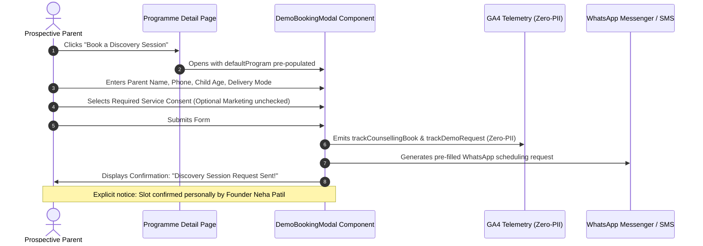

# AAA — SPRINT 1 PROGRAMME DISCOVERY CTA VALIDATION REPORT

**Document Reference:** `AAA-S4-VAL-CTA-01`  
**Workstream Reference:** `AAA-S4-WS-PROG-01`  
**Governing Determination:** `MGT-DET-S4-PE-04`  
**Compliance Officer:** Nitin Patil  
**Academic Director:** Neha Patil  
**Active Branch:** `feat/sprint1-public-web`  
**Date:** 4 November 2026  

---

## 1. Executive Summary & Audit Purpose

This report validates the technical, legal, and user-experience integration of the **AAA Personalised Learning Discovery Session** conversion architecture across the five dedicated programme pages.

The objective is to ensure that prospective parents are guided through an informative, encouraging, low-friction inquiry flow that satisfies all legal privacy standards, consumer protection rules, and zero-PII requirements.

---

## 2. Modal Inspection & Technical Flow

---

## 3. Mandatory Compliance & Privacy Criteria

### 3.1 Minimum Data Collection Principle
Under DPDP Rule 2025 readiness standards, the Discovery Session modal collects strictly the minimum necessary data to initiate contact:
- **Parent / Guardian Name** (sanitized against XSS and formula injection)
- **10-Digit Mobile Number** (validated)
- **Child's Age Bracket** (coarse range: e.g., "4.5–6", "7–9", "9–11", "12–14", "Grade 2–5", "Grade 6–10")
- **Programme of Interest** (pre-populated from current page context)
- **Preferred Delivery Mode** (Offline Wakad Center / Live Online)

**Excluded Data:**
- ❌ No Date of Birth (DOB) collected.
- ❌ No School Name collected.
- ❌ No Residential Address collected.
- ❌ No Medical, Psychological, or Clinical Information requested.

### 3.2 Unbundled Dual Consent Protocol
In strict compliance with modern privacy directives, consent is unbundled into two distinct checkboxes:
1. **Required Service Communication Consent:**
   > *"Required: I consent to receiving Discovery Session scheduling messages via WhatsApp / SMS from Arnav Abacus Academy."*
   *(Mandatory for submission; validated client-side).*
2. **Optional Marketing Communication Consent:**
   > *"Optional: I agree to receive occasional mathematical insights and academy announcements."*
   *(Unchecked by default; optional; fully unbundled).*

### 3.3 Transparent Scheduling Nature
To eliminate any consumer confusion under CCPA Coaching Guidelines:
- The UI explicitly clarifies:
  > *"Submission represents a Discovery Session scheduling request, not an automatically confirmed appointment. Founder Neha Patil personally confirms each slot based on batch availability."*
- Confirmation screen states:
  > *"Discovery Session Request Sent! Thank you! WhatsApp has opened with your request details. Founder Neha Patil and our academic team will confirm your Discovery Session slot shortly."*

---

## 4. Programme-Specific Context Mapping

When a parent clicks `"Book a Discovery Session"` from any dedicated programme page, `DemoBookingModal` opens with the exact curriculum pre-selected:

| Source Programme Page | Context Parameter Passed to Modal | WhatsApp Template Pre-Fill |
| :--- | :--- | :--- |
| `/programs/abacus` | `Abacus Mathematics (Ages 4.5–9)` | `Program Interested: Abacus Mathematics (Ages 4.5–9)` |
| `/programs/vedic-maths` | `Vedic Mathematics (Ages 9–14)` | `Program Interested: Vedic Mathematics (Ages 9–14)` |
| `/programs/mental-maths` | `Mental Mathematics (Ages 6–14)` | `Program Interested: Mental Mathematics (Ages 6–14)` |
| `/programs/school-maths` | `School Mathematics (Grades 1–10)` | `Program Interested: School Mathematics (Grades 1–10)` |
| `/programs/ipm-olympiad` | `IPM & Olympiad Mathematics (Grades 2–9)` | `Program Interested: IPM & Olympiad Mathematics (Grades 2–9)` |

---

## 5. Zero-PII Telemetry Verification

Analytics events triggered during the Discovery Session conversion flow:

1. **`trackCounsellingBook`**:
   - `source`: e.g. `"program_page_abacus_cta"`
   - `program`: e.g. `"Abacus Mathematics (Ages 4.5–9)"`
   - `deliveryMode`: `"offline"` or `"online"`
   - `childAgeGroup`: e.g. `"7-9"`
   - **Zero-PII Status:** **VERIFIED**. No parent name or phone number is included in parameters.
2. **`trackDemoRequest`**:
   - `source`: e.g. `"program_page_abacus_cta"`
   - `program`: e.g. `"Abacus Mathematics (Ages 4.5–9)"`
   - `deliveryMode`: `"offline"` or `"online"`
   - **Zero-PII Status:** **VERIFIED**.
3. **`trackWhatsAppClick`**:
   - `cta_location`: `"discovery_modal_submit"`
   - `target_action`: `"book_discovery_session"`
   - **Zero-PII Status:** **VERIFIED**.

---

## 6. Validation Sign-Off

The Discovery Session integration across the programme pages satisfies all operational, legal, and privacy guidelines. It provides parents with transparent, low-pressure access to educator-led guidance while safeguarding minor data privacy.
