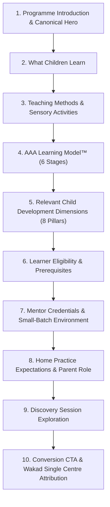

# AAA — SPRINT 1 PROGRAMME PAGE CONTENT ALIGNMENT REGISTER

**Document Reference:** `AAA-S4-REG-PROG-01`  
**Workstream Reference:** `AAA-S4-WS-PROG-01`  
**Governing Determination:** `MGT-DET-S4-PE-04`  
**Compliance Officer:** Nitin Patil  
**Academic Director:** Neha Patil  
**Active Branch:** `feat/sprint1-public-web`  
**Date:** 4 November 2026  

---

## 1. Scope & Objective

This register catalogs the structural, pedagogical, and conversion alignment across the five dedicated programme pages of Arnav Abacus Academy:

1. [`src/pages/ProgramAbacus.tsx`](file:///c:/0-ATHARV2NITIN_Projects/AAA_WEB/src/pages/ProgramAbacus.tsx) (`/programs/abacus`)
2. [`src/pages/ProgramVedicMaths.tsx`](file:///c:/0-ATHARV2NITIN_Projects/AAA_WEB/src/pages/ProgramVedicMaths.tsx) (`/programs/vedic-maths`)
3. [`src/pages/ProgramMentalMaths.tsx`](file:///c:/0-ATHARV2NITIN_Projects/AAA_WEB/src/pages/ProgramMentalMaths.tsx) (`/programs/mental-maths`)
4. [`src/pages/ProgramSchoolMaths.tsx`](file:///c:/0-ATHARV2NITIN_Projects/AAA_WEB/src/pages/ProgramSchoolMaths.tsx) (`/programs/school-maths`)
5. [`src/pages/ProgramIpmOlympiad.tsx`](file:///c:/0-ATHARV2NITIN_Projects/AAA_WEB/src/pages/ProgramIpmOlympiad.tsx) (`/programs/ipm-olympiad`)

---

## 2. Mandatory Ten-Part Structural Standard

In accordance with Workstream 4 instructions, each page is aligned to the consistent 10-part structural framework, while presenting a distinct curriculum:

---

## 3. Page-by-Page Alignment Matrix

### 3.1 Abacus Mathematics (`/programs/abacus`)
- **Canonical Hero H1:** `Abacus Maths Classes in Wakad, Pune`
- **Age Band:** Ages 4.5 to 14 Years (Peak foundation: 5 to 9 Years)
- **What Children Learn:** Tactile Soroban bead manipulation (Big & Small Friends complements), base-10 number sense, transitioning to Anzan mental calculation.
- **Teaching Methods:** Hands-on Soroban bead moving, auditory dictation rounds, progressive 8-level syllabus.
- **AAA Learning Model™:** Inspire (eliminating fear of numbers) $\rightarrow$ Explore (bead tactility) $\rightarrow$ Understand (complements) $\rightarrow$ Practice (micro-drills) $\rightarrow$ Apply (school arithmetic) $\rightarrow$ Reflect (milestones).
- **Development Dimensions:** Spatial Visualization, Working Memory, Sustained Attention, Processing Speed, Self-Confidence.
- **Mentor Credential:** `Neha Patil (MCA, Certified Trainer of Abacus & Vedic Mathematics)`.
- **Small Batches:** `Personalised learning in small batches, with a maximum of five students per batch.`
- **Practice Expectations:** 10–15 minutes of regular daily practice at home rather than weekend cramming.
- **Discovery Session:** Direct integration of `DemoBookingModal` pre-populated with `"Abacus Mathematics (Ages 4.5–9)"`.
- **Location & Catchment:** Single dedicated physical center at *Flat No. 3, 1st Floor, Adv. Balaji Sagar Bungalow, Wakad, Pune 411057 (Serving Wakad, Pimple Saudagar, Hinjawadi, Tathawade & Baner)*.

---

### 3.2 Vedic Mathematics (`/programs/vedic-maths`)
- **Canonical Hero H1:** `Vedic Maths Classes in Wakad, Pune`
- **Age Band:** Ages 9 to 14 Years (Grades 5 to 10)
- **What Children Learn:** High-speed mental cross-multiplication, base-10/100 calculations, algebraic factorisation shortcuts, and Beejank (digit-sum checking) for rapid reverse-proof verification.
- **Teaching Methods:** Modular sutras (*Urdhva Tiryagbhyam*, *Nikhilam*), step-by-step problem simplification, mental verification drills.
- **Academic Validation Outcome:** Ratified by Neha Patil (04-Nov-2026): Early levels focus on high-utility calculation sutras (*Urdhva Tiryagbhyam*, *Nikhilam*, *Beejank*), with students systematically completing all 16 Sutras across advanced levels.
- **AAA Learning Model™:** Inspire (wonder of ancient mathematics) $\rightarrow$ Explore (number patterns) $\rightarrow$ Understand (sutras) $\rightarrow$ Practice (accuracy drills) $\rightarrow$ Apply (school exams) $\rightarrow$ Reflect (error reduction).
- **Development Dimensions:** Pattern Recognition, Working Memory, Processing Speed, Cognitive Flexibility, Executive Function.
- **Mentor Credential:** `Neha Patil (MCA, Certified Trainer of Abacus & Vedic Mathematics)`.
- **Discovery Session:** `DemoBookingModal` pre-populated with `"Vedic Mathematics (Ages 9–14)"`.

---

### 3.3 Mental Mathematics (`/programs/mental-maths`)
- **Canonical Hero H1:** `Mental Mathematics & Speed Arithmetic in Wakad, Pune`
- **Age Band:** Ages 6 to 14 Years
- **What Children Learn:** Rapid mental arithmetic without physical counting aids or scratchpad dependency; mental number bonding and split-merge calculation strategies.
- **Teaching Methods:** Progressive flash drills, oral challenge rounds, stress-free timed sprints, auditory calculation practice.
- **Academic Validation Outcome:** Ratified by Neha Patil (04-Nov-2026): Formally offered both as an independent standalone track (Ages 6–14) and as an integrated bridging curriculum between Abacus and Vedic Maths.
- **AAA Learning Model™:** Inspire (math without fear) $\rightarrow$ Explore (number bonds) $\rightarrow$ Understand (mental algorithms) $\rightarrow$ Practice (sprints) $\rightarrow$ Apply (daily calculations) $\rightarrow$ Reflect (speed gains).
- **Development Dimensions:** Working Memory, Processing Speed, Sustained Attention, Pattern Recognition, Self-Confidence.
- **Discovery Session:** `DemoBookingModal` pre-populated with `"Mental Mathematics (Ages 6–14)"`.

---

### 3.4 School Mathematics (`/programs/school-maths`)
- **Canonical Hero H1:** `School Maths Coaching & Foundation in Wakad`
- **Grade Band:** Grades 1 to 10 (CBSE, ICSE, and Maharashtra State Board)
- **What Children Learn:** Core curriculum concept mastery (fractions, geometry, algebra, word problems), structured multi-step problem solving, and error-triage habits.
- **Teaching Methods:** Conceptual first principles, guided problem-solving, structured homework reinforcement, and practice test simulations.
- **Board Status Disclaimer:** Clear notification that AAA provides supplementary coaching and is **not an official affiliate or authorized body of CBSE, ICSE, or State Boards**.
- **AAA Learning Model™:** Inspire (demystifying textbook problems) $\rightarrow$ Explore (real-world word problem breakdown) $\rightarrow$ Understand (theorems & formulas) $\rightarrow$ Practice (step-by-step exercises) $\rightarrow$ Apply (school exam papers) $\rightarrow$ Reflect (error log review).
- **Development Dimensions:** Executive Function, Cognitive Flexibility, Pattern Recognition, Attention to Detail, Confidence.
- **Discovery Session:** `DemoBookingModal` pre-populated with `"School Mathematics (Grades 1–10)"`.

---

### 3.5 IPM & Olympiad Mathematics (`/programs/ipm-olympiad`)
- **Canonical Hero H1:** `IPM & Maths Olympiad Coaching in Wakad, Pune`
- **Grade Band:** Grades 2 to 9
- **What Children Learn:** Non-routine problem decomposition, competitive logical reasoning, multi-step word problem analysis, and high-level arithmetic agility.
- **Target Competitions:** IPM (Institute for Promotion of Mathematics, Pune), SOF IMO, SilverZone IOM.
- **Academic Validation Outcome:** Ratified by Neha Patil (04-Nov-2026): Focuses strictly on IPM, SOF IMO, and Maharashtra State Scholarship Math Exams (NMTC excluded from public claims).
- **Non-Guarantee Disclaimer:** Explicit disclosure that AAA prepares students with rigorous mathematical foundations, but **does not guarantee ranks, medals, selection, or specific exam scores**.
- **AAA Learning Model™:** Inspire (thrill of intellectual puzzles) $\rightarrow$ Explore (unfamiliar problem patterns) $\rightarrow$ Understand (underlying logic) $\rightarrow$ Practice (past paper decomposition) $\rightarrow$ Apply (timed competition trials) $\rightarrow$ Reflect (strategic review).
- **Development Dimensions:** Spatial Visualization, Executive Function, Pattern Recognition, Cognitive Flexibility, High-Level Reasoning.
- **Discovery Session:** `DemoBookingModal` pre-populated with `"IPM & Olympiad Mathematics (Grades 2–9)"`.

---

## 4. Uniform Conversion & Attribution Standard

Across all five pages, conversion and attribution adhere strictly to:
- **Primary CTA:** `"Book a Discovery Session"` (triggers `DemoBookingModal` with specific program parameter).
- **Secondary CTA:** `"Explore Our Learning Approach"` or `"View Complete Syllabus"`.
- **Location Attribution:** Flat No. 3, 1st Floor, Adv. Balaji Sagar Bungalow, Opp. Creative Cameo, Near Park Street, Behind Wisdom World School, Wakad, Pune 411057.
- **Regional Service Catchment:** Wakad, Pimple Saudagar, Hinjawadi, Tathawade, and Baner.
- **Grievance Contact:** Nitin Patil (`+91 90219 24968`, Mon–Sat 9:30 AM–7:30 PM).
