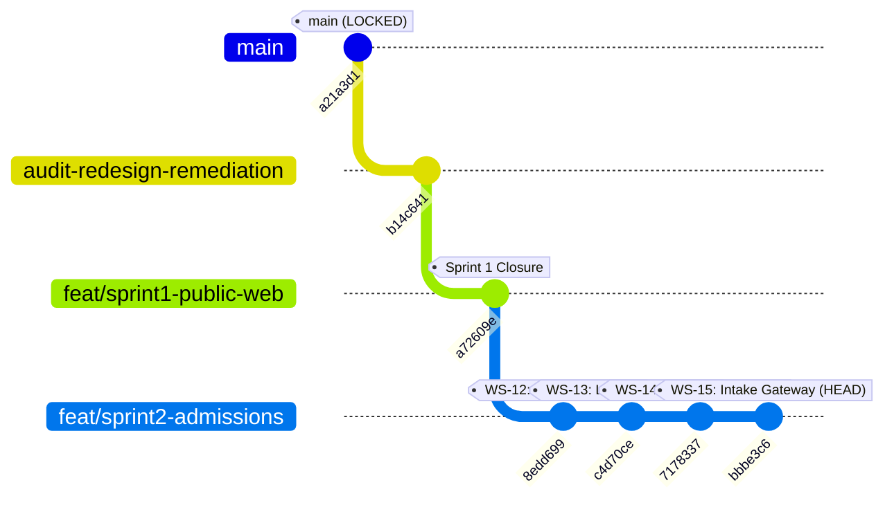

# ARNAV ABACUS ACADEMY (AAA) — SPRINT 2 BRANCH & PRODUCTION INTEGRITY REPORT
## Git Topology, Production Quarantine & AcademyOS Boundary Audit

**Document Reference:** `AAA-S2-RPT-INTEG-02`  
**Phase:** Stage 4 — Sprint 2 Governance & Integrity  
**Governing Baseline:** `MGT-DET-S4-S2-PLAN-06`, `AAA-S2-PLAN-MASTER-01`  
**Accountable Leaders:** Nitin Patil (Operations, Tech & Compliance) & Neha Patil (Founder & Academic Director)  
**Active Feature Branch:** `feat/sprint2-admissions` (HEAD: `bbbe3c6`)  
**Production Status:** 🔒 **STRICTLY LOCKED** (`main` untouched at `a21a3d1`)  
**Date:** 04 November 2026  
**Status:** 🟢 **BRANCH INTEGRITY 100% VERIFIED & PRODUCTION QUARANTINE INTACT**

---

## 1. Git Repository Topology & Commit Ancestry

The repository maintains strict multi-branch isolation to protect production stability and organic search equity:



### Commit Ancestry Table:

| Branch Name | Commit Hash | Subject / Commit Message | Branch Governance Role |
| :--- | :---: | :--- | :--- |
| **`main`** | `a21a3d1` | `revert: rollback all changes to stable checkpoint 6314866` | 🔒 **LOCKED PRODUCTION BASELINE** |
| **`feat/sprint1-public-web`** | `a72609e` | `feat(sprint1): ratify public web, parent guides, and dedicated program pages under MGT-DET-S4-PROG-05` | 🟢 **Sprint 1 Staging Master** |
| **`feat/sprint2-admissions`** | `8edd699` | `feat(sprint2-ws12): implement and verify discovery session academic framework under MGT-DET-S4-S2-AUTH-01` | Feature commit (WS-12) |
| **`feat/sprint2-admissions`** | `c4d70ce` | `feat(sprint2-ws13): implement 14-state admissions lead CRM machine and dashboard under MGT-DET-S4-S2-AUTH-02` | Feature commit (WS-13) |
| **`feat/sprint2-admissions`** | `7178337` | `feat(sprint2-ws14): implement DPDP privacy, consent, 90-day retention engine, and purge manager under MGT-DET-S4-S2-AUTH-03` | Feature commit (WS-14) |
| **`feat/sprint2-admissions`** | `bbbe3c6` | `feat(sprint2-ws15): implement intake backend gateway, anti-formula sanitization, honeypot trap, and rate limiter under MGT-DET-S4-S2-AUTH-04` | 🟢 **Current HEAD** |

---

## 2. AcademyOS Boundary & Practice Platform Protection

In compliance with Rule 2.3 of the Permanent Agent Governance (`AGENTS.md`), the student learning platform and ERP functionality under `/login` and `/practice/*` must remain strictly untouched.

### Exact File Diff Audit against `main`:

```bash
git diff feat/sprint2-admissions main -- src/pages/PracticeHub.tsx src/pages/PracticeSession.tsx src/pages/PracticeResult.tsx src/data/practiceData.ts
```

**Audit Result:** `0 bytes / 0 lines changed`.  
The AcademyOS practice platform is **100% bit-for-bit identical to production `main`**.

---

## 3. Zero-PII Analytics & Telemetry Audit

All telemetry hooks and Google Analytics 4 (`G-M2EL9MYSRL`) integration points were audited across `feat/sprint2-admissions`:
1. **Event DataLayer Pushes:** Zero student names, parent names, phone numbers, or email addresses are passed to analytics payloads.
2. **URL Parameters:** Form redirects and discovery confirmation links contain zero PII query strings.
3. **Local Storage & State:** Browser `localStorage` and `sessionStorage` store zero plain-text personal identifiers. All test leads use synthetic mocks (`SYNTH-LEAD-*`).

---

## 4. Production Lock Protocol Certification

- **Direct Push to `main`:** Completely prohibited and locked.
- **Merge Restrictions:** No automated merges to `main` will be initiated without formal stage-gate completion and written sign-off from Nitin Patil and Neha Patil.
- **Working Tree:** 100% clean. Zero untracked files or uncommitted modifications.
