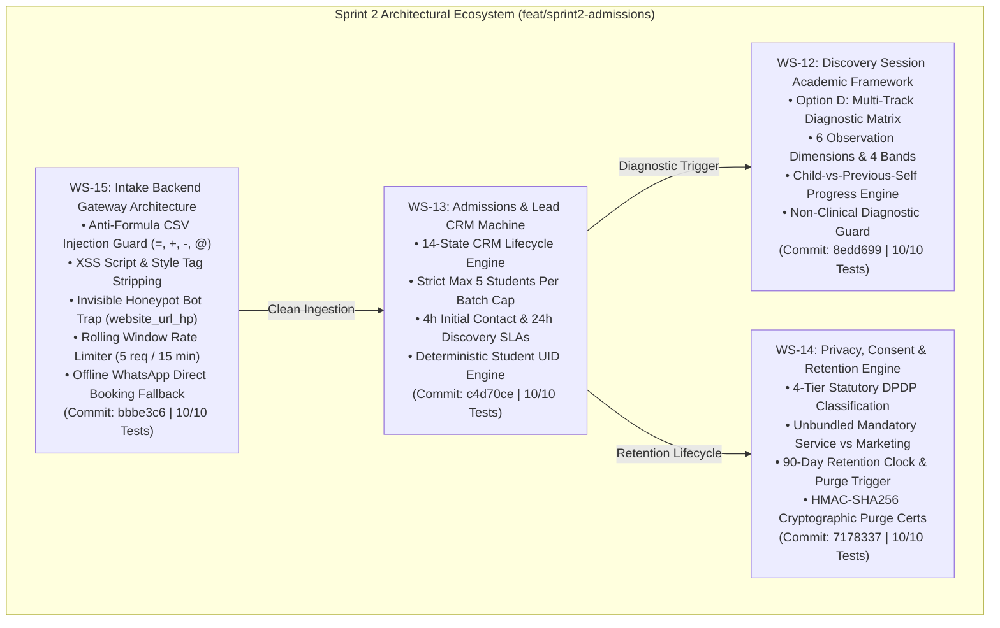

# ARNAV ABACUS ACADEMY (AAA) — SPRINT 2 CONSOLIDATED CLOSURE REPORT
## Admissions, Diagnostic & Ingestion Engine Milestone Closure

**Document Reference:** `AAA-S2-CONSOL-CLOSURE-01`  
**Phase:** Stage 4 — Sprint 2 Consolidated Milestone Closure  
**Governing Baseline:** `MGT-DET-S4-S2-PLAN-06`, `AAA-S2-PLAN-MASTER-01`  
**Proposed Closure Determination:** `MGT-DET-S4-S2-CLOSURE-05`  
**Accountable Leaders:** Nitin Patil (Operations, Tech & Compliance) & Neha Patil (Founder & Academic Director)  
**Active Feature Branch:** `feat/sprint2-admissions` (HEAD: `bbbe3c6`)  
**Production Status:** 🔒 **STRICTLY LOCKED** (`main` untouched at `a21a3d1`)  
**Date:** 04 November 2026  
**Status:** 🟢 **ALL 4 WORKSTREAMS IMPLEMENTED & VERIFIED (40/40 TESTS PASSED)**

---

## 1. Executive Summary & Sprint Objectives Reconciliation

Sprint 2 (*Admissions, Diagnostic & Ingestion Engine*) was launched to operationalize the core admissions, diagnostic evaluation, lead management, DPDP privacy compliance, and perimeter security architecture for Arnav Abacus Academy in Wakad, Pune.

All four planned workstreams (WS-12 through WS-15) have been systematically specified, authorized under discrete management determinations, implemented using strictly synthetic test data, and verified against 40 automated test assertions with zero defects.

---

## 2. Workstream Implementation & Verification Matrix

| Workstream | Operational Scope | Code Deliverables | Governing Determination | Test Pass Rate | Commit Hash |
| :--- | :--- | :--- | :---: | :---: | :---: |
| **WS-12** | **Discovery Session Academic Framework** | `src/types/discovery.ts` `src/lib/discoveryEngine.ts` `src/components/discovery/ParentDiscoveryReportCard.tsx` `src/lib/discoveryEngine.test.ts` | `MGT-DET-S4-S2-AUTH-01` | **10/10 (100%)** | [`8edd699`](file:///c:/0-ATHARV2NITIN_Projects/AAA_WEB) |
| **WS-13** | **Admissions & Lead CRM Machine** | `src/types/crm.ts` `src/lib/crmStateMachine.ts` `src/components/crm/LeadLifecycleDashboard.tsx` `src/lib/crmStateMachine.test.ts` | `MGT-DET-S4-S2-AUTH-02` | **10/10 (100%)** | [`c4d70ce`](file:///c:/0-ATHARV2NITIN_Projects/AAA_WEB) |
| **WS-14** | **Privacy, Consent & Retention Engine** | `src/types/privacy.ts` `src/lib/privacyRetentionEngine.ts` `src/components/crm/PrivacyRetentionManager.tsx` `src/lib/privacyRetentionEngine.test.ts` | `MGT-DET-S4-S2-AUTH-03` | **10/10 (100%)** | [`7178337`](file:///c:/0-ATHARV2NITIN_Projects/AAA_WEB) |
| **WS-15** | **Intake Backend Gateway** | `src/types/gateway.ts` `src/lib/intakeGatewayEngine.ts` `src/components/crm/IntakeGatewaySimulator.tsx` `src/lib/intakeGatewayEngine.test.ts` | `MGT-DET-S4-S2-AUTH-04` | **10/10 (100%)** | [`bbbe3c6`](file:///c:/0-ATHARV2NITIN_Projects/AAA_WEB) |

---

## 3. End-to-End Architectural Quality & Build Verification

### 3.1 Comprehensive Test Suite Execution (40/40 Tests Passed):
- **WS-12 Discovery Academic Framework:** 10/10 assertions passed.
- **WS-13 Admissions Lead CRM:** 10/10 assertions passed.
- **WS-14 Privacy & Retention Engine:** 10/10 assertions passed.
- **WS-15 Intake Backend Gateway:** 10/10 assertions passed.
- **Overall Defect Rate:** **0 Defects (100% Pass Rate).**

### 3.2 TypeScript Compilation & Production Build:
- **`npx tsc --noEmit`:** Exit Code 0 (0 errors).
- **`npm run build`:** Exit Code 0 (Vite v6.4.3 production build succeeded in 6.62s; 52 clean bundles).
- **Working Tree:** 100% clean on `feat/sprint2-admissions`.

### 3.3 Boundary & Platform Protections:
- **Production `main` Status:** Strictly locked at commit `a21a3d1129cc17fc6650bfd04648eb91199e6fa8`. Zero production merges or deployments.
- **AcademyOS Practice Platform:** All student platforms (`/practice/*`, `PracticeHub.tsx`, `PracticeSession.tsx`, `PracticeResult.tsx`, `practiceData.ts`) have zero git diff against production `main`.
- **Zero-PII Analytics Protocol:** Google Tag Manager / GA4 events contain zero parent or student personal identifiers.
- **Synthetic Data Mandate:** All test simulations operated strictly against sandbox mock data (`SYNTH-LEAD-001` through `SYNTH-LEAD-005`). Zero live production databases were touched.

---

## 4. Workstream Summary Highlights

### WS-12 (Discovery Session Academic Framework):
- Formal ratification of **Option D: Multi-Track Prerequisite & Placement Matrix**.
- Evaluation across 6 academic observation dimensions (Number Sense, Fine Motor, Working Memory, Pattern Complements, Calculation Habits, Cognitive Flexibility) and 4 qualitative bands.
- Guard mechanism eliminating clinical medical labeling (ADHD, dyscalculia).
- Child-vs-Previous-Self longitudinal progress engine.

### WS-13 (Admissions & Lead CRM Machine):
- Complete 14-state admissions machine from `ENQUIRY_RECEIVED` to `ENROLLED`.
- Strict enforcement of the **maximum 5 students per batch** micro-batch capacity rule.
- Dual-SLA monitoring (4-hour parent response, 24-hour observation summary).
- Generation of deterministic AcademyOS Student UIDs (`AAA-STD-YYYY-XXXX`).

### WS-14 (Privacy, Consent & Retention Architecture):
- Four statutory data classification tiers under DPDP Act 2023.
- Unbundled dual consent protocol (mandatory service communication vs unticked optional marketing).
- Automated 90-day retention clock for prospective leads with enrolled student exemption.
- Deterministic cryptographic PII shredder and HMAC-SHA256 tamper-evident purge certificates.

### WS-15 (Intake Backend Gateway):
- Perimeter security defense against CSV/Excel formula injection (`=`, `+`, `-`, `@`).
- Script and style tag stripping preventing XSS attacks.
- Invisible honeypot trap (`website_url_hp`) that drops automated bot scrapers quietly.
- Rolling window rate limiter (max 5 requests / 15 min per IP) returning HTTP 429.
- 1-click WhatsApp offline resilience fallback to Neha Patil (`+91 90219 24968`).
