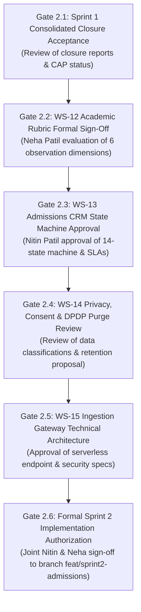

# AAA — SPRINT 2 DEPENDENCY AND STAGE-GATE REGISTER
## Workstream Sequences, Approval Order & Implementation Preconditions

**Document Reference:** `AAA-S2-REG-DEP-GATE-01`  
**Phase:** Stage 4 — Sprint 2 Planning & Gate Governance  
**Governance Authority:** Nitin Patil (Operations Lead) & Neha Patil (Academic Director)  
**Date:** 04 November 2026  
**Status:** 🟡 **ACTIVE GATE REGISTER — ZERO SPRINT 2 IMPLEMENTATION PERMITTED**

---

## 1. Executive Dependency Architecture

To safeguard academic authority, statutory data compliance, and repository stability, work in Sprint 2 is strictly governed by a sequential, staged dependency chain:

---

## 2. Sprint 2 Stage-Gate Specifications Ledger

| Stage Gate ID | Gate Title | Gate Objective & Scope | Accountable Authority | Mandatory Pre-Conditions | Exit Artifact / Approval Reference | Gate Status |
| :---: | :--- | :--- | :---: | :--- | :--- | :---: |
| **GATE-2.1** | **Sprint 1 Closure Acceptance** | Review and accept the Sprint 1 Consolidated Closure Pack and Hard Gate Reconciliation. | Nitin Patil & Neha Patil | Complete verification suite on `feat/sprint1-public-web` (Build 0, AcademyOS isolated). | `MGT-DET-S4-S1-CLOSE-01` | 🟡 **Awaiting Review** |
| **GATE-2.2** | **Discovery Academic Framework Sign-Off** | Formally select Option A, B, or C from the Observation Dimension Change Proposal. | **Neha Patil (Sole Authority)** | Review of `AAA_Sprint2_WS12_Observation_Dimension_Change_Proposal.md`. | Signed Academic Sign-Off Form | 🟡 **Awaiting Neha Review** |
| **GATE-2.3** | **Lead CRM Lifecycle Sign-Off** | Approve the 14-state lifecycle machine, role assignments, escalation rules, and SLAs. | Nitin Patil | Operational alignment on maximum 5-student batch pacing. | Operations Lead Determination | 🟡 **Awaiting Nitin Review** |
| **GATE-2.4** | **Privacy & Retention Protocol Sign-Off** | Approve DPDP data classifications, dual-consent enforcement, and non-enrolled purge SOP. | Nitin Patil (Compliance Officer) | Review of statutory applicability and data minimization rules. | Compliance Determination Record | 🟡 **Awaiting Nitin Review** |
| **GATE-2.5** | **Intake Backend Architecture Sign-Off** | Select primary serverless ingestion pattern, anti-abuse specs, and AcademyOS ID mapping. | Nitin Patil | Zero external third-party broker storage verified. | Technical Specification Sign-Off | 🟡 **Awaiting Nitin Review** |
| **GATE-2.6** | **Sprint 2 Implementation Authorization** | Formally authorize creation of feature branch `feat/sprint2-admissions` to begin code development. | **Joint Management (Nitin & Neha)** | Successful passage of Gates 2.1 through 2.5. | `MGT-DET-S4-S2-AUTH-01` | 🔒 **STRICTLY BLOCKED** |

---

## 3. Strict Preconditions for Code Implementation

Under no circumstances shall software development for Sprint 2 begin until:
1. All six planning gates above are sequentially approved.
2. The isolated staging feature branch `feat/sprint2-admissions` is explicitly authorized and branched from the verified HEAD of `feat/sprint1-public-web`.
3. Branch `main` remains locked, isolated, and protected from direct pushes or unapproved merges.
