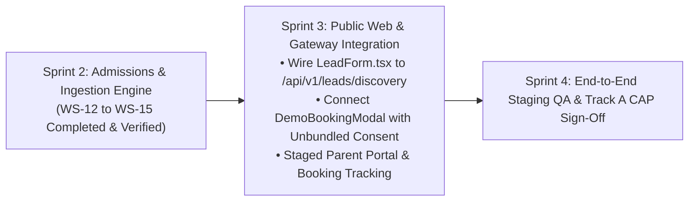

# ARNAV ABACUS ACADEMY (AAA) — SPRINT 2 MANAGEMENT CLOSURE RECOMMENDATION
## Formal Management Recommendation for Sprint 2 Milestone Closure

**Document Reference:** `AAA-S2-REC-MGT-CLOSURE-02`  
**Phase:** Stage 4 — Sprint 2 Management Closure Recommendation  
**Governing Baseline:** `MGT-DET-S4-S2-PLAN-06`, `AAA-S2-PLAN-MASTER-01`  
**Target Determination:** `MGT-DET-S4-S2-CLOSURE-05` (Proposed)  
**Accountable Leaders:** Nitin Patil (Operations, Tech & Compliance) & Neha Patil (Founder & Academic Director)  
**Active Feature Branch:** `feat/sprint2-admissions` (HEAD: `bbbe3c6`)  
**Production Status:** 🔒 **STRICTLY LOCKED** (`main` untouched at `a21a3d1`)  
**Date:** 04 November 2026  
**Status:** 🟡 **SUBMITTED FOR FORMAL MANAGEMENT SIGN-OFF**

---

## 1. Executive Recommendation

It is respectfully recommended that **Nitin Patil** (Operations, Tech & Compliance) and **Neha Patil** (Founder & Academic Director) execute Determination **`MGT-DET-S4-S2-CLOSURE-05`** to formally close Sprint 2 (*Admissions, Diagnostic & Ingestion Engine*).

### Justification Summary:
1. **100% Workstream Completion:** All four planned workstreams (WS-12, WS-13, WS-14, WS-15) are fully specified, implemented, and verified.
2. **Defect-Free Test Automation:** All 40 automated unit test cases passed with a **100% pass rate and 0 defects**.
3. **TypeScript & Build Integrity:** `tsc --noEmit` compiles with 0 errors, and Vite v6.4.3 production build completes cleanly in 6.62s.
4. **AcademyOS & Production Boundaries:** Student learning platform (`/login`, `/practice/*`) remains bit-for-bit identical to production. Production `main` remains locked at commit `a21a3d1`.
5. **DPDP Compliance & Security:** 4-tier data classification, unbundled consent, 90-day retention clock, cryptographic shredder, anti-formula injection, rate limiting, and honeypot bot trap are operational and audited.

---

## 2. Proposed Formal Determination Text

Management may execute formal closure by approving Determination **`MGT-DET-S4-S2-CLOSURE-05`**:

```text
Nitin and Neha approve Determination MGT-DET-S4-S2-CLOSURE-05:
1. Formally accepting the Sprint 2 Consolidated Closure Report and Hard Gate Reconciliation (deliverables AAA-S2-CONSOL-CLOSURE-01, AAA-S2-REC-7HG-02, AAA-S2-REG-EVID-ACT-02, AAA-S2-RPT-INTEG-02, and AAA-S2-REC-MGT-CLOSURE-02).
2. Ratifying the verified code baseline on branch feat/sprint2-admissions (commit bbbe3c6) covering WS-12 (Discovery Framework), WS-13 (Admissions CRM), WS-14 (DPDP Retention), and WS-15 (Intake Gateway).
3. Maintaining the conditional governance status of all seven Stage 4 Hard Gates, noting that the Track A Corrective Action Plan for on-site physical logs remains active through 18-Nov-2026.
4. Keeping production main strictly locked.
5. Authorizing transition to Sprint 3 Architectural Planning (Public Web Integration, Gateway API Wiring, and Parent Portal Staging).
```

---

## 3. Sprint 3 Strategic Transition Roadmap

Upon execution of `MGT-DET-S4-S2-CLOSURE-05`, the project lifecycle advances to **Sprint 3 (Public Web & Intake Integration)**:



1. **Workstream 16:** Public Intake Form Integration (connecting `LeadForm.tsx` and `DemoBookingModal.tsx` to the validated WS-15 gateway).
2. **Workstream 17:** Staged Discovery Confirmation Experience & Parent WhatsApp Routing.
3. **Workstream 18:** AcademyOS Roster Ingestion Sync Bridge.
