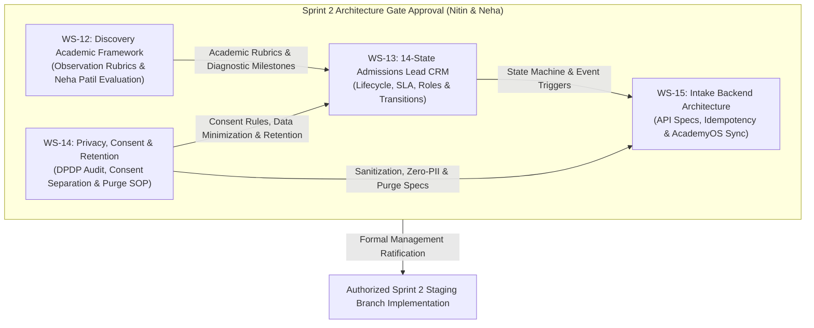

# AAA — SPRINT 2 MASTER PLAN
## Admissions & Discovery Session Workflow Architecture

**Document Reference:** `AAA-S2-PLAN-MASTER-01`  
**Phase:** Stage 4 — Sprint 2 Planning & Architecture  
**Governing Determinations:** `MGT-DET-S4-PE-04`, `MGT-DET-S4-PROG-05`  
**Execution Authority:** Nitin Patil (Operations, Technology & Legal) & Neha Patil (Founder & Academic Director)  
**Active Staging Branch:** `feat/sprint1-public-web` (Branch for Sprint 2 to be created upon authorization)  
**Production Status:** 🔒 **STRICTLY LOCKED** (`main` untouched at `a21a3d1`)  
**Date:** 04 November 2026  
**Status:** 🟡 **DRAFT ARCHITECTURAL MASTER PLAN — STRICTLY DOCUMENTATION ONLY**

---

## 1. Executive Summary & Authorization Boundary

The core objective of **Sprint 2: Admissions & Discovery Session Workflow** is to design the complete, educator-led admissions journey for Arnav Abacus Academy.

In strict adherence to project governance:
> [!IMPORTANT]
> **Sprint 2 Boundary Mandate:**
> This plan is **STRICTLY DOCUMENTATION AND ARCHITECTURAL DESIGN ONLY**. It does **NOT** authorize software implementation, database schema creation, API coding, CRM deployment, or live data ingestion. All technical implementation remains blocked until management formally ratifies the complete Sprint 2 architecture package.

---

## 2. Sprint 2 Architectural Workstreams (WS-12 to WS-15)

Sprint 2 decomposes into four integrated, interdependent workstreams:

### 2.1 Workstream Summary Breakdown:
1. **WS-12: Discovery Session Academic Framework:**
   - Formalizes the diagnostic observation rubric (non-clinical, developmental).
   - Formulates the Academic Change Proposal comparing the existing approved 6 dimensions against the newly proposed 6 dimensions for Neha Patil's exclusive evaluation.
   - Preserves 4 developmental bands: *Exploring*, *Developing*, *Secure*, and *Extending*.
2. **WS-13: Admissions & Lead CRM Architecture:**
   - Establishes the 14-state lead lifecycle machine from initial enquiry to active enrolled student.
   - Specifies entry/exit criteria, role responsibility, SLAs, communication templates, and duplicate handling.
3. **WS-14: Privacy, Consent and Retention Architecture:**
   - Formalizes DPDP-compliant data classification, service vs marketing consent separation, and parent authority.
   - Defines the non-enrolled lead retention proposal (90-day design baseline subject to statutory validation) and automated purge SOP.
4. **WS-15: Intake Backend & Integration Architecture:**
   - Formulates architecture options for server-side lead ingestion, webhook authentication, idempotency, rate limiting, and AcademyOS Student ID integration.

---

## 3. Accountable Leadership Roles & Governance Ownership

| Leadership Role | Officer Assigned | Primary Responsibilities in Sprint 2 Planning | Review & Sign-Off Authority |
| :--- | :--- | :--- | :---: |
| **Academic Director** | **Neha Patil** | Exclusive authority over discovery observation dimensions, developmental scoring criteria, non-clinical diagnostics, and pedagogical alignment. | Sole Academic Sign-Off on WS-12 |
| **Operations, Tech & Compliance Officer** | **Nitin Patil** | Lead CRM state machine, SLA definition, data classification, internal DPDP compliance review, intake API specifications, and AcademyOS boundary protection. | Technical & Operational Sign-Off on WS-13, WS-14, WS-15 |
| **Joint Management Authority** | **Nitin Patil & Neha Patil** | Formal Stage-Gate adoption of Sprint 2 Master Architecture prior to code branch creation. | Joint Management Ratification |

---

## 4. Sprint 2 Architectural Deliverables Suite

The following 9 authoritative planning deliverables constitute the Sprint 2 pack:
1. `AAA_Sprint2_Master_Plan.md` (`AAA-S2-PLAN-MASTER-01`)
2. `AAA_Sprint2_WS12_Discovery_Academic_Framework.md` (`AAA-S2-ARCH-WS12-01`)
3. `AAA_Sprint2_WS12_Observation_Dimension_Change_Proposal.md` (`AAA-S2-PROP-WS12-02`)
4. `AAA_Sprint2_WS13_Lead_CRM_Lifecycle_Architecture.md` (`AAA-S2-ARCH-WS13-01`)
5. `AAA_Sprint2_WS14_Privacy_Consent_and_Retention_Architecture.md` (`AAA-S2-ARCH-WS14-01`)
6. `AAA_Sprint2_WS15_Intake_Backend_Architecture.md` (`AAA-S2-ARCH-WS15-01`)
7. `AAA_Sprint2_Dependency_and_Stage_Gate_Register.md` (`AAA-S2-REG-DEP-GATE-01`)
8. `AAA_Sprint2_Risk_and_Decision_Register.md` (`AAA-S2-REG-RISK-DEC-01`)
9. `AAA_Sprint2_Management_Approval_Pack.md` (`AAA-S2-MGT-APPROVAL-01`)

---

## 5. Non-Negotiable Boundary Constraints

1. **Zero Code Changes:** No code files in `src/` or `dist/` shall be touched during Sprint 2 planning.
2. **Production Locked:** Production `main` remains locked at commit `a21a3d1`.
3. **No Live Systems:** No live CRM services, real database collections, or live external messaging APIs shall be created or deployed.
4. **Internal Review Distinction:** Nitin Patil’s internal DPDP compliance review is strictly an internal risk determination and shall not be confused with external legal counsel advice.
