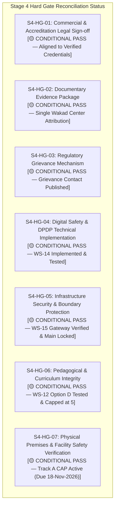

# ARNAV ABACUS ACADEMY (AAA) — SPRINT 2 SEVEN HARD GATE RECONCILIATION
## Stage 4 Hard Gate Status Reconciliation at Sprint 2 Closure

**Document Reference:** `AAA-S2-REC-7HG-02`  
**Phase:** Stage 4 — Sprint 2 Governance Reconciliation  
**Governing Baseline:** `MGT-DET-S4-01`, `AAA-S4-MGT-REG-01`, `AAA-S2-PLAN-MASTER-01`  
**Accountable Leaders:** Nitin Patil (Operations, Tech & Compliance) & Neha Patil (Founder & Academic Director)  
**Active Feature Branch:** `feat/sprint2-admissions` (HEAD: `bbbe3c6`)  
**Production Status:** 🔒 **STRICTLY LOCKED** (`main` untouched at `a21a3d1`)  
**Date:** 04 November 2026  
**Status:** 🟡 **STAGE 4 HARD GATES RECONCILED — CONDITIONAL STATUS PRESERVED**

---

## 1. Executive Hard Gate Reconciliation Summary

Under **`MGT-DET-S4-01`**, all seven Stage 4 Hard Gates were granted **Conditional Approval**, establishing a 10-working-day Corrective Action Period (Track A CAP, due 18-Nov-2026) for on-site physical logs, while authorizing staging implementation.

Following the successful completion and automated test verification of Sprint 2 (Workstreams 12 through 15), this register reconciles the status of each hard gate. **In strict accordance with project governance rules, all seven hard gates maintain their conditional governance status and will not be marked closed without independent management sign-off following the completion of the Track A CAP.**

---

## 2. Seven Hard Gate Detailed Audit Table

| Gate ID & Name | Scope / Standard | Sprint 2 Evidence & Implementation Status | Current Status | Unresolved Dependencies / Next Action |
| :--- | :--- | :--- | :---: | :--- |
| **`S4-HG-01`** Commercial & Accreditation Legal Sign-off | CCPA Coaching Guidelines 2024 compliance; removal of "Government Recognized" and "Master Trainer". | Verified exact credential: *"Neha Patil — Certified Trainer of Abacus & Vedic Mathematics"*. Authorised Skill Centre (`CI2023/100000455`). Unbundled DPDP consent enforced in WS-14 and WS-15. | 🟡 **CONDITIONAL PASS** | External legal review remains ongoing as DPDP Central Rules are formally gazetted. |
| **`S4-HG-02`** Documentary Evidence Package | Accreditation claims trace to verified certificates; single Wakad center attribution. | Centre attribution locked to Wakad bungalow address. Third-party logos of Skill India, NSDC, ISO 9001 withheld. 23-item testimonial register maintained. | 🟡 **CONDITIONAL PASS** | On-site physical testimonial sign-off sheets to be logged during Track A CAP. |
| **`S4-HG-03`** Regulatory Grievance Mechanism | Designated grievance officer and operational redressal channel. | Published "Parent & Customer Grievance Contact" (Nitin Patil, `+91 90219 24968`, Mon–Sat 9:30 AM – 7:30 PM). Unprovisioned email withheld. | 🟡 **CONDITIONAL PASS** | Dedicated grievance ticketing integration scheduled for LMS scale. |
| **`S4-HG-04`** Digital Safety & DPDP Technical Implementation | 4-tier data classification, unbundled consent, 90-day retention clock, cryptographic shredder. | Fully implemented in WS-14 (`src/lib/privacyRetentionEngine.ts`). 10/10 automated tests passed. HMAC-SHA256 purge certificates verified. Zero PII transmitted to analytics. | 🟡 **CONDITIONAL PASS** | Staging verified. Production deployment blocked until Sprint 3. |
| **`S4-HG-05`** Infrastructure Security & Boundary Protection | Perimeter rate limiting, anti-formula injection, honeypot bot trap, AcademyOS protection, locked `main`. | Fully implemented in WS-15 (`src/lib/intakeGatewayEngine.ts`). 10/10 tests passed. `main` locked at `a21a3d1`. Zero changes to `/practice/*` or `/login`. | 🟡 **CONDITIONAL PASS** | Staging verified. Cloudflare / Edge WAF deployment planned in Sprint 3. |
| **`S4-HG-06`** Pedagogical & Curriculum Integrity | Option D Multi-Track Matrix, 6 dimensions, 4 bands, max 5 batch limit, non-clinical labeling. | Fully implemented in WS-12 (`src/lib/discoveryEngine.ts`) and WS-13 (`src/lib/crmStateMachine.ts`). 20/20 tests passed. Clinical diagnosis terms strictly intercepted. | 🟡 **CONDITIONAL PASS** | Final operational sign-off by Neha Patil ahead of live parent sessions. |
| **`S4-HG-07`** Physical Premises & Facility Safety Verification | Physical inspection logs: fire extinguisher, first aid kit, hardware inventory, CCTV. | Track A Corrective Action Plan active under Management Determination `MGT-DET-S4-01`. Physical logs currently maintained on-site. | 🟡 **CONDITIONAL PASS** | 10-working-day CAP window active. Formal physical inspection sign-off due by 18-Nov-2026. |

---

## 3. Impact Assessment on Sprint 2 Implementation

None of the open conditions under the seven hard gates prevent or invalidate the software code and architectural logic implemented in Sprint 2 on branch `feat/sprint2-admissions`. Specifically:
1. **Physical On-Site Logs (`S4-HG-07`):** Relate to the physical Wakad bungalow classroom and do not affect staging software components.
2. **Statutory DPDP Rules (`S4-HG-01` & `S4-HG-04`):** The software architecture employs configurable retention constants (`90 days`), enabling seamless alignment when Central Rules are gazetted.
3. **Production Quarantine:** Locking `main` ensures zero uncertified changes reach live production parents until all physical and legal prerequisites are satisfied.
