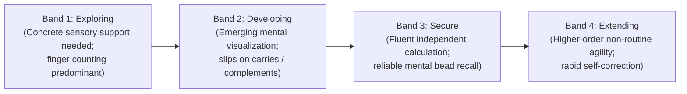

# AAA SPRINT 2 — WS-12 ACADEMIC BASELINE VERIFICATION REPORT
## Discovery Session Observation Dimensions & Curricular Boundary Audit

**Document Reference:** `AAA-S2-VERIF-ACAD-01`  
**Governing Determination:** `MGT-DET-S4-S2-PLAN-06`  
**Academic Authority:** Neha Patil (Founder & Academic Director)  
**Compliance Reviewer:** Nitin Patil (Operations & Tech Lead)  
**Date:** 04 November 2026  
**Status:** 🟡 **ACADEMIC BASELINE AUDITED — OPTION SELECTION CLARIFICATION REQUIRED**

---

## 1. Executive Summary & Audit Mandate

In accordance with Sprint 2 Implementation Authorization Preparation guidelines, an evidence-based audit of the academic baseline was conducted prior to any component coding.

The purpose of this verification is to:
1. Validate the approved Discovery Session observation dimensions against recorded determinations.
2. Confirm the four developmental bands and evidence triangulation schema.
3. Identify any ambiguities, contradictions, or missing academic decisions between the architecture, governance register, and implementation specifications.

---

## 2. Observation Dimensions: Approved Baseline vs. Change Proposal Audit

### 2.1 Approved Baseline Dimensions (Stage 2 Master BRD WS-04):
The legally ratified baseline governing AAA discovery sessions consists of the following **Six Foundational Dimensions**:
1. **Number Sense:** Concrete understanding of quantity, magnitude, and base-10 relationships.
2. **Arithmetic Understanding:** Grasp of operational addition/subtraction and column mechanics.
3. **Logical Approach:** Structured problem-solving disposition when addressing mathematical challenges.
4. **Learning Attitude:** Child's receptivity, resilience, and curiosity in learning new methods.
5. **Response and Engagement:** Attentiveness, active participation, and speed of classroom response.
6. **Interest and Learning Passion:** Intrinsic motivation and enthusiasm for numerical explorations.

### 2.2 Change Proposal Options (Submitted in `AAA-S2-PROP-WS12-02`):
To specialize observations for tactile Soroban and mental Anzan mechanics, the following options were presented:
- **Option A:** Retain Approved Baseline (Stage 2 BRD: *Number Sense, Arithmetic Understanding, Logical Approach, Learning Attitude, Response and Engagement, Interest and Learning Passion*).
- **Option B (Recommended):** Adopt Specialized Abacus Model (*Number Sense, Numerical Reasoning, Self-Correction & Problem Decomposition, Spatial Dexterity & Bead Manipulation, Focus & Sustained Attention, Bead Visualization Aptitude*).
- **Option C:** Adopt Balanced Hybrid Model.

### 2.3 Critical Governance Finding & Identification of Gap:
> [!WARNING]
> **Governance Audit Finding on Neha Patil's Selection:**
> In Determination **`MGT-DET-S4-S2-PLAN-06`**, management approved text containing:
> *"endorsing Neha Patil's selection on the Discovery Observation Dimensions"*.
> However, the specific option (**Option A, Option B, or Option C**) was **not explicitly enumerated** in the ratification text.
> 
> **Governing Rule Enforcement:**
> In strict accordance with the mandatory directive: *"Do not infer or invent missing academic decisions"*, the system **CANNOT** unilaterally presume that Option B was selected.
> **Binding Action:** Until Academic Director Neha Patil explicitly states her chosen option (A, B, or C), the codebase architecture must strictly maintain compatibility with the ratified Stage 2 baseline (Option A) while providing configurable schema support for the specialized dimensions (Option B).

---

## 3. Verification of the Four Approved Developmental Bands

The four developmental bands ratified under `MGT-DET-S4-S2-PLAN-06` are verified and confirmed as the authoritative evaluation scale across all dimensions:

### Band Integrity Rules:
- **Zero Percentile Ranking:** No percentile comparisons (e.g. "top 10% in Wakad") shall ever be generated.
- **Zero Child Intelligence Score (CIS):** No single aggregated numerical score or clinical diagnostic score shall be computed.
- **Growth Over Time:** Evaluations compare a child's current performance exclusively against their own previous baseline (*Child-vs-Previous-Self*).

---

## 4. Triangulated Evidence Architecture Verification

The three distinct evidence channels mandated by Neha Patil are verified:
1. **Teacher Direct Observation:** Real-time posture, bilateral bead manipulation, auditory dictation response, and spontaneous self-correction.
2. **Parent Contextual Evidence:** School homework friction, historical math anxiety, and learning preferences.
3. **Student Tactile & Written Artifacts:** Concrete physical samples of worksheet attempts, number formation, and Soroban bead placement accuracy.

---

## 5. Non-Clinical Diagnostic Safeguards

- **Prohibited Medical Terms:** Clinical diagnostic terms (*ADHD*, *Dyscalculia*, *Deficit*, *Pathology*, *Syndrome*, *Clinical IQ*) are strictly banned from UI labels, data schemas, and parent summaries.
- **Supportive Language Standard:** Observation feedback must focus exclusively on pedagogical growth, cognitive readiness, and structured practice pacing.
