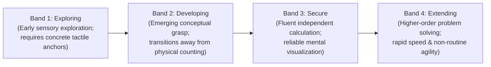
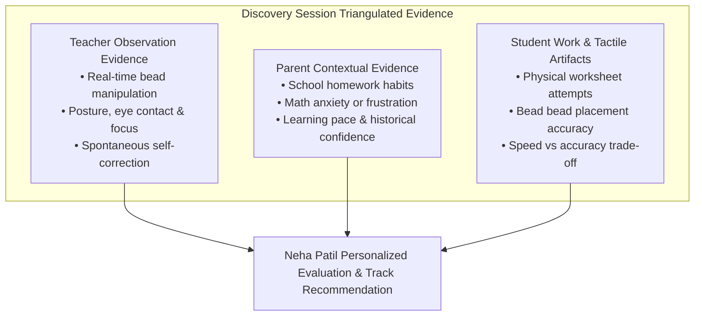

# AAA — SPRINT 2 WORKSTREAM 12: DISCOVERY SESSION ACADEMIC FRAMEWORK
## Pedagogical Design, Developmental Bands & Non-Clinical Diagnostic Principles

**Document Reference:** `AAA-S2-ARCH-WS12-01`  
**Phase:** Stage 4 — Sprint 2 Architecture (WS-12)  
**Academic Authority:** Neha Patil (Founder & Academic Director)  
**Compliance Reviewer:** Nitin Patil  
**Date:** 04 November 2026  
**Status:** 🟡 **DRAFT ACADEMIC ARCHITECTURE — SUBJECT TO NEHA PATIL SIGN-OFF**

---

## 1. Executive Pedagogical Mission & Philosophy

The **AAA Personalised Learning Discovery Session** is an encouraging, 1-on-1 educator-led diagnostic exploration designed to understand a child's mathematical mindset, visual-spatial reasoning, and developmental readiness.

### The Prime Educational Directive:
> *"Mathematics is the medium; developing confident, independent and thoughtful learners is the mission."*

### Strict Non-Clinical Diagnostic Boundary:
- **Educational, Not Medical:** The Discovery Session is strictly an academic and cognitive readiness assessment.
- **Zero Clinical Labeling:** Terms such as *ADHD*, *Dyscalculia*, *Clinical Deficit*, *IQ Score*, or *Neurodevelopmental Disorder* are **strictly prohibited** in all parent reports, rubric criteria, and teacher notes.
- **Growth-Centric Focus:** Observations celebrate a child’s natural curiosity, identifying specific cognitive scaffolding needs without imposing fear or percentile pressure on parents.

---

## 2. The Four Approved Developmental Bands

To evaluate learner aptitude across observation dimensions without comparative cohort ranking or percentile shaming, AAA utilizes **Four Standard Developmental Bands**:

### Detailed Band Criteria:
1. **Band 1: Exploring (Foundation Window)**
   - *Child Behavior:* Heavily relies on physical objects, finger counting, or sensory bead touch to process small quantities. May pause when grouping numbers beyond 5.
   - *Pedagogical Response:* Gentle tactile introduction using Junior Soroban (13-rod) and colorful sensory number anchors.
2. **Band 2: Developing (Bridging Window)**
   - *Child Behavior:* Grasps basic addition/subtraction conceptually; beginning to visualize numbers mentally but slips when dealing with carries, borrows, or base-10 complements.
   - *Pedagogical Response:* Structured introduction of *Friends of 5* and *Friends of 10* formulas; replacing finger ticks with mental bead manipulation.
3. **Band 3: Secure (Fluency Window)**
   - *Child Behavior:* Demonstrates consistent, effortless arithmetic recall. Accurately visualizes beads (Anzan) or applies mental arithmetic shortcuts without margin scribbles.
   - *Pedagogical Response:* Deepening mental arithmetic speed, multi-digit operations, and Beejank reverse verification.
4. **Band 4: Extending (Advanced Window)**
   - *Child Behavior:* Solves multi-step word problems with ease. Detects mathematical patterns instantly and demonstrates high cognitive flexibility and self-correction.
   - *Pedagogical Response:* Accelerated progression to advanced Vedic Sutras, algebraic factorization, and competitive IPM / IMO Olympiad problem decomposition.

---

## 3. Triangulated Evidence Architecture

To guarantee comprehensive and holistic insight, every Discovery Session synthesizes three distinct evidence sources:

1. **Teacher Direct Observation:** Evaluates child posture, hand-eye coordination with the abacus frame, eye movements during mental Anzan visualization, and reaction to challenging questions.
2. **Parent Contextual Insights:** Gathered through structured intake questions regarding homework friction, school examination pressure, and past math experiences.
3. **Student Tactile & Worksheet Artifacts:** Concrete physical samples of student number writing, speed trial accuracy, and bead manipulation mechanics.

---

## 4. Structured 30-Minute Discovery Session Workflow

| Phase | Time Allocation | Activity Focus | Pedagogical Objective |
| :---: | :---: | :--- | :--- |
| **Phase 1** | **00 – 05 Mins** | **Warm-up & Rapport Building** | Eliminate performance anxiety. Friendly conversation about child's hobbies, favorite games, and school interests. Zero math testing. |
| **Phase 2** | **05 – 15 Mins** | **Tactile Bead Exploration (Soroban)** | Introduce the Soroban abacus as a fun calculation tool. Observe fine motor grip (thumb & index finger), bead movement, and number representation (1–20). |
| **Phase 3** | **15 – 22 Mins** | **Number Sense & Mental Visualization** | Present simple mental flash cards and pattern games. Observe whether the child relies on fingers, mental visualization, or rote verbal recitation. |
| **Phase 4** | **22 – 27 Mins** | **Spatial Logic & Non-Routine Thinking** | Present an engaging puzzle or shape/pattern challenge. Observe how the child handles unfamiliar problems and whether they self-correct when stuck. |
| **Phase 5** | **27 – 30 Mins** | **Celebration & Parent Recommendations** | Celebrate the child's effort with specific praise. Share direct, encouraging observations with parents and recommend the ideal course track and batch pacing. |

---

## 5. Academic Director Authority & Sign-Off

In accordance with project governance:
- **Exclusive Academic Ownership:** Founder & Academic Director **Neha Patil** maintains sole authority over discovery session rubrics, milestone criteria, and course track assignment.
- **No Automated Placement:** No computer algorithm or automated quiz shall ever replace the direct, compassionate evaluation of Founder Neha Patil.
