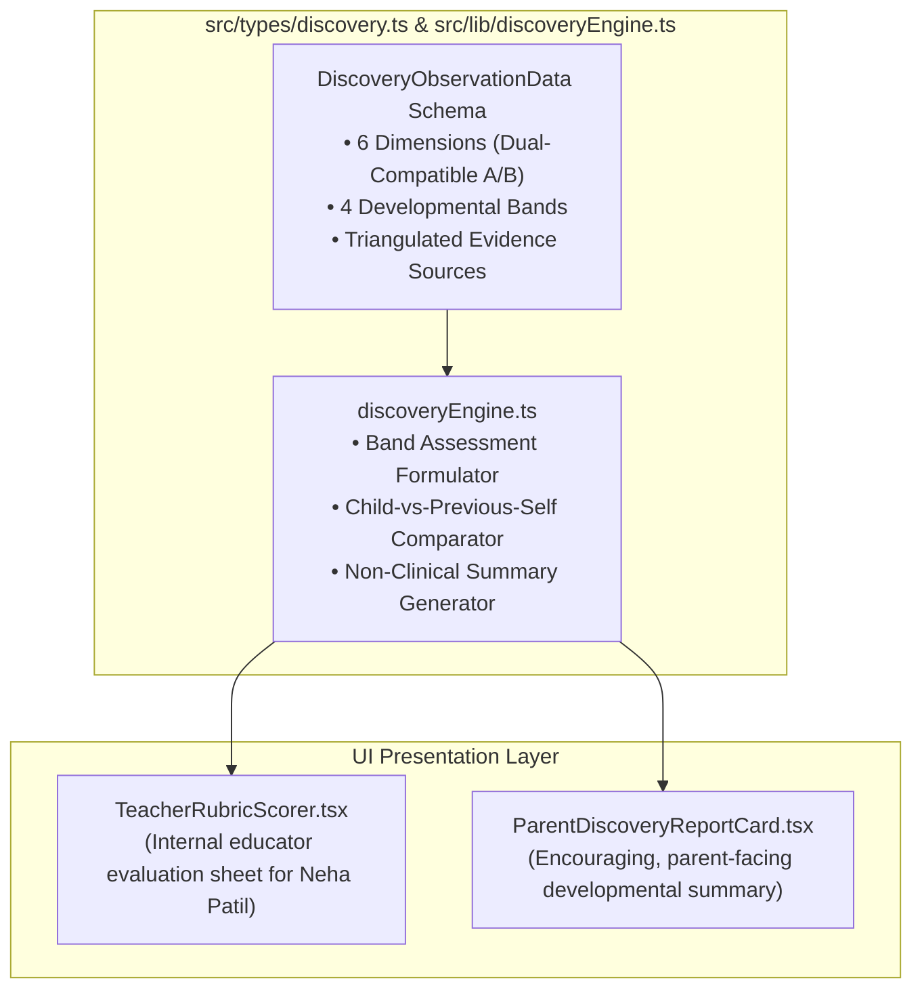

# AAA SPRINT 2 — WS-12 IMPLEMENTATION PLAN
## Component Architecture, Types & Parent Summary Design

**Document Reference:** `AAA-S2-PLAN-WS12-01`  
**Phase:** Stage 4 — Sprint 2 Implementation (WS-12 Academic Framework)  
**Governing Authority:** Neha Patil (Academic Director) & Nitin Patil (Tech Lead)  
**Date:** 04 November 2026  
**Status:** 🟡 **AUTHORIZED SPECIFICATION — BOUNDED TO WS-12 ONLY**

---

## 1. Implementation Scope & Boundary Rules

In accordance with Management Determination `MGT-DET-S4-S2-PLAN-06` and the strict exclusions defined by management:
- **Authorized Scope:** Design and code only the **academic discovery data types**, **scoring rubric schemas**, **parent feedback recommendation generator**, and **child-vs-previous-self progress comparator**.
- **Explicit Exclusions:** Zero CRM lead status logic (WS-13), zero automated lead retention purges (WS-14), zero live backend APIs (WS-15), zero database migrations, zero external SMS/WhatsApp API connections, zero production merges.

---

## 2. Component & Module Architecture

### Module Specifications:
1. **`src/types/discovery.ts`:**
   - Defines strict TypeScript interfaces for `DevelopmentalBand` (`"Exploring" | "Developing" | "Secure" | "Extending"`).
   - Defines `ObservationDimension` supporting both Option A (Stage 2 Baseline) and Option B (Specialized Abacus Model) dynamically.
   - Defines `EvidenceTriangulation` (`teacherObservation`, `parentInsights`, `studentArtifacts`).
   - Defines `DiscoverySessionRecord` and `ChildProgressComparison`.
2. **`src/lib/discoveryEngine.ts`:**
   - Formulates encouraging, non-clinical summary narrative based on developmental bands.
   - Compares initial discovery session against subsequent check-ins exclusively on a *Child-vs-Previous-Self* trajectory.
   - Enforces zero clinical terms via runtime sanitization checks.
3. **`src/components/discovery/ParentDiscoveryReportCard.tsx`:**
   - Clean, accessible presentation card for parents summarizing child strengths and recommended course pacing.

---

## 3. Strict Synthetic Data Test Model

All tests and demonstration interfaces must execute strictly against isolated synthetic test fixtures:
- `SYNTH-DISC-001` (Early Beginner, Age 5, Junior Soroban readiness).
- `SYNTH-DISC-002` (Elementary Student, Age 8, Anzan Mental Visualization readiness).
- `SYNTH-DISC-003` (Middle Schooler, Age 11, Vedic Maths & School Checking readiness).

Zero real student PII, parent contact records, or production database queries are permitted.
