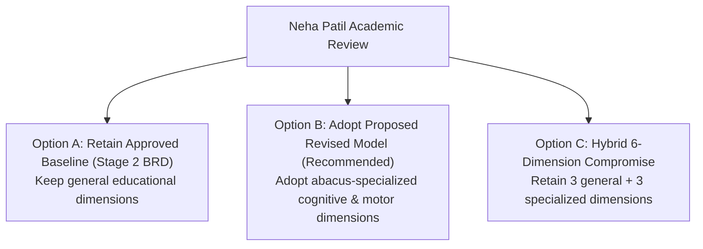

# AAA — SPRINT 2 WORKSTREAM 12: OBSERVATION DIMENSION CHANGE PROPOSAL
## Formal Comparison & Recommendation for Academic Director Neha Patil

**Document Reference:** `AAA-S2-PROP-WS12-02`  
**Phase:** Stage 4 — Sprint 2 Architecture (WS-12 Academic Alignment)  
**Academic Authority:** Neha Patil (Founder & Academic Director)  
**Compliance Officer:** Nitin Patil  
**Date:** 04 November 2026  
**Status:** 🟡 **SUBMITTED FOR FORMAL ACADEMIC DIRECTOR EVALUATION & SIGN-OFF**

---

## 1. Executive Summary & Purpose

During earlier project phases (Stage 2 BRD WS-04), management established six foundational observation dimensions for parent discovery sessions. In recent technical drafts for Sprint 1 and Sprint 2, a revised set of six dimensions was formulated to better capture the specific tactile and mental mechanics of Japanese Soroban and Vedic arithmetic.

In strict adherence to governance instructions:
> [!IMPORTANT]
> **No Automatic Replacement:**
> The approved baseline dimensions remain in full legal and operational effect. This document presents a transparent, side-by-side comparison and formal **Academic Change Proposal** for Founder & Academic Director **Neha Patil's** exclusive review, modification, and determination.

---

## 2. Side-by-Side Comparison of Observation Dimensions

| Dimension # | Approved Baseline Dimensions (Stage 2 BRD) | Proposed Revised Dimensions (Sprint 2 Architecture Draft) | Nature of Proposed Change | Curricular & Pedagogical Rationale |
| :---: | :--- | :--- | :---: | :--- |
| **01** | **Number Sense** | **Number Sense** | 🟢 **RETAINED (Unchanged)** | Foundational number sense (magnitude, quantity estimation, base-10 relationships) is universal across both models. |
| **02** | **Arithmetic Understanding** | **Numerical Reasoning** | 🔄 **RENAMED & RECLASSIFIED** | *"Arithmetic Understanding"* often implies rote school syllabus calculations. *"Numerical Reasoning"* emphasizes conceptual flexibility, decomposing numbers, and seeing patterns. |
| **03** | **Logical Approach** | **Self-Correction & Problem Decomposition** | 🔄 **REFINED & SPECIALIZED** | *"Logical Approach"* is broad. The proposed dimension evaluates whether a child independently notices an error, pauses to re-calculate, and breaks complex tasks into steps. |
| **04** | **Learning Attitude** | **Spatial Dexterity & Bead Manipulation** | 🆕 **NEW SPECIALIZED (Replaces broad attitude)** | Abacus calculation relies heavily on physical fine-motor dexterity (bilateral thumb and index finger movement). The new dimension evaluates tactile coordination with the instrument. |
| **05** | **Response and Engagement** | **Focus & Sustained Attention** | 🔄 **RENAMED & DEEPENED** | Replaces generic "engagement" with the specific cognitive requirement of abacus training: sustained auditory/visual focus during rapid dictation drills. |
| **06** | **Interest and Learning Passion** | **Bead Visualization Aptitude (Anzan Readiness)** | 🆕 **NEW COGNITIVE (Replaces broad passion)** | Directly assesses a child's mental transition from moving physical beads to visualizing the Soroban frame in the mind's eye (the core prerequisite for Anzan). |

---

## 3. Detailed Analysis of Dimension Adjustments

### 3.1 Dimensions Proposed to be Replaced / Merged:
- **"Learning Attitude" and "Interest and Learning Passion":**
  - *Observation:* While critical, general learning attitude and passion are qualitative contextual factors better captured through **Parent Contextual Insights** and informal teacher notes rather than a formal 1–5 scoring dimension.
  - *Proposal:* Integrate "Attitude & Passion" into the qualitative narrative summary of the session report, reserving the 6 formal scoring dimensions for observable cognitive and psychomotor skills.

### 3.2 Newly Proposed Specialized Dimensions:
1. **Spatial Dexterity & Bead Manipulation:**
   - Evaluates child motor control with the 13/17-rod physical Soroban frame.
   - Identifies whether the child struggles with pencil-holding grip while moving beads.
2. **Bead Visualization Aptitude (Anzan Readiness):**
   - Evaluates whether the child can close their eyes and mentally picture 1–9 on a single abacus rod.
   - Critical diagnostic for placing a student into Junior Abacus vs Elementary Anzan tracks.

---

## 4. Options Presented to Academic Director Neha Patil

Academic Director Neha Patil is invited to select one of the following three governance options:

### Option A: Retain Existing Approved Baseline (Status Quo)
- Retain the exact six Stage 2 dimensions: *Number Sense, Arithmetic Understanding, Logical Approach, Learning Attitude, Response and Engagement, Interest and Learning Passion*.
- *Implication:* Broad and familiar; less specialized for abacus bead mechanics.

### Option B: Adopt Proposed Revised Model (Recommended)
- Adopt the six specialized dimensions: *Number Sense, Numerical Reasoning, Self-Correction, Spatial Dexterity, Focus & Sustained Attention, Bead Visualization Aptitude*.
- *Implication:* Highly tailored to AAA's unique value proposition of tactile Soroban and Anzan mental arithmetic. Captures motor skills and mental imagery directly.

### Option C: Adopt a Hybrid 6-Dimension Framework
- Combine the best elements into a balanced hybrid model:
  1. *Number Sense & Quantity Estimation*
  2. *Numerical Reasoning & Mental Operations*
  3. *Bead Visualization Aptitude (Mental Soroban / Anzan)*
  4. *Focus & Sustained Attention*
  5. *Self-Correction & Problem Decomposition*
  6. *Learning Passion & Engagement*

---

## 5. Next Action & Academic Sign-Off Form

Founder & Academic Director **Neha Patil** will record her decision during the Sprint 2 Planning Workshop. Zero code changes to rubrics will be executed until written approval is registered.
