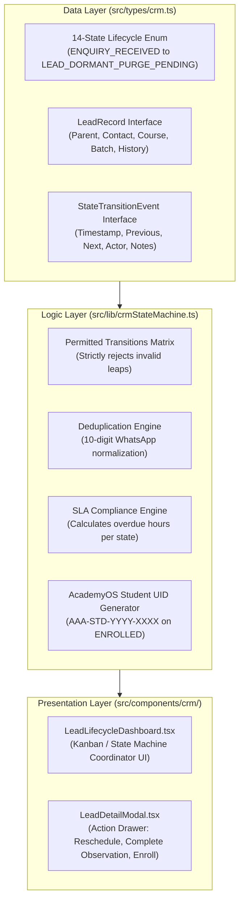

# AAA SPRINT 2 — WS-13 IMPLEMENTATION PLAN
## Admissions & Lead CRM 14-State Machine Implementation Plan

**Document Reference:** `AAA-S2-PLAN-WS13-01`  
**Phase:** Stage 4 — Sprint 2 Implementation (WS-13 Lead CRM)  
**Governing Baseline:** `MGT-DET-S4-S2-PLAN-06`, `AAA-S2-ARCH-WS13-01`  
**Target Determination:** `MGT-DET-S4-S2-AUTH-02` (Proposed)  
**Technical Lead:** Nitin Patil (Operations & Tech Lead)  
**Academic Lead:** Neha Patil (Academic Director)  
**Active Feature Branch:** `feat/sprint2-admissions`  
**Production Status:** 🔒 **STRICTLY LOCKED** (`main` untouched at `a21a3d1`)  
**Date:** 04 November 2026  
**Status:** 🟡 **SUBMITTED FOR MANAGEMENT IMPLEMENTATION AUTHORIZATION**

---

## 1. Executive Implementation Scope & Safeguards

The objective of **WS-13: Admissions & Lead CRM Machine** is to implement the authoritative, state-governed admissions workflow for Arnav Abacus Academy within the staging branch `feat/sprint2-admissions`.

### Strict Operational Safeguards:
- **Zero Third-Party Vendor Dependencies:** The CRM machine is built natively in TypeScript/React to guarantee 100% data residency and avoid external broker data leaks.
- **Strict Synthetic Data Mandate:** All unit tests and staging UI views execute against synthetic mock leads (`SYNTH-LEAD-001` to `SYNTH-LEAD-005`). Zero real parent contact numbers or student names will be processed.
- **AcademyOS Isolation:** Existing student learning platforms (`/practice/*`, `PracticeResult.tsx`, `Login.tsx`) remain untouched. The CRM state machine operates exclusively on prospective admissions data.
- **Production Quarantine:** Branch `main` remains locked at commit `a21a3d1`. Zero live database writes or deployments are permitted.

---

## 2. Module Decomposition & Implementation Architecture

---

## 3. Detailed Component Deliverables

1. **`src/types/crm.ts`:**
   - Strict TypeScript enum for all 14 states:
     `ENQUIRY_RECEIVED`, `PARENT_CONTACTED`, `DISCOVERY_SCHEDULED`, `DISCOVERY_REMINDED`, `DISCOVERY_ATTENDED`, `DISCOVERY_NO_SHOW`, `DISCOVERY_RESCHEDULED`, `OBSERVATION_COMPLETED`, `RECOMMENDATION_DELIVERED`, `DECISION_PENDING`, `FOLLOW_UP_ACTIVE`, `ENROLLED`, `ENQUIRY_CANCELLED`, `LEAD_DORMANT_PURGE_PENDING`.
   - Interfaces for `LeadRecord`, `LeadStateTransition`, `SLABreachedStatus`, and `EnrollmentConfirmation`.
2. **`src/lib/crmStateMachine.ts`:**
   - Authoritative permitted transitions lookup table preventing illegal state jumps (e.g. `ENQUIRY_RECEIVED` $\rightarrow$ `ENROLLED` without discovery session is blocked).
   - Role-based transition guard (Admissions Coordinator vs. Founder Neha Patil vs. Compliance Officer Nitin Patil).
   - Phone number normalization & duplicate detection.
   - Deterministic AcademyOS student conversion function.
3. **`src/components/crm/LeadLifecycleDashboard.tsx`:**
   - High-contrast, accessible internal dashboard for managing leads through the 14 lifecycle states.
   - Visual SLA alert indicators (e.g. Warning at 80% SLA, Overdue flag).
   - Micro-batch counter enforcing the maximum 5 students per batch rule.
4. **`src/lib/crmStateMachine.test.ts`:**
   - Unit test suite verifying all state transitions, duplicate detection, invalid transition rejections, and AcademyOS UID generation.
