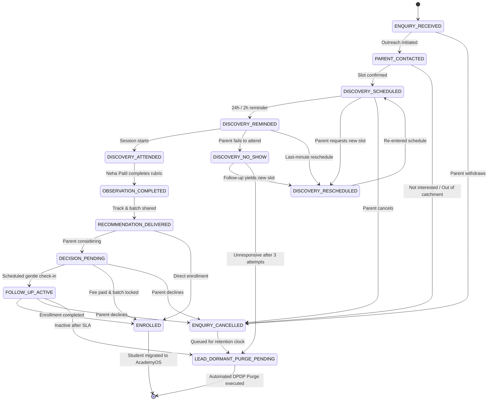

# AAA — SPRINT 2 WORKSTREAM 13: ADMISSIONS & LEAD CRM ARCHITECTURE
## Authoritative 14-State Admissions Lifecycle Machine & Operational Protocol

**Document Reference:** `AAA-S2-ARCH-WS13-01`  
**Phase:** Stage 4 — Sprint 2 Architecture (WS-13)  
**System Lead:** Nitin Patil (Operations & Tech Lead)  
**Academic Consultant:** Neha Patil (Academic Director)  
**Date:** 04 November 2026  
**Status:** 🟡 **DRAFT SPECIFICATION — STRICTLY ARCHITECTURAL DESIGN (NO LIVE CRM CODE)**

---

## 1. Architectural Mission & State Machine Overview

The **AAA Admissions & Lead CRM Machine** governs the journey of a prospective parent from initial online exploration through to active classroom enrollment in AcademyOS.

### Operational Principles:
- **Zero Pressure, High Respect:** AAA does not employ aggressive sales calls or telemarketing pressure.
- **Academic-Led Guidance:** Admissions recommendations are made by educators, not commission-based salespeople.
- **Statutory Data Discipline:** All lead states must preserve parent consent, maintain audit logs, and adhere to DPDP data minimization standards.

---

## 2. Rigorous Definition of All 14 Lifecycle States

The tables below provide the complete specification for each of the 14 lifecycle states:

### State 01: `ENQUIRY_RECEIVED`
- **Purpose:** Inbound capture of initial parent interest from web lead form or direct WhatsApp link.
- **Entry Criteria:** Parent submits valid name, 10-digit phone, and service communication consent.
- **Exit Criteria:** Admissions officer executes initial outreach or parent cancels.
- **Permitted Transitions:** `PARENT_CONTACTED`, `ENQUIRY_CANCELLED`.
- **Responsible Role:** Admissions Coordinator / Nitin Patil.
- **SLA:** $\le 4$ business hours (during operating window: Mon–Sat 9:30 AM–7:30 PM).
- **Required Evidence:** Inbound payload timestamp, sanitized phone number, service consent boolean (`true`).
- **Parent Communication:** Automated WhatsApp acknowledgement acknowledging request receipt.
- **Escalation / Exceptions:** If uncontacted after 12 business hours, alert sent to Nitin Patil.
- **Closure Conditions:** None (Transient entry state).

---

### State 02: `PARENT_CONTACTED`
- **Purpose:** First direct conversational contact to understand child’s learning context and school grade.
- **Entry Criteria:** Admissions coordinator initiates WhatsApp message or phone call.
- **Exit Criteria:** Discovery session slot selected, or parent declines.
- **Permitted Transitions:** `DISCOVERY_SCHEDULED`, `ENQUIRY_CANCELLED`, `LEAD_DORMANT_PURGE_PENDING`.
- **Responsible Role:** Admissions Coordinator.
- **SLA:** $\le 24$ hours to establish mutual slot availability.
- **Required Evidence:** Call/message timestamp log in CRM notes.
- **Parent Communication:** Friendly introduction outlining the educational nature of the Discovery Session.
- **Escalation / Exceptions:** Maximum 3 contact attempts across 5 working days before moving to dormant.
- **Closure Conditions:** Parent unresponsive after 3 attempts.

---

### State 03: `DISCOVERY_SCHEDULED`
- **Purpose:** Discovery exploration slot formally booked on Neha Patil's calendar.
- **Entry Criteria:** Mutually agreed date, time, and delivery mode (Offline Wakad Center vs Live Online).
- **Exit Criteria:** Transition to reminder dispatch, parent reschedule, or cancellation.
- **Permitted Transitions:** `DISCOVERY_REMINDED`, `DISCOVERY_RESCHEDULED`, `ENQUIRY_CANCELLED`.
- **Responsible Role:** Admissions Coordinator / Neha Patil.
- **SLA:** Slot confirmation dispatched within 2 hours of verbal agreement.
- **Required Evidence:** Calendar event UID, confirmed slot timestamp, mode (`offline` | `online`).
- **Parent Communication:** Confirmation message with Wakad Center Google Maps link and child preparation advice.
- **Escalation / Exceptions:** Slot clash requires immediate reschedule outreach within 1 hour.
- **Closure Conditions:** None.

---

### State 04: `DISCOVERY_REMINDED`
- **Purpose:** Dispatch timely reminders to minimize parent no-shows.
- **Entry Criteria:** Reaching $T-24$ hours and $T-2$ hours before scheduled slot.
- **Exit Criteria:** Session start time reached, or parent requests reschedule prior to slot.
- **Permitted Transitions:** `DISCOVERY_ATTENDED`, `DISCOVERY_NO_SHOW`, `DISCOVERY_RESCHEDULED`.
- **Responsible Role:** Automated Workflow / Admissions Coordinator.
- **SLA:** Dispatched exactly at $T-24\text{h}$ and $T-2\text{h}$.
- **Required Evidence:** Dispatched message timestamp.
- **Parent Communication:** Polite reminder with center parking details and welcoming greeting.
- **Escalation / Exceptions:** If parent responds requesting new time, immediately move to `DISCOVERY_RESCHEDULED`.
- **Closure Conditions:** None.

---

### State 05: `DISCOVERY_ATTENDED`
- **Purpose:** Child and parent arrive at center or connect to live video exploration session.
- **Entry Criteria:** Teacher checks in student at start of discovery session.
- **Exit Criteria:** 30-minute exploration completed and evaluation initiated.
- **Permitted Transitions:** `OBSERVATION_COMPLETED`.
- **Responsible Role:** Founder Neha Patil.
- **SLA:** Session duration: 30 minutes.
- **Required Evidence:** Check-in timestamp, physical presence record.
- **Parent Communication:** In-person warm educator greeting; orientation on session flow.
- **Escalation / Exceptions:** If child exhibits intense anxiety, session paused for gentle warm-up.
- **Closure Conditions:** None.

---

### State 06: `DISCOVERY_NO_SHOW`
- **Purpose:** Track unfulfilled slots and initiate courteous follow-up.
- **Entry Criteria:** 15 minutes elapsed past scheduled start time without parent arrival or notice.
- **Exit Criteria:** Parent reached for rescheduling or lead marked unresponsive.
- **Permitted Transitions:** `DISCOVERY_RESCHEDULED`, `LEAD_DORMANT_PURGE_PENDING`.
- **Responsible Role:** Admissions Coordinator.
- **SLA:** Friendly check-in call/message within 30 minutes of missed slot.
- **Required Evidence:** No-show timestamp, follow-up outreach log.
- **Parent Communication:** *"We missed you today! Hope everything is well. Let us know if you'd like to reschedule."*
- **Escalation / Exceptions:** If parent remains unresponsive after 2 follow-ups over 7 days, transition to dormant.
- **Closure Conditions:** Unresponsive after 7 days.

---

### State 07: `DISCOVERY_RESCHEDULED`
- **Purpose:** Accommodate parent calendar changes while preserving lead context.
- **Entry Criteria:** Parent requests new session date/time prior to or after slot.
- **Exit Criteria:** New slot selected and locked.
- **Permitted Transitions:** `DISCOVERY_SCHEDULED`, `ENQUIRY_CANCELLED`.
- **Responsible Role:** Admissions Coordinator.
- **SLA:** New slot confirmed within 24 hours.
- **Required Evidence:** Reschedule reason tag (`sick`, `travel`, `exam`, `work_conflict`).
- **Parent Communication:** Rescheduled confirmation notice.
- **Escalation / Exceptions:** Maximum 2 reschedules permitted per lead before requiring management review.
- **Closure Conditions:** Parent cancels without picking new date.

---

### State 08: `OBSERVATION_COMPLETED`
- **Purpose:** Neha Patil records diagnostic rubric scores and qualitative observations.
- **Entry Criteria:** Session concluded; rubric sheet scored across approved developmental bands.
- **Exit Criteria:** Course track recommendation generated.
- **Permitted Transitions:** `RECOMMENDATION_DELIVERED`.
- **Responsible Role:** Founder Neha Patil.
- **SLA:** Rubric scored $\le 2$ hours post-session.
- **Required Evidence:** Anonymized scored rubric (Teacher observations, student artifacts).
- **Parent Communication:** Verbal debrief immediately post-session.
- **Escalation / Exceptions:** Complex multi-track student (e.g. Abacus vs Vedic bridge) reviewed personally by Neha.
- **Closure Conditions:** None.

---

### State 09: `RECOMMENDATION_DELIVERED`
- **Purpose:** Formal delivery of personalized course roadmap, batch timings, and fee schedule to parent.
- **Entry Criteria:** Neha Patil confirms course track (e.g., Junior Abacus Foundation, Level 1).
- **Exit Criteria:** Parent accepts immediately, requests review period, or declines.
- **Permitted Transitions:** `DECISION_PENDING`, `ENROLLED`, `ENQUIRY_CANCELLED`.
- **Responsible Role:** Admissions Coordinator / Neha Patil.
- **SLA:** Delivery $\le 4$ hours post-session.
- **Required Evidence:** Course roadmap document UID, fee disclosure timestamp.
- **Parent Communication:** Written summary card outlining child strengths and recommended batch schedule.
- **Escalation / Exceptions:** None.
- **Closure Conditions:** None.

---

### State 10: `DECISION_PENDING`
- **Purpose:** Provide parent respectful consideration window to coordinate family schedules.
- **Entry Criteria:** Recommendation delivered; parent reviewing family availability.
- **Exit Criteria:** Enrollment fee paid, follow-up scheduled, or parent declines.
- **Permitted Transitions:** `ENROLLED`, `FOLLOW_UP_ACTIVE`, `ENQUIRY_CANCELLED`.
- **Responsible Role:** Admissions Coordinator.
- **SLA:** Standard consideration window: 3 to 5 calendar days.
- **Required Evidence:** Consideration period start timestamp.
- **Parent Communication:** Gentle check-in message on Day 3.
- **Escalation / Exceptions:** If batch seats reach 4 out of 5, polite courtesy alert sent (*"1 seat remaining in this slot"*).
- **Closure Conditions:** None.

---

### State 11: `FOLLOW_UP_ACTIVE`
- **Purpose:** Structured, respectful check-in to answer lingering parent questions.
- **Entry Criteria:** Day 4 reached in decision window without parent response.
- **Exit Criteria:** Final decision reached or lead transitions to dormant.
- **Permitted Transitions:** `ENROLLED`, `ENQUIRY_CANCELLED`, `LEAD_DORMANT_PURGE_PENDING`.
- **Responsible Role:** Admissions Coordinator.
- **SLA:** Maximum 2 respectful follow-ups over 7 days.
- **Required Evidence:** Follow-up timestamps, parent responses logged.
- **Parent Communication:** Helpful answer to curriculum or schedule questions; zero hard sell.
- **Escalation / Exceptions:** If parent expresses hesitation, offer direct 5-min phone call with Neha Patil.
- **Closure Conditions:** Unresponsive after Day 10.

---

### State 12: `ENROLLED`
- **Purpose:** Formal admission completion; student record created in AcademyOS.
- **Entry Criteria:** Admission form completed, enrollment fee received, batch slot reserved.
- **Exit Criteria:** Student onboarded and kit issued.
- **Permitted Transitions:** Terminal CRM State (Lead converts to Student entity in AcademyOS).
- **Responsible Role:** Operations Lead Nitin Patil / Neha Patil.
- **SLA:** Student onboarding kit dispatched and portal account activated within 24 hours.
- **Required Evidence:** Payment transaction ID, signed enrollment agreement, AcademyOS Student UID.
- **Parent Communication:** Official Welcome Pack, batch start date, classroom address directions, kit details.
- **Escalation / Exceptions:** Batch full requires opening new 5-student micro-batch.
- **Closure Conditions:** Permanent transition to active student roster.

---

### State 13: `ENQUIRY_CANCELLED`
- **Purpose:** Record voluntary withdrawal or out-of-catchment inquiries.
- **Entry Criteria:** Parent explicitly indicates they do not wish to proceed.
- **Exit Criteria:** Transition to dormant retention clock.
- **Permitted Transitions:** `LEAD_DORMANT_PURGE_PENDING`.
- **Responsible Role:** Admissions Coordinator.
- **SLA:** State updated within 2 hours of parent notice.
- **Required Evidence:** Cancellation reason tag (`fees`, `location`, `timing_conflict`, `other`).
- **Parent Communication:** Warm acknowledgement thanking parent for their time and wishing child well.
- **Escalation / Exceptions:** Immediate cessation of all marketing or scheduling calls.
- **Closure Conditions:** Locked from outbound marketing unless explicit re-engagement requested.

---

### State 14: `LEAD_DORMANT_PURGE_PENDING`
- **Purpose:** Hold non-enrolled inquiry records for statutory retention window prior to permanent deletion.
- **Entry Criteria:** Enquiry cancelled or unresponsive past SLA thresholds.
- **Exit Criteria:** Automated purge job permanently overwrites and deletes record.
- **Permitted Transitions:** Terminal state. Record permanently purged.
- **Responsible Role:** Automated DPDP Engine / Compliance Officer Nitin Patil.
- **SLA:** Held for approved retention period (e.g. 90-day design baseline), then permanently erased.
- **Required Evidence:** Cryptographic purge certificate / deletion audit log timestamp.
- **Parent Communication:** Zero outbound communication.
- **Escalation / Exceptions:** Immediate purge upon parent "Right to Erasure" request.
- **Closure Conditions:** Record deleted; anonymized counter incremented.

---

## 3. Duplicate Handling & Idempotency Rules

1. **Deduplication Key:** Normalized 10-digit WhatsApp phone number (`cleanPhone`).
2. **Active Lead Duplicate:** If a lead exists in states 01 through 11, a new submission updates the `lastInboundTimestamp` and appends course interest notes without creating a duplicate record or altering existing appointment slots.
3. **Enrolled Student Duplicate:** If the phone matches an active enrolled parent in AcademyOS, the system flags the submission as an *Existing Parent Sibling Enquiry*, notifying admissions to link sibling profiles.
