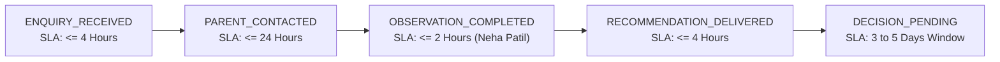

# AAA SPRINT 2 — WS-13 STATE MACHINE SPECIFICATION
## Permitted Transitions Matrix, Role Permissions & SLA Logic

**Document Reference:** `AAA-S2-SPEC-WS13-01`  
**Phase:** Stage 4 — Sprint 2 Implementation (WS-13 Lead CRM)  
**Technical Lead:** Nitin Patil (Operations & Tech Lead)  
**Academic Lead:** Neha Patil (Academic Director)  
**Date:** 04 November 2026  
**Status:** 🟡 **AUTHORIZED SPECIFICATION**

---

## 1. Permitted State Transitions Matrix

To prevent lead corruption and preserve admissions integrity, the state machine strictly enforces permitted transitions. Any transition not explicitly listed in the matrix is rejected with a compile-time or runtime exception:

| Current State | Permitted Destination States | Authorized Actor Role | Mandatory Transition Pre-Condition |
| :--- | :--- | :---: | :--- |
| **`ENQUIRY_RECEIVED`** | `PARENT_CONTACTED`, `ENQUIRY_CANCELLED` | Admissions Coordinator / Nitin Patil | Initial outreach logged with timestamp. |
| **`PARENT_CONTACTED`** | `DISCOVERY_SCHEDULED`, `ENQUIRY_CANCELLED`, `LEAD_DORMANT_PURGE_PENDING` | Admissions Coordinator | Slot agreed or parent explicitly declines. |
| **`DISCOVERY_SCHEDULED`** | `DISCOVERY_REMINDED`, `DISCOVERY_RESCHEDULED`, `ENQUIRY_CANCELLED` | Automated Workflow / Coordinator | Slot UID present; calendar confirmed. |
| **`DISCOVERY_REMINDED`** | `DISCOVERY_ATTENDED`, `DISCOVERY_NO_SHOW`, `DISCOVERY_RESCHEDULED` | Teacher / Admissions Coordinator | Session start time reached. |
| **`DISCOVERY_ATTENDED`** | `OBSERVATION_COMPLETED` | **Neha Patil (Sole Authority)** | 30-min diagnostic observation executed. |
| **`DISCOVERY_NO_SHOW`** | `DISCOVERY_RESCHEDULED`, `LEAD_DORMANT_PURGE_PENDING` | Admissions Coordinator | Courteous follow-up outreach executed. |
| **`DISCOVERY_RESCHEDULED`**| `DISCOVERY_SCHEDULED`, `ENQUIRY_CANCELLED` | Admissions Coordinator | Max 2 reschedules permitted. |
| **`OBSERVATION_COMPLETED`**| `RECOMMENDATION_DELIVERED` | Neha Patil / Coordinator | Rubric scored across approved bands. |
| **`RECOMMENDATION_DELIVERED`**| `DECISION_PENDING`, `ENROLLED`, `ENQUIRY_CANCELLED` | Admissions Coordinator | Course roadmap & fee delivered. |
| **`DECISION_PENDING`** | `ENROLLED`, `FOLLOW_UP_ACTIVE`, `ENQUIRY_CANCELLED` | Admissions Coordinator | 3 to 5 calendar days window elapsed. |
| **`FOLLOW_UP_ACTIVE`** | `ENROLLED`, `ENQUIRY_CANCELLED`, `LEAD_DORMANT_PURGE_PENDING` | Admissions Coordinator | Max 2 gentle follow-ups over 7 days. |
| **`ENROLLED`** | *Terminal Admissions State* $\rightarrow$ Migrates to AcademyOS | Operations Lead / Neha Patil | Fee paid; batch locked ($\le 5$ students). |
| **`ENQUIRY_CANCELLED`** | `LEAD_DORMANT_PURGE_PENDING` | Admissions Coordinator | Voluntary withdrawal recorded. |
| **`LEAD_DORMANT_PURGE_PENDING`** | *Terminal CRM State* $\rightarrow$ Automated Purge | Compliance Officer / Nightly Cron | 90-day retention clock expired. |

---

## 2. SLA Hierarchy & Overdue Escalations

### SLA Alert Escalation Rules:
1. **At 80% SLA Elapsed:** UI renders amber indicator badge (*"SLA Window Expiring Soon"*).
2. **At 100% SLA Elapsed:** UI renders red pulse indicator (*"SLA Breached"*), logging an overdue alert to Nitin Patil.
3. **At 150% SLA Elapsed:** Lead is flagged for immediate management review.

---

## 3. Deduplication & Idempotency Rules

- **Primary Deduplication Key:** E.164 normalized mobile number (`+91XXXXXXXXXX`).
- **Active Lead Rule:** If an enquiry arrives for an existing active lead (States 01 to 11), the record appends the new message notes and updates `lastContactTimestamp` without resetting appointment dates or duplicating rows.
- **Enrolled Student Sibling Rule:** If the phone matches an existing enrolled student in AcademyOS, the system flags the record as an *Active Sibling Enquiry*, linking family accounts automatically.
