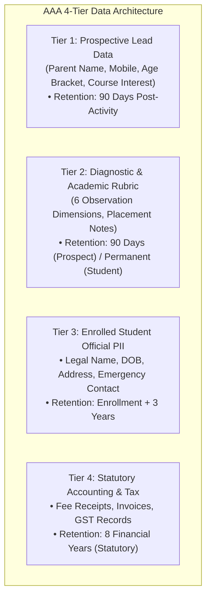

# AAA SPRINT 2 — WS-14 DPDP PURGE & PRIVACY SPECIFICATION
## Data Protection, Dual Consent & Automated Purge Specification

**Document Reference:** `AAA-S2-SPEC-WS14-01`  
**Phase:** Stage 4 — Sprint 2 Specification (WS-14 Privacy & Retention)  
**Governing Baseline:** `MGT-DET-S4-S2-PLAN-06`, `AAA-S2-ARCH-WS14-01`  
**Target Determination:** `MGT-DET-S4-S2-AUTH-03`  
**Compliance Lead:** Nitin Patil (Internal Compliance Officer)  
**Academic Lead:** Neha Patil (Academic Director)  
**Active Feature Branch:** `feat/sprint2-admissions`  
**Production Status:** 🔒 **STRICTLY LOCKED** (`main` untouched at `a21a3d1`)  
**Date:** 04 November 2026  
**Status:** 🟡 **SUBMITTED FOR MANAGEMENT IMPLEMENTATION AUTHORIZATION**

---

## 1. Executive Purpose & Legal Distinction

This specification establishes the authoritative implementation rules for **Workstream 14 (Privacy, Consent & Retention Architecture)** under the Digital Personal Data Protection (DPDP) Act 2023.

> [!IMPORTANT]
> **Internal Compliance Notice:**  
> This specification represents operational and architectural compliance frameworks developed by **Nitin Patil** in his internal oversight capacity. It is not external statutory legal advice. The 90-day retention rule for prospective leads is an operational design standard designed to uphold purpose limitation and data minimization principles.

---

## 2. Four-Tier Data Classification & Minimization Architecture

All data fields handled by the admissions and discovery lifecycle are classified into four immutable tiers:



### Data Element Specification Table:

| Field Name | Tier | Storage Location | Processing Purpose | Minimization Rule |
| :--- | :---: | :--- | :--- | :--- |
| `parentName` | Tier 1 | Inbound Lead Store | Scheduling communication | Min 2 chars, sanitized, zero PII to client analytics |
| `parentPhone` | Tier 1 | Inbound Lead Store | Direct WhatsApp/SMS coordination | Normalized 10 digits (E.164 without prefix in local storage) |
| `childAgeGroup` | Tier 1 | Inbound Lead Store | Age bracket verification | **Bracket only** (`4.5-6`, `7-9`, `10-14`). Zero exact DOBs at intake |
| `courseInterest` | Tier 1 | Inbound Lead Store | Discovery tool preparation | Restricted to `abacus`, `vedic`, `mental-math`, `school-math`, `olympiad` |
| `observationScores` | Tier 2 | Discovery Diagnostic Store | Academic track placement | Qualitative 1–4 bands across 6 dimensions. Zero medical labels |
| `studentLegalName` | Tier 3 | Enrolled Student Store | Diploma & AcademyOS roster | Collected only upon formal enrollment agreement |
| `feeTransactionId` | Tier 4 | Financial Ledger Store | Tax & GST reconciliation | Encrypted persistence; isolated from marketing systems |

---

## 3. Unbundled Dual Consent Specification

Under DPDP Act Section 6, consent must be free, specific, informed, unconditional, and unambiguous with clear affirmative action. Bundling service communication with marketing broadcast is strictly prohibited.

### Consent Fields Schema:
```typescript
interface LeadConsentRecord {
  serviceConsent: boolean;          // Mandatory for scheduling (true required)
  serviceConsentTimestamp: string; // ISO 8601 UTC
  marketingConsent: boolean;        // Strictly optional (default: false)
  marketingConsentTimestamp?: string;
  consentSource: 'WEB_FORM' | 'PHONE_INBOUND' | 'WALK_IN';
  consentIpAddressMasked?: string;  // e.g., '192.168.1.xxx' (anonymized)
  parentGuardianConfirmed: boolean; // Confirms legal guardian authority
}
```

### Validation Invariants:
1. If `serviceConsent === false`, lead submission MUST be rejected with HTTP 422: `"Service communication consent is required to coordinate Discovery Session."`
2. `marketingConsent` MUST default to `false`. Pre-ticked checkboxes are strictly banned.
3. Withdrawal of marketing consent (`marketingConsent = false`) takes effect immediately without invalidating service communication.

---

## 4. 90-Day Retention Clock Computation Engine

The retention clock tracks inactive prospective leads to enforce purpose limitation.

### Retention Clock Rules:
1. **Clock Activation:** Starts upon lead reaching a dormant, cancelled, or completed non-enrolling state (`LEAD_DORMANT`, `ENQUIRY_CANCELLED`, `DISCOVERY_COMPLETED_NO_SHOW`).
2. **Clock Calculation:**
   $$\text{Days Elapsed} = \left\lfloor \frac{\text{Current Date} - \text{Last Activity Date}}{86,400,000 \text{ ms}} \right\rfloor$$
   $$\text{Days Remaining} = \max(0, 90 - \text{Days Elapsed})$$
3. **Purge Eligibility:**
   $$\text{Is Eligible for Scheduled Purge} \iff \text{Days Elapsed} \ge 90 \land \text{Status} \in \{\text{DORMANT}, \text{CANCELLED}, \text{NO\_SHOW}\}$$
4. **Enrolled Exemption:** Active enrolled students (`ENROLLED_ACTIVE`) have a retention clock of **Enrollment + 3 Years**, completely bypassing the 90-day prospective purge.

---

## 5. Cryptographic PII Shredder & Purge Certificate Mechanics

When a record is purged—either via automated 90-day retention or manual Parent Right-to-Erasure—it undergoes deterministic cryptographic shredding.

### Shredding Transformations:
```typescript
// Input record (synthetic example)
{
  leadUID: "AAA-LEAD-2026-0891",
  parentName: "Amit Sharma",
  parentPhone: "9876543210",
  parentEmail: "amit.sharma@example.com",
  childName: "Rohan Sharma",
  notes: "Parent inquired about weekday morning slots for abacus",
  courseInterest: "abacus",
  leadStatus: "LEAD_DORMANT"
}

// Shredded Output (Permanent Anonymization)
{
  leadUID: "AAA-LEAD-2026-0891",
  parentName: "[PURGED]",
  parentPhone: "[PURGED]",
  parentEmail: null,
  childName: "[PURGED]",
  notes: "[PURGED_PER_DPDP_SCHEDULED_RETENTION]",
  courseInterest: "abacus",           // Retained for statistical aggregate reporting
  leadStatus: "RECORD_PURGED",
  purgedAt: "2026-11-04T18:30:00.000Z"
}
```

### Tamper-Evident Purge Certificate Schema:
For every purged record, an immutable certificate is generated and stored in the purge registry:
```typescript
interface PurgeCertificate {
  certificateId: string;       // PURGE-CERT-YYYYMMDD-XXXX
  leadUID: string;             // Original UID
  purgedAt: string;            // ISO 8601 UTC
  purgeReason: 'SCHEDULED_90_DAY_RETENTION' | 'PARENT_RIGHT_TO_ERASURE';
  authorizedBy: 'SYSTEM_AUTOPURGE' | 'NITIN_PATIL_COMPLIANCE';
  fieldsPurged: string[];      // ['parentName', 'parentPhone', 'parentEmail', 'childName', 'notes']
  tamperProofHash: string;     // HMAC-SHA256 of certificateId:leadUID:purgedAt:purgeReason
}
```

---

## 6. Parent Right-to-Erasure Protocol

1. **Submission Channels:** Written email to `grievance@arnavabacus.com` or direct operational request to Compliance Officer Nitin Patil.
2. **Verification:** Phone OTP or verification of intake email address.
3. **Execution SLA:** Immediate execution within **24 hours** for prospective leads.
4. **Execution Action:** Calls `shredLeadPII(leadUID, 'PARENT_RIGHT_TO_ERASURE', 'NITIN_PATIL_COMPLIANCE')`, immediately generating a Purge Certificate provided to the parent as proof of erasure.

---

## 7. Synthetic Test Isolation Safeguard

All purge tests, retention algorithms, and certificate validations must run against synthetic mock data (`SYNTH-LEAD-001` through `SYNTH-LEAD-005`). No real customer data, production databases, or live network endpoints may be touched during Sprint 2 implementation.
