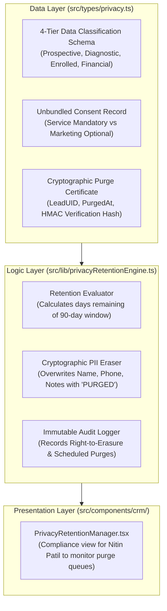

# AAA SPRINT 2 — WS-14 IMPLEMENTATION PLAN
## Privacy, Consent & Retention Engine Implementation Plan

**Document Reference:** `AAA-S2-PLAN-WS14-01`  
**Phase:** Stage 4 — Sprint 2 Implementation (WS-14 Privacy & Retention)  
**Governing Baseline:** `MGT-DET-S4-S2-PLAN-06`, `AAA-S2-ARCH-WS14-01`  
**Target Determination:** `MGT-DET-S4-S2-AUTH-03` (Proposed)  
**Compliance Lead:** Nitin Patil (Internal Compliance Officer)  
**Academic Lead:** Neha Patil (Academic Director)  
**Active Feature Branch:** `feat/sprint2-admissions`  
**Production Status:** 🔒 **STRICTLY LOCKED** (`main` untouched at `a21a3d1`)  
**Date:** 04 November 2026  
**Status:** 🟡 **SUBMITTED FOR MANAGEMENT IMPLEMENTATION AUTHORIZATION**

---

## 1. Executive Implementation Scope & Safeguards

The objective of **WS-14: Privacy, Consent & Retention Architecture** is to implement the authoritative Digital Personal Data Protection (DPDP) compliance engine for Arnav Abacus Academy within `feat/sprint2-admissions`.

### Mandatory Governance Boundaries:
- **Internal Compliance vs External Legal Advice:** Nitin Patil’s internal review governs operational data practices and architecture. It does not replace statutory external legal counsel.
- **90-Day Retention Design Baseline:** The 90-day retention threshold for non-enrolled inquiry records is treated as an operational design baseline, fully auditable and subject to statutory DPDP rule finalization.
- **Strict Synthetic Data Mandate:** All purge simulations, retention tests, and consent verifications execute strictly against synthetic mock records (`SYNTH-LEAD-001` to `SYNTH-LEAD-005`). Zero real customer or minor data will be touched.
- **AcademyOS Isolation:** All internal student practice databases (`/practice/*`, `PracticeResult.tsx`) remain bit-for-bit identical to production.
- **Production Quarantine:** Branch `main` remains locked at commit `a21a3d1`.

---

## 2. Module Decomposition & Implementation Architecture

---

## 3. Detailed Component Deliverables

1. **`src/types/privacy.ts`:**
   - Typings for Data Classification Tiers (`TIER_1_PROSPECTIVE`, `TIER_2_DIAGNOSTIC`, `TIER_3_ENROLLED_PII`, `TIER_4_STATUTORY_FINANCIAL`).
   - Typings for `ConsentState`, `PurgeCertificate`, `RetentionAuditEntry`, and `DataSubjectRequest` (*Access*, *Correction*, *Erasure*).
2. **`src/lib/privacyRetentionEngine.ts`:**
   - Retention evaluation function determining if a non-enrolled lead has crossed the 90-day threshold.
   - Deterministic PII shredder permanently replacing personal identifiers with anonymized markers.
   - HMAC-SHA256 tamper-evident purge certificate generator.
   - Right-to-Erasure handler processing immediate on-demand parent requests within 24 hours.
3. **`src/components/crm/PrivacyRetentionManager.tsx`:**
   - Dedicated compliance interface for Nitin Patil to view retention countdowns, execute simulated purges, and review audit certificates.
4. **`src/lib/privacyRetentionEngine.test.ts`:**
   - Unit test suite asserting 90-day retention calculations, cryptographic PII erasure, unbundled consent verification, and Right-to-Erasure execution.
