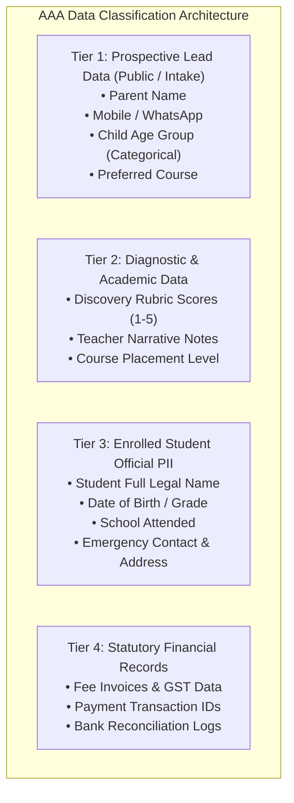
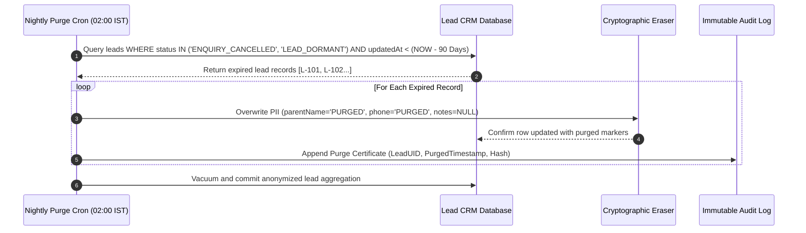

# AAA — SPRINT 2 WORKSTREAM 14: PRIVACY, CONSENT & RETENTION ARCHITECTURE
## Data Protection Protocol, Consent Governance & Retention Architecture

**Document Reference:** `AAA-S2-ARCH-WS14-01`  
**Phase:** Stage 4 — Sprint 2 Architecture (WS-14)  
**Compliance Lead:** Nitin Patil (Internal Compliance Officer)  
**Academic Lead:** Neha Patil  
**Date:** 04 November 2026  
**Status:** 🟡 **DRAFT PRIVACY ARCHITECTURE — SUBJECT TO STATUTORY REVIEW**

---

## 1. Governance Boundary & Legal Clarification Notice

> [!IMPORTANT]
> **Internal Compliance Statement vs External Legal Advice:**
> This document reflects internal architectural and operational assessments conducted by **Nitin Patil** in his capacity as AAA Operations & Compliance Officer. This assessment does **NOT** constitute external legal counsel or statutory legal certification. The proposed 90-day retention baseline for prospective leads is a **design specification proposal** subject to continuous legal review as Digital Personal Data Protection (DPDP) Act rules are finalized by the Central Government.

---

## 2. Comprehensive Data Inventory & Classification Schema

All data elements collected across the AAA admissions and student lifecycle are categorized into four strict classification tiers:



### Data Element Inventory & Minimization Audit:

| Data Field | Data Tier | Lifecycle Stage Collected | Statutory Justification & Purpose | Minimization Rule Applied |
| :--- | :---: | :--- | :--- | :--- |
| **Parent Full Name** | Tier 1 | Inbound Discovery Request | Service communication, addressing parent respectfully. | Minimum 2 characters, sanitized against XSS. |
| **Mobile Number** | Tier 1 | Inbound Discovery Request | Direct service coordination via WhatsApp/SMS. | Normalized 10 digits; zero PII sent to analytics. |
| **Child Age Group** | Tier 1 | Inbound Discovery Request | Recommending age-appropriate discovery activities. | **Strict Bracket Only** (e.g. `4.5-6`, `7-9`). Zero exact birthdates collected at lead stage. |
| **Course Interest** | Tier 1 | Inbound Discovery Request | Preparing appropriate teacher demonstration tools. | Selected from fixed enumeration list. |
| **Observation Scores** | Tier 2 | Discovery Session | Diagnostic track placement across developmental bands. | 1–5 qualitative rubric. Zero clinical terms. |
| **Student Legal Name** | Tier 3 | Formal Enrollment | Official Certificate of Completion & AcademyOS account. | Collected only upon signed enrollment agreement. |
| **Residential Address** | Tier 3 | Formal Enrollment | Physical kit delivery & classroom safety roster. | Collected only upon verified physical admission. |
| **Fee Transaction ID** | Tier 4 | Formal Enrollment | Statutory accounting, taxation & receipt generation. | Encrypted persistence; retained per tax statute. |

---

## 3. Unbundled Dual Consent Governance Protocol

In strict alignment with the DPDP Act 2023, AAA enforces explicit, unbundled consent separation across all public intake channels:

```mermaid
flowchart LR
    Intake["Parent Intake Submission"] --> Check1{"Checkbox 1: Service Communication<br/>(Mandatory for Scheduling)"}
    Intake --> Check2{"Checkbox 2: Marketing Insights<br/>(Optional, Unticked by Default)"}
    
    Check1 -->|Ticked (true)| ValidService["Permits Discovery Slot Scheduling via WhatsApp/SMS"]
    Check1 -->|Unticked (false)| Block["Form Blocked: Cannot Coordinate Slot"]
    
    Check2 -->|Ticked (true)| OptInMarketing["Enters Academy Educational Updates List"]
    Check2 -->|Unticked (false)| ZeroMarketing["Strictly Excluded from Marketing Broadcasts"]
```

### Legal Text Standards:
1. **Mandatory Service Consent:**
   > *"Required: I consent to receiving Discovery Session scheduling messages via WhatsApp / SMS from Arnav Abacus Academy."*
   - Purpose: Operational coordination of appointment, directions, and reminders.
   - Processing condition: Necessary for service fulfillment requested by parent.
2. **Optional Marketing Consent:**
   > *"Optional: I agree to receive occasional mathematical insights and academy announcements."*
   - Purpose: Newsletters, seasonal workshop alerts, and math articles.
   - Default state: Strictly unticked (`false`).
   - Revocation: 1-click opt-out via reply *"STOP"* on WhatsApp.

---

## 4. Retention Schedule by Record Category

The table below governs data retention across different lifecycle categories:

| Record Category | Data Classification | Proposed Retention Period | Statutory Rationale / Governing Policy | Purge & Destruction Method |
| :--- | :---: | :---: | :--- | :--- |
| **Non-Enrolled Prospective Leads** | Tier 1 | **90 Calendar Days** *(Design Proposal Baseline)* | Purpose limitation under DPDP: data no longer needed once enquiry cycle lapses. | Automated cryptographic deletion of PII fields; anonymized conversion counter incremented. |
| **Discovery Session Rubrics (Non-Enrolled)** | Tier 2 | **90 Calendar Days** | Diagnostic observation data purged in tandem with parent contact details. | Secure digital file shredding; paper rubrics shredded on-site. |
| **Active Enrolled Student Records** | Tier 3 | **Duration of Enrollment + 3 Years** | Preservation of academic progress, level completions, and alumni verification. | Archived in encrypted cold storage; accessible only by Director Neha Patil. |
| **Official Diplomas & Ledgers** | Tier 3 | **Permanent (Anonymized)** | Tamper-evident diploma verification ledger (HMAC-SHA256). | Masked public record (`Atharv P.`, Level 8 Diploma). |
| **Invoices & Financial Accounts** | Tier 4 | **8 Financial Years** | Mandatory compliance under Indian Income Tax Act & GST statute. | Encrypted offline storage; isolated from marketing systems. |

---

## 5. Non-Enrolled Lead Automated Purge Architecture

To operationalize the 90-day retention proposal, the system specifies an automated purge batch job:



---

## 6. Parent Data Subject Rights & Grievance Protocol

Parents retain full statutory rights over their personal and child data under DPDP Act provisions:
1. **Right to Access & Summary:** Parents may request a summary of all personal data held by emailing `grievance@arnavabacus.com` or contacting Nitin Patil at `+91 90219 24968`.
2. **Right to Correction:** Updating contact numbers or spelling corrections executed within 48 business hours.
3. **Right to Erasure (Withdrawal of Consent):** Immediate purge of prospective lead data executed within 24 hours of receiving written request.
4. **Nominee Registration:** Registered enrolled parents may nominate a secondary guardian for educational updates.
