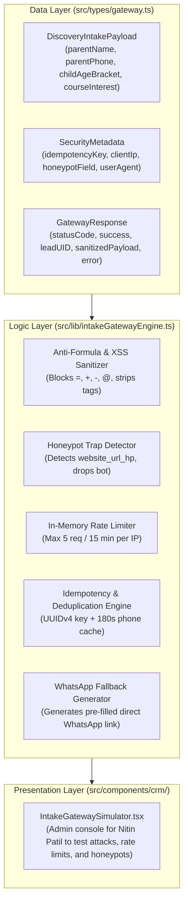

# AAA SPRINT 2 — WS-15 IMPLEMENTATION PLAN
## Intake Backend Gateway & Security Architecture Implementation Plan

**Document Reference:** `AAA-S2-PLAN-WS15-01`  
**Phase:** Stage 4 — Sprint 2 Implementation (WS-15 Intake Gateway)  
**Governing Baseline:** `MGT-DET-S4-S2-PLAN-06`, `AAA-S2-ARCH-WS15-01`  
**Target Determination:** `MGT-DET-S4-S2-AUTH-04` (Proposed)  
**System Architect & Compliance Lead:** Nitin Patil (Operations & Tech Lead)  
**Academic Lead:** Neha Patil (Academic Director)  
**Active Feature Branch:** `feat/sprint2-admissions` (HEAD: `7178337`)  
**Production Status:** 🔒 **STRICTLY LOCKED** (`main` untouched at `a21a3d1`)  
**Date:** 04 November 2026  
**Status:** 🟡 **SUBMITTED FOR MANAGEMENT IMPLEMENTATION AUTHORIZATION**

---

## 1. Executive Implementation Scope & Safeguards

The objective of **WS-15: Intake Backend Gateway Architecture** is to implement the authoritative ingestion gateway, input validation, anti-formula injection, rate limiting, and honeypot protection for prospective parent discovery requests on `feat/sprint2-admissions`.

### Mandatory Governance Boundaries:
- **Zero Production Deployment:** Serverless routes and gateway modules execute in staging sandbox mode. Production deployment remains locked until Sprint 3.
- **Zero Live Database Connections:** All tests, deduplication caches, and rate-limiting counters run in-memory and against synthetic mocks (`SYNTH-LEAD-*`).
- **Zero-PII Analytics Protocol:** Gateway payload processing strictly isolates PII from telemetry or analytics streams.
- **AcademyOS Isolation:** All internal student platform code (`/login`, `/practice/*`) remains untouched.
- **Production Quarantine:** Branch `main` remains locked at commit `a21a3d1`.

---

## 2. Module Decomposition & Implementation Architecture

---

## 3. Detailed Component Deliverables

1. **`src/types/gateway.ts`:**
   - Ingestion payload types (`DiscoveryIntakePayload`), gateway response structures (`GatewayResponse`), rate limiter state types, and honeypot detection interfaces.
2. **`src/lib/intakeGatewayEngine.ts`:**
   - Input sanitization guarding against CSV/Excel formula injection (`=`, `+`, `-`, `@`) and XSS attacks.
   - Strict Indian mobile number validator (`^[6-9]\d{9}$`).
   - Honeypot bot trap handler (`website_url_hp`).
   - Rolling window rate limiter (5 requests / 15 mins).
   - Idempotency key validator and 180-second duplicate suppression cache.
   - Network resilience WhatsApp direct link fallback generator.
3. **`src/components/crm/IntakeGatewaySimulator.tsx`:**
   - Interactive testing interface for Nitin Patil to simulate bot attacks, formula injection attempts, rate-limit floods, and inspect sanitized gateway responses.
4. **`src/lib/intakeGatewayEngine.test.ts`:**
   - 10-point automated unit test suite verifying payload validation, formula injection blocking, honeypot traps, rate limits, and deduplication.
