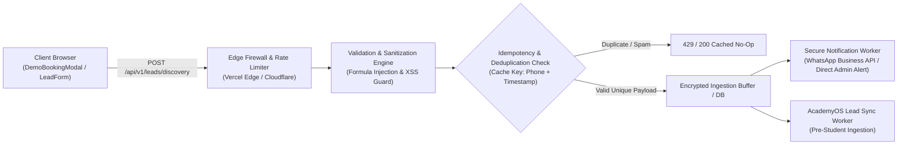
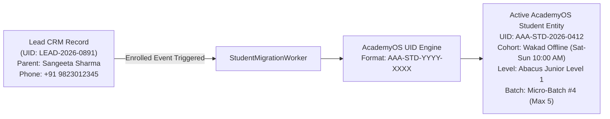

# AAA — SPRINT 2 WORKSTREAM 15: INTAKE BACKEND ARCHITECTURE
## Ingestion Gateway Specifications, Security Architecture & AcademyOS Integration Options

**Document Reference:** `AAA-S2-ARCH-WS15-01`  
**Phase:** Stage 4 — Sprint 2 Architecture (WS-15)  
**System Architect:** Nitin Patil (Operations & Tech Lead)  
**Date:** 04 November 2026  
**Status:** 🟡 **DRAFT TECHNICAL ARCHITECTURE SPECIFICATION (STRICTLY NO CODE/API CHANGES)**

---

## 1. Architectural Mission & Ingestion Pipeline

The **AAA Intake Backend Gateway** is designed to ingest prospective parent discovery session requests from web components, validate and sanitize incoming payloads, safeguard against spam and abuse, and reliably dispatch notifications while maintaining strict zero-PII analytics separation.

---

## 2. Ingestion Options Analysis & Architectural Evaluation

| Evaluation Criteria | Option 1: Direct Serverless Function (`/api/v1/lead`) [Recommended] | Option 2: Headless BaaS Webhook (Supabase / Appwrite) | Option 3: Third-Party Form Service (Formspree / Make) |
| :--- | :--- | :--- | :--- |
| **Data Residency & DPDP** | 🟢 **Full Sovereignty:** Runs within project domain; zero unauthorized third-party broker storage. | 🟢 **High Sovereignty:** Hosted in chosen cloud region (e.g., AWS Mumbai / ap-south-1). | 🔴 **Risk:** Data crosses international borders; terms of service conflict with DPDP consent mandates. |
| **PII Encryption at Rest** | 🟢 **Custom AES-256:** Sensitive fields encrypted before saving to disk/DB. | 🟢 **Built-in Postgres RLS:** Strong row-level security and column encryption. | 🟡 **Vendor Encrypted:** Relies on third-party multi-tenant encryption keys. |
| **AcademyOS Integration** | 🟢 **Seamless Native Sync:** Direct interoperability with AcademyOS student schemas. | 🟡 **Webhook Required:** Requires bidirectional webhook bridge to AcademyOS. | 🔴 **High Friction:** Fragile external polling and schema transformations required. |
| **Operational Simplicity** | 🟢 **Lightweight & Fast:** Deploys alongside existing Next.js / Vite / Vercel runtime. | 🟡 **Infrastructure Overhead:** Requires managing separate database project and secrets. | 🟢 **Plug-and-Play:** Minimal setup but poor custom governance. |
| **Recommendation** | 🟢 **PRIMARY RECOMMENDATION FOR SPRINT 3 STAGING** | 🟡 Secondary Future Consideration (LMS Scale) | ❌ **REJECTED (Privacy & DPDP Non-Compliant)** |

---

## 3. Detailed Security & Protection Specifications

### 3.1 Input Validation & Anti-Formula Injection Sanitization
- **Name Sanitization:** Allowed regex `^[a-zA-Z\s\.\']{2,60}$`. Prohibits HTML tags (`<`, `>`), script tags, and CSV formula characters (`=`, `+`, `-`, `@`) at string start to prevent CSV injection during admin spreadsheet exports.
- **Phone Validation:** Strips non-digits; enforces exact 10-digit Indian mobile standard `^[6-9]\d{9}$`.
- **Honeypot Trap:** Hidden DOM input field (`website_url_hp`) invisible to human parents via CSS `display:none`. If populated, bot submission is instantly dropped with synthetic HTTP 200 to confuse scrapers.

### 3.2 Rate Limiting & Abuse Prevention
- **IP Rate Limit:** Maximum 5 submissions per IP address per 15-minute rolling window.
- **Payload Size Bound:** Maximum request body size capped at 16 KB.
- **CORS Protection:** Endpoint restricted to `https://arnavabacus.com` and authorized staging Vercel previews. Direct external origin calls rejected with HTTP 403.

### 3.3 Idempotency & Duplicate Prevention
- **Idempotency Key:** Client generates a unique UUIDv4 token per modal submission (`X-Idempotency-Key`).
- **Deduplication Logic:** If an identical phone number and program request arrives within 180 seconds, the backend suppresses duplicate WhatsApp alerts and returns the existing submission status.

---

## 4. Integration with AcademyOS Student ID Architecture

When a prospective lead successfully converts to an enrolled student (CRM State 12: `ENROLLED`), the system executes a deterministic migration into AcademyOS:

### Student Identifier Specification:
- **Format:** `AAA-STD-[YYYY]-[XXXX]` (e.g., `AAA-STD-2026-0412`).
- **Cryptographic Separation:** Lead enquiry IDs (`LEAD-YYYY-XXXX`) are distinct from official Student IDs to ensure non-enrolled leads leave no orphaned records in the student database upon DPDP purging.

---

## 5. Offline Submission & Network Resilience

For parents with unstable mobile connectivity:
1. **Client Resiliency Buffer:** `DemoBookingModal.tsx` caches pending payload in `sessionStorage` with a 15-minute TTL if offline.
2. **Exponential Backoff:** Retries dispatch up to 3 times ($T_0$, $T_0 + 2\text{s}$, $T_0 + 6\text{s}$).
3. **Graceful Fallback:** If API fails completely, client renders a direct 1-click fallback button: *"Open WhatsApp Directly to Schedule with Neha Patil"*, guaranteeing zero lost parent inquiries.
