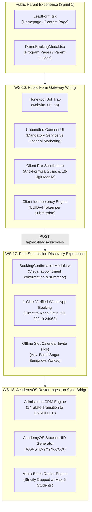
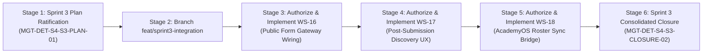

# ARNAV ABACUS ACADEMY (AAA) — SPRINT 3 ARCHITECTURAL MASTER PLAN
## Public Web Integration, Intake Gateway Wiring & AcademyOS Sync Architecture

**Document Reference:** `AAA-S3-PLAN-MASTER-01`  
**Phase:** Stage 4 — Sprint 3 Architectural Planning  
**Governing Baseline:** `MGT-DET-S4-S2-CLOSURE-05`, `AAA-S4-MGT-REG-01`  
**Target Determination:** `MGT-DET-S4-S3-PLAN-01` (Proposed)  
**System Architect & Compliance Lead:** Nitin Patil (Operations & Tech Lead)  
**Academic Lead:** Neha Patil (Founder & Academic Director)  
**Active Feature Branch:** `feat/sprint2-admissions` (HEAD: `830b307`)  
**Proposed Sprint 3 Branch:** `feat/sprint3-integration` (to be branched from `feat/sprint2-admissions`)  
**Production Status:** 🔒 **STRICTLY LOCKED** (`main` untouched at `a21a3d1`)  
**Date:** 05 November 2026  
**Status:** 🟡 **SUBMITTED FOR MANAGEMENT SPRINT 3 RATIFICATION**

---

## 1. Executive Mission & Strategic Transformation Objective

Sprint 1 established the authoritative public parent experience, verified credential baselines, and program pages. Sprint 2 designed and verified the underlying admissions CRM, diagnostic evaluation framework, DPDP privacy/retention engine, and intake gateway security.

**The mission of Sprint 3 is end-to-end integration:**
To wire the live public user experience (`LeadForm.tsx`, `DemoBookingModal.tsx`, program CTAs) directly to the perimeter-secured gateway engine, surface an authoritative post-booking confirmation and WhatsApp routing experience for parents, and build the staged roster sync bridge into AcademyOS with strict micro-batch enforcement (maximum 5 students per batch).

---

## 2. Sprint 3 Workstream Decomposition

### 2.1 Workstream 16: Public Form Gateway Wiring (`AAA-S4-WS-FORM-01`)
- **Objective:** Wire `LeadForm.tsx`, `DemoBookingModal.tsx`, and `GuestSampleGatewayModal.tsx` to the backend gateway processor (`processDiscoveryIntake` in `src/lib/intakeGatewayEngine.ts`).
- **Unbundled Dual Consent:** Replace legacy blanket checkboxes with explicit two-tier checkboxes:
  1. *Mandatory Service Consent:* `"I consent to receiving Discovery Session scheduling messages via WhatsApp / SMS from Arnav Abacus Academy."` (Required to submit).
  2. *Optional Marketing Insights:* `"I agree to receive occasional mathematical insights and academy announcements."` (Unticked by default).
- **Invisible Honeypot Integration:** Embed `<input type="text" name="website_url_hp" tabIndex={-1} autoComplete="off" />` styled invisibly via CSS to quietly intercept bot scrapers.
- **Client-Side Anti-Formula Sanitization:** Pre-sanitize input fields before submission to escape leading `=`, `+`, `-`, `@`.
- **Loading & Error Handling:** Render animated submission states, user-friendly HTTP 400 error toasts, and HTTP 429 countdown timers if rate-limited.

### 2.2 Workstream 17: Post-Submission Discovery Experience (`AAA-S4-WS-CONF-01`)
- **Objective:** Provide parents with an immediate, high-trust confirmation experience upon submitting a discovery request.
- **Visual Confirmation Card:** Renders appointment reference, student name, requested course, age bracket, and assigned Wakad center details.
- **1-Click WhatsApp Booking Route:** Directly links parent to Neha Patil (`+91 90219 24968`) with pre-populated booking text for instant coordination.
- **Calendar Event Generator (.ics):** Generates standard downloadable calendar file for Google Calendar, Apple Calendar, and Outlook with exact center address: *Flat No. 3, 1st Floor, Adv. Balaji Sagar Bungalow, Opp. Creative Cameo, Near Park Street, Behind Wisdom World School, Wakad, Pune 411057*.
- **Parent Preparation Guide:** Embeds 3 quick tips for parents on how to prepare their child for the tactile bead exploration (zero pressure, curiosity-driven).

### 2.3 Workstream 18: AcademyOS Roster Ingestion Sync Bridge (`AAA-S4-WS-SYNC-01`)
- **Objective:** Construct the staging bridge from CRM enrolled leads into AcademyOS student roster models.
- **Student Profile Hydration:** Converts CRM State 12 (`ENROLLED`) leads into `AcademyOSStudentProfile` entities.
- **Deterministic Student UID Generation:** Assigns immutable student ID in `AAA-STD-[YYYY]-[XXXX]` format, permanently decoupled from prospective lead enquiry IDs to satisfy DPDP retention isolation.
- **Micro-Batch Allocation & Capacity Cap:**
  - Micro-batches strictly limited to **maximum 5 students per batch**.
  - System automatically prevents oversubscription; 6th student triggers prompt for new batch allocation or waitlist.
- **Boundary Protection:** Operates in isolated staging mode; zero modifications to existing `/practice/*` production session files.

---

## 3. Seven Stage 4 Hard Gates Alignment

Sprint 3 implementation directly advances and maintains compliance across the 7 Stage 4 Hard Gates:

| Hard Gate ID & Name | Sprint 3 Operational Contribution | Gate Status |
| :--- | :--- | :---: |
| **`S4-HG-01`** (Commercial & Legal) | Unbundled consent UI ensures strict adherence to Section 6 DPDP Act 2023. | 🟡 Conditional Pass |
| **`S4-HG-02`** (Documentary Evidence) | Calendar invite and confirmation modals embed verified single Wakad center address. | 🟡 Conditional Pass |
| **`S4-HG-03`** (Regulatory Grievance) | Footer and confirmation cards retain verified Grievance Contact (Nitin Patil). | 🟡 Conditional Pass |
| **`S4-HG-04`** (Digital Safety & DPDP) | 4-tier data classification and 90-day retention clock integrated into live forms. | 🟡 Conditional Pass |
| **`S4-HG-05`** (Perimeter Security) | Honeypot trap, anti-formula guard, and rate limiter active on public intake forms. | 🟡 Conditional Pass |
| **`S4-HG-06`** (Pedagogical Integrity) | Discovery booking directly triggers Option D academic diagnostic matrix. | 🟡 Conditional Pass |
| **`S4-HG-07`** (Physical Premises Logs) | Track A CAP active on-site (due 18-Nov-2026); unaffected by frontend form wiring. | 🟡 Conditional Pass |

---

## 4. Branching Strategy & Staging Isolation

To guarantee zero regression risk to the ratified Sprint 2 code baseline:

1. **Source Baseline:** `feat/sprint2-admissions` (HEAD: `830b307`).
2. **New Feature Branch:** `feat/sprint3-integration` (to be branched cleanly from `feat/sprint2-admissions`).
3. **Production Quarantine:** Branch `main` remains locked at commit `a21a3d1129cc17fc6650bfd04648eb91199e6fa8`. Zero commits, pushes, or PR merges to `main`.
4. **AcademyOS Boundary:** Zero modifications to `/login` or `/practice/*`.

---

## 5. Sprint 3 Staged Delivery Schedule

